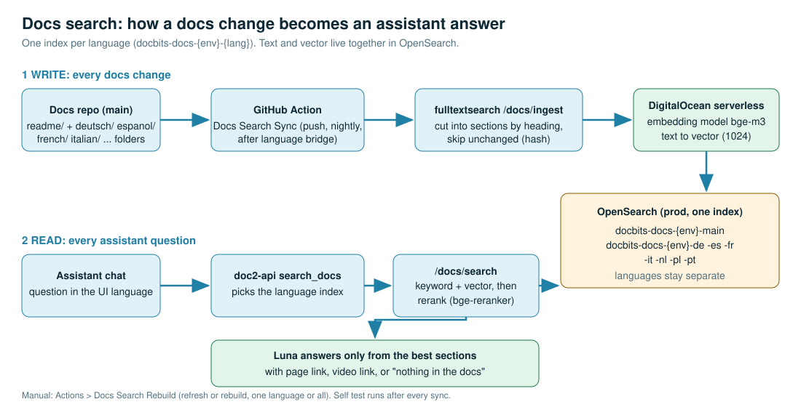

# DocBits

## Welcome to DocBits

Welcome to **DocBits**, your comprehensive source for documentation strategies and insights. At DocBits, we are dedicated to providing clear, concise, and up-to-date documentation resources for developers, technical writers, and anyone involved in the creation or management of technical documentation.

For the full documentation, please visit [docs.docbits.com](https://docs.docbits.com).

## Docs search (vector index for the Assistant)

The Settings Assistant answers questions from this documentation. For that, every docs page is cut into sections, turned into a vector and stored in OpenSearch. The assistant searches it with keywords and vectors together, reranks the best sections and answers only from them.

**What happens when you change a docs page**

1. A change reaches `main` (English in `readme/`, other languages through the language bridge into `deutsch/`, `espanol/`, `french/`, `italian/`, `dutch/`, `polish/`, `portuguese/`).
2. The GitHub Action **Docs Search Sync** (`.github/workflows/docs-search-sync.yml`) sends changed pages to the fulltextsearch service (`/docs/ingest`). It runs on every push, every night for all 8 languages, and after every **Sync Language Folders** run.
3. fulltextsearch cuts the page into sections by heading, skips sections whose text did not change, and asks the DigitalOcean serverless embedding model (bge-m3) for the vectors.
4. Text and vector are stored in **one OpenSearch index per language**: `docbits-docs-{env}-{lang}`. Languages never mix.
5. The Action ends with a self test: one real question per language must find its page, and the service must have used embeddings and rerank (not keyword-only), otherwise the run fails.

**Manual refresh or rebuild:** Actions > **Docs Search Rebuild**, choose a language (or `all`) and a mode.

| Mode | What it does | When |
|---|---|---|
| `refresh` | full ingest + reconcile (unchanged pages are skipped, deleted pages are removed) | something looks stale |
| `rebuild` | drops the language's index, then ingests everything again | wrong or mixed content, new embedding model |

**Setup:** the repo secrets `DOCS_INGEST_URL` (fulltextsearch base URL) and `DOCS_INGEST_KEY` (service key). Languages: `main` (English), `de`, `es`, `fr`, `it`, `nl`, `pl`, `pt`. Script and options: `.github/scripts/docs_search_sync.py` (`diff`, `full`, `purge`, `verify`, all with `--dry-run`).
