# 分析仪表板

## 概述

**分析仪表板**可全面呈现文档处理绩效。它会跟踪文档在各个处理阶段所花费的时间（从导入到导出），帮助您发现瓶颈、比较不同组织、文档类型和供应商的绩效，并将结果与 **DocBits 全球平均值**进行基准比较。

每份文档都会依次经过以下阶段：

**新建**（已导入）→ **运行中**（处理中）→ **待验证**（等待用户审核）→ **待审批**（等待审批）→ **导出**（已完成并导出）

文档在每个阶段都会花费时间。分析仪表板会准确显示所需时间，以及您应重点改进的环节。

### 两类瓶颈

该仪表板可帮助您区分以下瓶颈：

* **系统瓶颈** — DocBits 执行自动处理（OCR 和文本提取、文档分类、字段提取、自动验证）所花费的时间。可通过配置和系统资源进行优化。
* **用户瓶颈** — 等待人工验证和审批所花费的时间（队列等待时间、手动数据更正、审核与验证、审批工作流）。可通过优化工作流和资源分配进行改进。

## 如何启用

分析仪表板由模块设置控制。启用后，左侧边栏会显示一个**分析仪表板**入口。

1. 前往 **设置 → 文档处理 → 模块 → 仪表板与分析**。
2. 启用 **分析仪表板**选项。

<mark style="color:red;">**注意**</mark>：分析仪表板需要 **AI Dashboard Subscription**。

<mark style="color:red;">**注意**</mark>：只有拥有**管理员**权限的用户才能访问分析仪表板。

## 流程类型

选择适合您分析需求的视角。每种流程类型都会从不同角度呈现相同的数据。

| 流程类型 | 用途 | 关键问题 |
| -------------------- | ---------------------------------------------- | ------------------------------------------------------------------- |
| **状态** | 跟踪文档从导入到导出的生命周期 | _“我的文档从导入到导出总共需要多长时间？”_ |
| **处理** | 分析技术模块的绩效 | _“哪些处理步骤存在瓶颈？”_ |
| **用户交互** | 查看人工操作环节和等待时间 | _“文档需要等待用户多长时间？”_ |

使用仪表板顶部的**流程类型**切换开关，在不同视角之间切换。

<figure><figcaption></figcaption></figure>

### 状态流程

跟踪文档从**新建**到**已导出**的处理过程，适用于端到端生命周期分析。

<figure>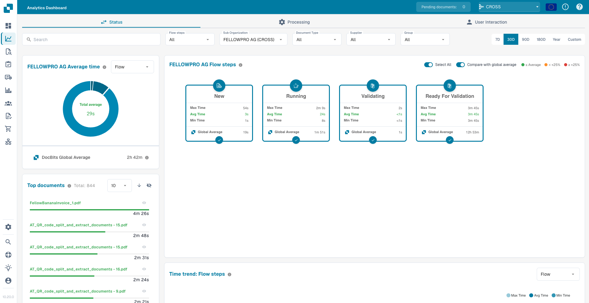<figcaption></figcaption></figure>

### 处理流程

分析所有**技术处理模块**（OCR、分类、提取、验证）的绩效，适用于发现系统端的瓶颈。

<figure>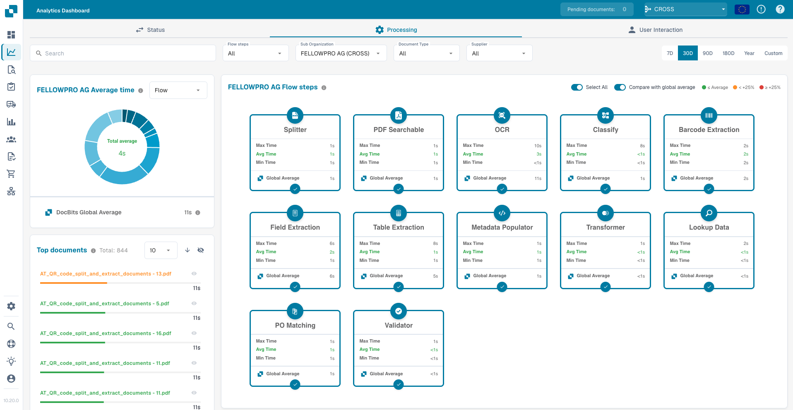<figcaption></figcaption></figure>

### 用户交互流程

聚焦于**人工操作环节**，包括队列等待时间、人工验证、审核和审批，适用于发现工作流和人员配置方面的瓶颈。

<figure>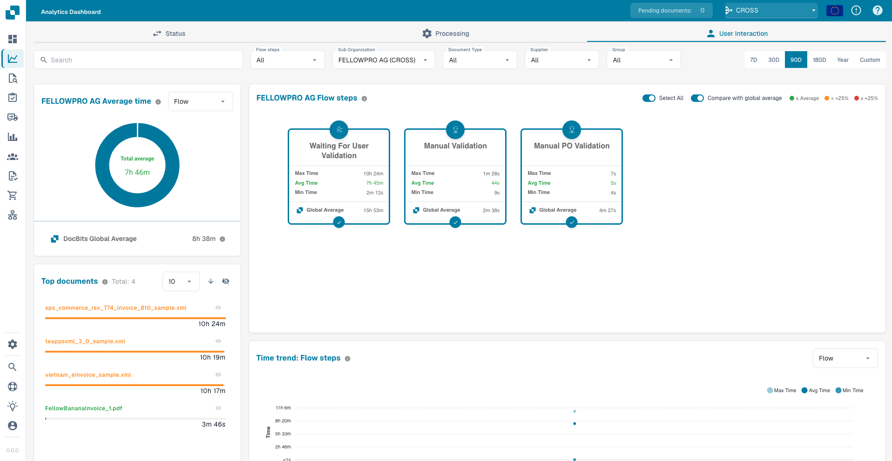<figcaption></figcaption></figure>

## 筛选选项

该仪表板支持强大的多维度筛选。所有图表、卡片和表格都会根据当前筛选条件实时更新。

### 搜索

按**名称**或**唯一 ID**即时查找任意文档。

<figure>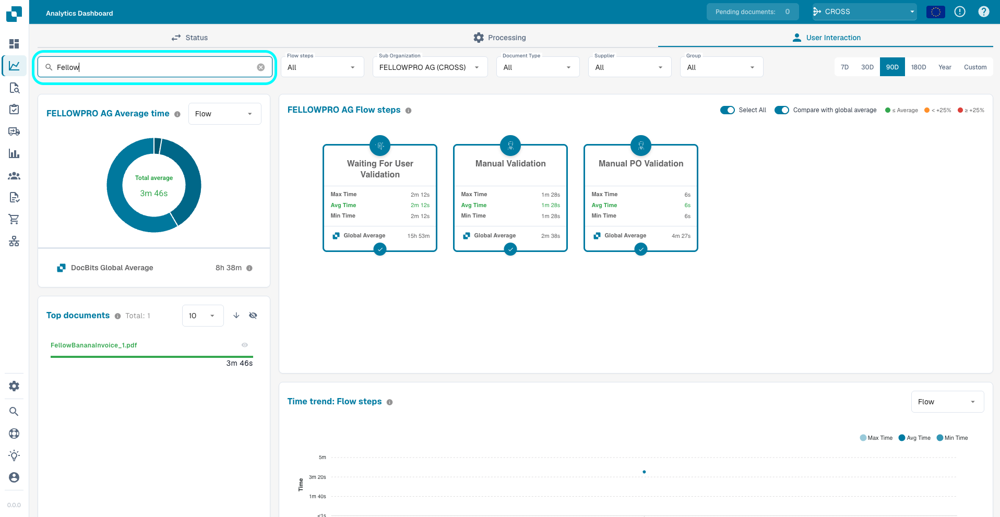<figcaption></figcaption></figure>

### 流程步骤

选择特定步骤以聚焦分析。启用或停用步骤也会重新计算仪表板其他组件中的时间指标。

<figure>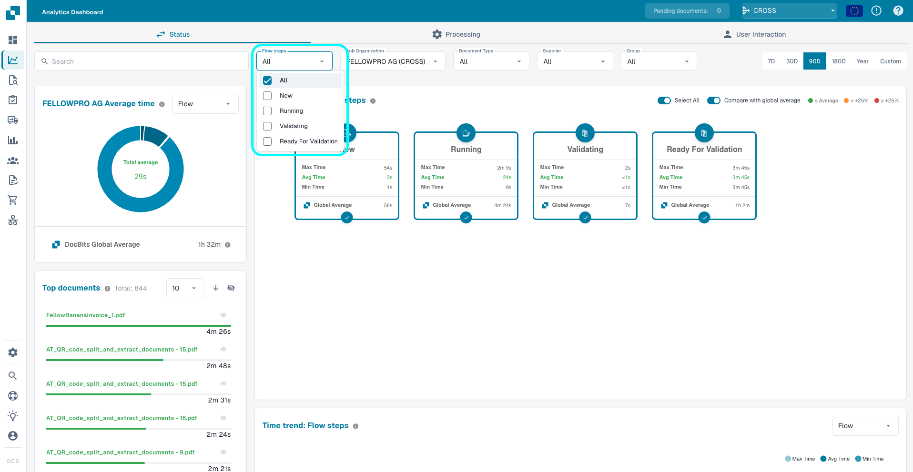<figcaption></figcaption></figure>

### 子组织、文档类型、供应商、组

比较以下维度的绩效：

* **子组织** — 不同的业务部门或租户
* **文档类型** — 发票、采购订单、交货单等
* **供应商** — 识别哪些供应商导致处理时间最长
* **组** — 比较不同已分配用户组的绩效（适用于**状态**和**用户交互**流程类型）

<figure>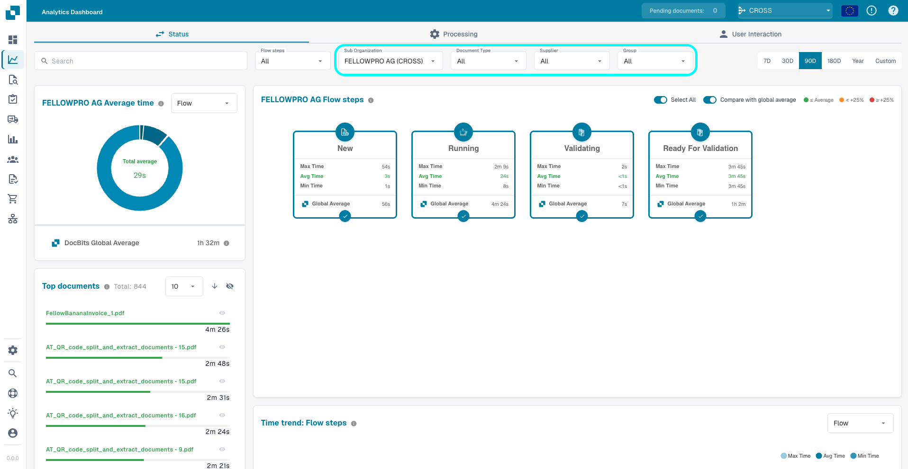<figcaption></figcaption></figure>

<mark style="color:red;">**注意**</mark>：**组**筛选器仅适用于**直接分配给组**的文档。分配给单个用户的文档，即使该用户属于某个组，**也不会**纳入组筛选结果。

### 仅显示已导出的文档

默认启用。仪表板指标仅统计已完成导出的文档。

<mark style="color:red;">**注意**</mark>：停用此选项可能会导致平均值不准确，因为尚未完成处理的文档也会纳入计算。

<figure>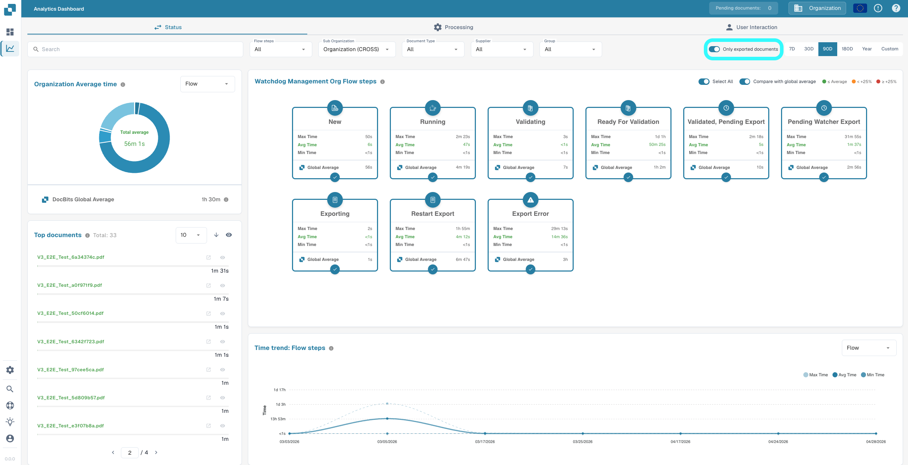<figcaption></figcaption></figure>

### 时间范围

分析从 **7 天**到**整年**的任意时段，也可以使用日期选择器设置**自定义范围**。

<figure>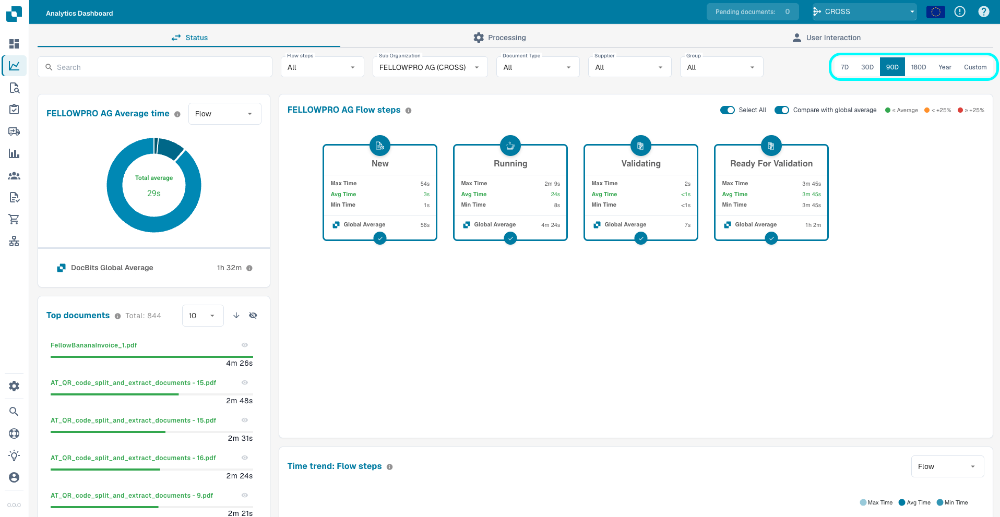<figcaption></figcaption></figure>

## 流程步骤卡片

每张卡片代表所选**流程类型**中的一个流程步骤。卡片会根据您的选择调整内容：在_状态_流程中显示生命周期阶段，在_处理_流程中显示处理模块，在_用户交互_流程中显示人工操作环节。

每张卡片显示：

* 该步骤的**最小、平均和最大**耗时
* **您的平均耗时**与 **DocBits 全球平均值**的对比（启用对比开关时）
* 一个选择圆圈，用于在平均耗时图表、时间趋势图和数据表所用的汇总时间计算中**纳入或排除**该步骤

标题区域中的**全选**切换开关可一次性纳入或排除所有步骤。

<figure>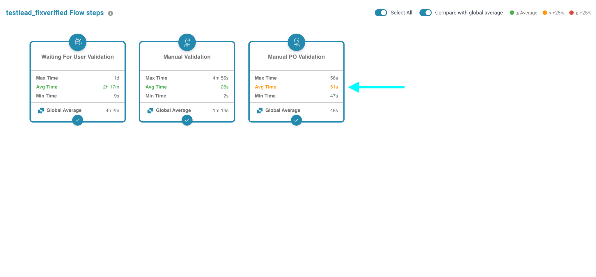<figcaption></figcaption></figure>

<figure>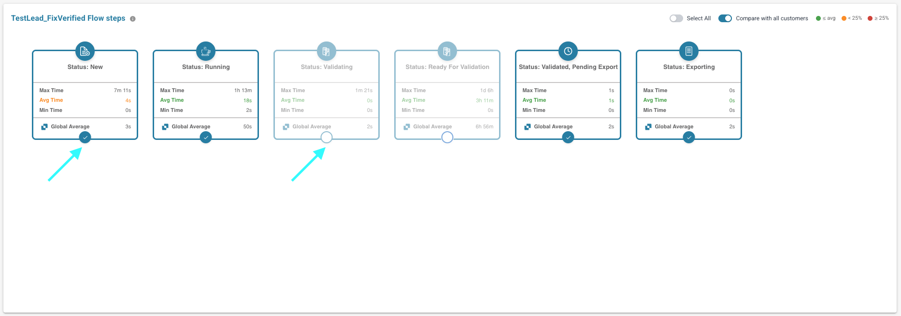<figcaption></figcaption></figure>

### 与全球平均值比较

**与全球平均值比较**切换开关用于控制是否在卡片和图表中显示 DocBits 全球平均值。启用后，每张卡片上的平均耗时会按以下颜色标示：

* **绿色** — 您的平均耗时小于或等于全球平均值
* **橙色** — 您的平均耗时比全球平均值高出不超过 **+25%**
* **红色** — 您的平均耗时比全球平均值高出 **+25%** 或更多

<figure>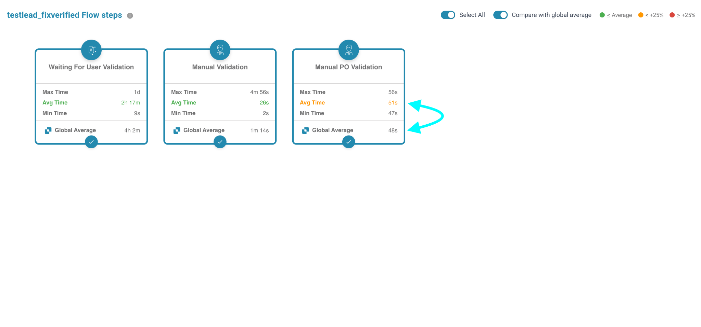<figcaption></figcaption></figure>

## 平均耗时图表

平均耗时图表可视化所选流程步骤的处理时间分布。使用**分组依据**选择器，可按不同维度进行比较：

* **流程步骤** — 查看哪些步骤耗时最长
* **子组织** — 识别不同业务部门之间的差异
* **文档类型** — 比较不同文档类型的处理时间
* **供应商** — 找出处理时间最长的供应商
* **组** — 比较不同已分配用户组的绩效（仅适用于状态和用户交互流程类型）

启用**与全球平均值比较**后，图表还会显示 DocBits 全球平均值，供您进行基准比较。

<figure>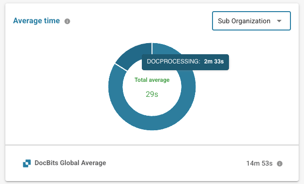<figcaption></figcaption></figure>

## 耗时最长的文档

**耗时最长的文档**卡片会列出符合当前筛选条件的单份文档，并按总耗时排序。

* **排序顺序**切换开关 — 在**降序**（耗时最长的文档在前）和**升序**（耗时最短的文档在前）之间切换。
* **每页行数**下拉菜单和分页控件 — 浏览结果集。
* 点击文档旁边的眼睛图标**隐藏或显示**该文档。隐藏的文档不会纳入仪表板的任何时间计算。
* 点击标题区域中的眼睛图标，可**隐藏或显示**当前筛选条件下的所有文档。
* **点击文档**（文件名或进度条）可将其文档 ID 复制到剪贴板。

<figure>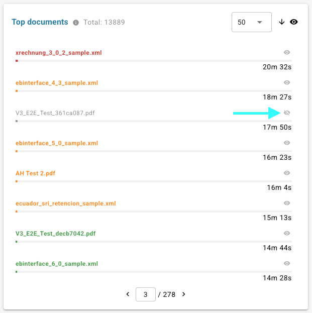<figcaption></figcaption></figure>

## 时间趋势图

跟踪绩效随时间的变化并发现异常。时间趋势图显示当前所选流程步骤的**平均耗时**，并可按以下维度分组：

* **流程步骤** — 每个所选步骤对应一条线
* **子组织**
* **文档类型**
* **供应商**
* **组**（适用于**状态**和**用户交互**流程类型）

这样，您可以轻松发现特定供应商的耗时突然增加，或特定文档类型的耗时逐渐上升，并在其演变为严重问题之前采取行动。

<figure>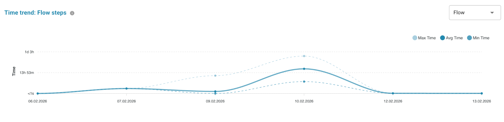<figcaption></figcaption></figure>

<figure>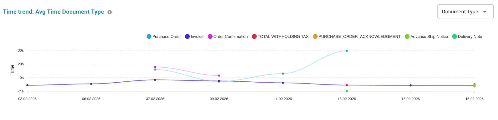<figcaption></figcaption></figure>

## 数据表

数据表可完整查看当前筛选条件下的所有底层行数据。

* **将列拖到隐藏列面板**（表格左侧）即可从视图中移除这些列。隐藏列仍用于汇总，**最小值 / 最大值 / 平均值**耗时会根据可见列动态重新计算。将列标签拖回表格，或点击 **+** 图标，即可恢复该列。
* 点击列标题进行**排序**，并通过拖放**调整**列顺序。
* 点击卡片标题区域中的按钮可**下载 CSV**，导出的内容仅包含当前可见列。

<figure>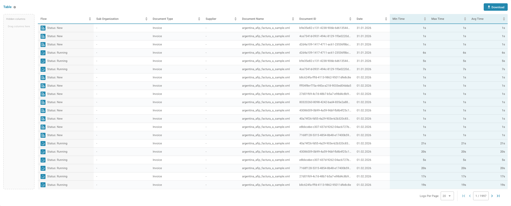<figcaption></figcaption></figure>

<figure><figcaption></figcaption></figure>

<figure>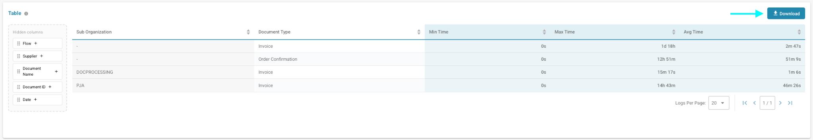<figcaption></figcaption></figure>

## 无接触式智能分析

**无接触式智能分析**选项卡会显示有多少文档在无人介入的情况下通过 DocBits 完成处理，以及其余文档停止处理的原因。请参阅[无接触式智能分析](touchless-intelligence/)。
