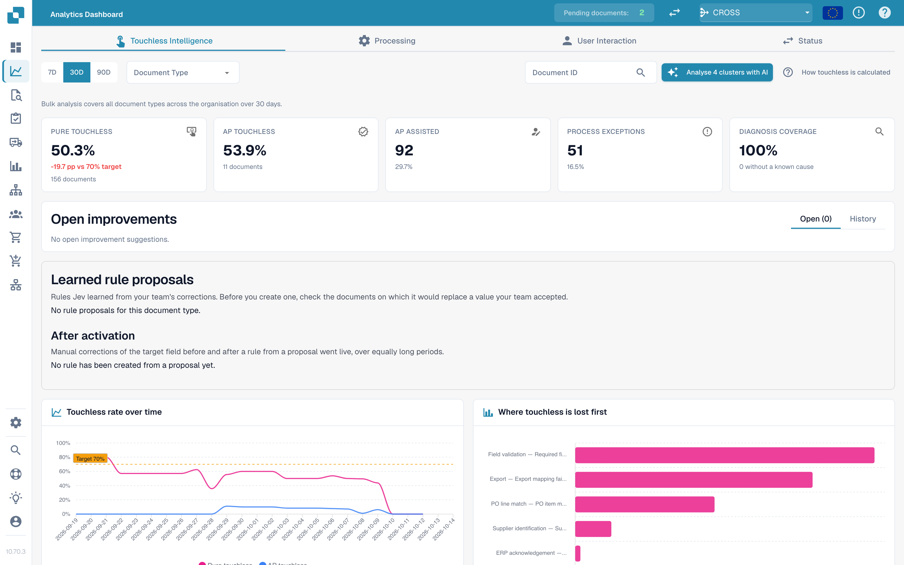
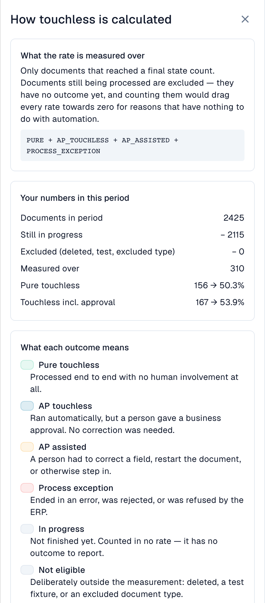
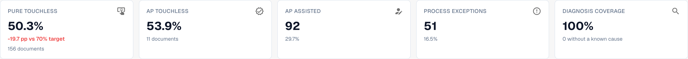
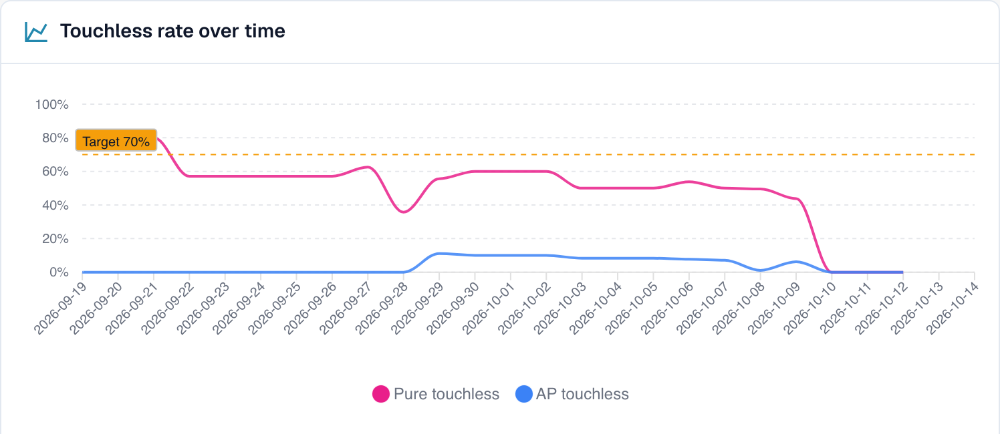
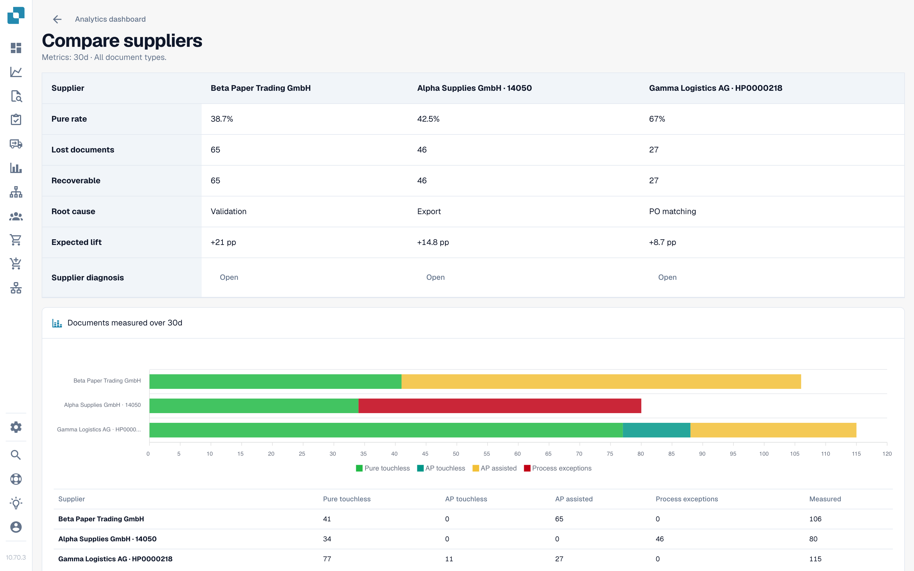

# 无接触智能



## 概述

**无接触智能**回答有关文档处理的两个问题：

1. **有多少文档在 DocBits 中流转时无需任何人操作？**这就是您的_无接触率_。
2. **其他文档为什么会停下来？我们应该做出哪些改变，才能减少这种情况？**这就是_诊断_。

它是[分析仪表板](../)中的一个标签页。它不会给您的团队增加任何工作：DocBits 会记录处理流水线中每份文档的处理情况，并每 15 分钟评估一次结果。

<figure><figcaption><p>无接触智能标签页：关键指标、改进项、随时间变化的无接触率以及首次流失图表。示例组织使用演示数据；供应商名称均为虚构。</p></figcaption></figure>

### 您可以用它做什么

| 您想要……                         | 使用                               | 示例                                                               |
| -------------------------------- | ---------------------------------- | ------------------------------------------------------------------ |
| 查看自动化程度                   | 顶部的五项**关键指标**             | “上个月，我们有 63.2 % 的文档在无人操作的情况下完成处理”             |
| 查看趋势                         | **无接触率随时间变化**             | “自从修复供应商主数据以来，无接触率从 55 % 上升到了 68 %”            |
| 找出文档卡在哪里                 | **无接触首次流失位置**             | “大多数文档停在字段验证阶段”                                       |
| 决定优先修复哪个供应商           | **供应商改进机会**                 | “修复供应商 A 可带来 +4.0 个百分点的提升”                           |
| 了解某个供应商                   | **供应商诊断**页面                 | “他们的发票没有 PO 编号，因此 PO 匹配失败”                          |
| 了解某份文档                     | **文档追踪**                       | “这张发票停在第 8 阶段：字段验证”                                  |
| 比较供应商                       | **比较供应商**                     | “供应商 A 和 B 使用相同的模板，但只有 B 失败”                       |
| 更改有帮助的设置                 | **更改提案**                       | “开启自动 PO 匹配：预览、应用、衡量、撤销”                         |

## 谁可以查看

* 此标签页属于分析仪表板。管理员可以为组织启用它。如果您看不到此标签页，请联系管理员。
* **组织管理员**始终可以查看。
* 管理员在**设置 → 角色**中为其他用户的角色授予**分析仪表板**标签页权限后，这些用户才能查看。未获授权时，只有管理员可以访问。
* 某些操作仅限管理员使用：**AI 分析**、**应用和撤销更改**、**已学习规则提案**和**咨询报告**。

如果您没有权限，页面会显示_不允许执行此操作，请联系管理员_。

## “无接触”的含义

每份文档最终都恰好属于**一种**结果：

| 结果               | 含义                                                                                             | 是否计入无接触率                                                                         |
| ------------------ | ------------------------------------------------------------------------------------------------ | ---------------------------------------------------------------------------------------- |
| **纯无接触**       | 从导入到导出全程处理，**没有任何人工参与**                                                       | 是，计为成功                                                                             |
| **AP 无接触**      | 自动处理完成，之后由人员进行**业务审批**。无需更正                                                 | 是，计为成功                                                                             |
| **AP 辅助处理**    | 人员需要**更正字段、重新启动文档**或以其他方式介入                                                 | 是，计为未达成。这不代表处理失败，只表示自动化未能完整处理该文档                         |
| **流程异常**       | 处理以**错误**结束、被**拒绝**、被 **ERP 拒收**或在流水线中**停滞**                               | 是，计为未达成                                                                           |
| **处理中**         | 尚未完成                                                                                         | **否**。尚无处理结果                                                                     |
| **不符合条件**     | 已删除、已归档、测试文档或被排除的文档类型                                                         | **否**                                                                                   |

**无接触率**的计算方式：

```
rate = (Pure touchless + AP touchless)
       ÷ (Pure touchless + AP touchless + AP assisted + Process exception)
```

仍处于**处理中**或**不符合条件**状态的文档永远不会计入计算。这样可以保护无接触率：五分钟前刚到达的文档不会拉低它。


**一次人工触碰，就会一直计为人工处理。**人员一旦处理过某份文档，即使之后的自动运行无需人工介入，该文档仍会计为人工处理。**重新启动文档不会让它重新变成无接触处理。**无接触率反映实际发生的工作。


### 计算示例（说明性数字）

30 天内，共有 200 份文档到达：

| 结果                           | 文档数 |
| ------------------------------ | ------ |
| 纯无接触                       | 120    |
| AP 无接触                       | 30     |
| AP 辅助处理                    | 30     |
| 流程异常                       | 10     |
| 处理中                         | 8      |
| 不符合条件（测试文档）         | 2      |

* 分母：120 + 30 + 30 + 10 = **190**。8 份处理中和 2 份不符合条件的文档不计入。
* **纯无接触**：120 ÷ 190 = **63.2 %**
* **AP 无接触**：30 ÷ 190 = **15.8 %**
* **无接触率**：(120 + 30) ÷ 190 = **78.9 %**

标签页会显示一个**目标值**（除非您的组织使用其他目标值，否则为 70 %）。在此示例中，无接触率高于目标值。

点击右上方的**无接触率的计算方式**，即可在 DocBits 中打开此说明，并查看所选期间的实际数字（期间内的文档、仍在处理中的文档、已排除文档和已计量文档）。

<figure><figcaption><p><strong>无接触率的计算方式</strong>侧边栏：计算公式、<strong>您在此期间的数据</strong>（此处为 2,425 份文档、2,115 份仍在处理、310 份已计量）以及每种结果的含义。示例组织使用演示数据；供应商名称均为虚构。</p></figcaption></figure>

### 数字的更新时间

每 15 分钟会**重新计算一次**处理结果。文档首次显示后，其结果仍可能发生变化：ERP 可能会在数小时后确认导出。标签页底部的**数据截至……**一行会显示上次计算这些数字的时间。

## 概览标签页

### 筛选条件

| 筛选条件                         | 作用                                                                                                                                                                                                                     |
| -------------------------------- | ------------------------------------------------------------------------------------------------------------------------------------------------------------------------------------------------------------------------ |
| **7D / 30D / 90D**               | 关键指标和队列所用的统计期间。默认值为 30 天                                                                                                                                                                             |
| **文档类型**                     | 将所有数字限定为一种类型，例如 INVOICE                                                                                                                                                                                   |
| **细分字段 / 细分值**            | 仅当您的组织通过一种文档类型运行多个流程时使用（例如 `order_type` 字段中的直接订单、间接订单和 EAM 订单）。选择字段可查看细分情况，选择值可将所有内容限定为该值 |
| **文档 ID**                      | 打开某份文档的**文档追踪**                                                                                                                                                                                               |

您在 DocBits 顶部选择的**子组织**会限定关键指标和供应商队列。问题簇和 AI 分析始终涵盖整个组织。

### 五项关键指标

<figure><figcaption><p>五项关键指标。此处纯无接触率为 50.3 %（156 份文档），比 70 % 的目标低 19.7 个百分点，诊断覆盖率为 100 %。示例组织使用演示数据；供应商名称均为虚构。</p></figcaption></figure>

| 卡片                   | 显示内容                                           | 示例（说明性数据）                                                        |
| ---------------------- | -------------------------------------------------- | ------------------------------------------------------------------------- |
| **纯无接触**           | 百分比以及与目标值的差距                           | **63.2 %** · “120 份文档” · “比 70 % 目标低 −6.8 个百分点”（低于目标，红色） |
| **AP 无接触**          | 百分比                                             | **15.8 %** · “30 份文档”                                                  |
| **AP 辅助处理**        | 文档数量及其占比                                   | **30** · 15.8 %                                                           |
| **流程异常**           | 文档数量及其占比                                   | **10** · 5.3 %                                                            |
| **诊断覆盖率**         | 已知原因的受阻文档占比                             | **80 %** · “10 份文档原因未知”                                            |

* 无数据可计量时，卡片会显示破折号（—），而非 **0 %**。破折号表示“无数据”，并不表示“为零”。
* **诊断覆盖率** = 原因已知的文档数 ÷ 所有受阻文档数。示例：50 份文档受阻，其中 10 份原因未知 → 40 ÷ 50 = **80 %**。数值较低意味着“我们还不清楚文档为何停下来”。在尝试修复具体原因之前，应先提高此数值。
* **点击卡片**可在新标签页中打开该数字对应的文档列表（“查看此数字对应的文档”）。文档数为 0 的卡片不可点击。

### 无接触率随时间变化

<figure><figcaption><p>按日显示无接触率及目标线。此处无接触率维持在 40 % 至 60 % 之间，并从 10 月 10 日开始急剧下降。示例组织使用演示数据；供应商名称均为虚构。</p></figcaption></figure>

图表中有一条**纯无接触**折线、一条 **AP 无接触**折线和一条**目标线**。较短的统计期间显示每日数据点，较长的统计期间显示每周数据点。

**示例。**您在 10 月 1 日开启自动 PO 匹配后，纯无接触率在两周内从 55 % 上升到 68 %。图表会显示曲线开始转向的日期，便于您将其与所做的更改对应起来。

### 无接触首次流失位置

<figure><figcaption><p>按文档首次停下的阶段和原因显示受阻文档。此处，<strong>字段验证：缺少必填字段</strong>影响的文档最多（58 份），其次是<strong>导出映射失败</strong>（46 份）和 <strong>PO 行项目不匹配</strong>（27 份）。示例组织使用演示数据；供应商名称均为虚构。</p></figcaption></figure>

柱状图按处理流水线阶段显示**受阻文档**数量，每份文档只显示最先阻止其继续处理的阶段。

**示例。**各柱分别为：供应商识别 12、字段验证 41、PO 行项目匹配 7。最高的柱表示应先检查**字段验证**，通常是因为未能提取某个必填字段。

### 供应商改进机会

<figure><figcaption><p>供应商队列（仅显示前四行）。第一个供应商有 106 份文档，纯无接触率为 38.7 %，有 65 份可挽回文档，因此修复后可提升<strong>21 个百分点</strong>。示例组织使用演示数据；供应商名称均为虚构。</p></figcaption></figure>

此队列回答**“我们应该先修复哪个供应商？”**队列按**可挽回文档**数量从高到低排序，每页 25 行。

| 列                             | 含义                                                                                                                                                   |
| ------------------------------ | ------------------------------------------------------------------------------------------------------------------------------------------------------ |
| **供应商编号 / 供应商**        | 供应商。无法识别供应商的文档会显示为**未识别供应商（n 份文档）**                                                                                          |
| **文档量**                     | 统计期间内该供应商的符合条件文档数                                                                                                                      |
| **纯无接触率**                 | 纯无接触文档所占比例。达到或超过目标值时显示绿色，低于目标值时显示红色                                                                                |
| **流失文档**                   | 以 AP 辅助处理或流程异常结束的文档。并非总是由人员导致：ERP 拒收或在流水线中停滞七天的文档也会计入 |
| **根本原因**                   | 修复责任方：配置、ERP 集成、导出、提取、主数据、计量、PO 匹配、用户流程、验证或未知                                                                      |
| **可挽回**                     | 流失文档中 DocBits 可以通过修复配置、主数据或供应商模板解决的数量                                                                                        |
| **预期提升**                   | 如果该供应商所有可挽回文档都能无接触处理，贵组织的无接触率预计提升的**百分点**数（**+x 个百分点**）                                                       |
| **置信度**                     | **高**、**中**或**低**：诊断的可信程度                                                                                                                   |
| **状态**                       | 新建、已打开、调查中、处理中、已确认、已解决、已忽略。文档数量过少的供应商会显示 **NEEDS\_DIAGNOSIS** |

**示例。**贵组织在该统计期间有 1,000 份符合条件的文档。供应商 A 有 40 份可挽回文档；供应商 B 有 90 份流失文档，但只有 10 份可挽回（问题在供应商一方）。

* 供应商 A：40 ÷ 1,000 = **预期提升 +4.0 个百分点**
* 供应商 B：10 ÷ 1,000 = **+1.0 个百分点**，尽管 B 的流失文档更多

队列将 A 排在 B 前面，因为**预期提升**是根据整个组织的文档量计算的，而不是根据该供应商的文档量。只有四份异常文档的供应商，不可能排在有四百份异常文档的供应商前面。

使用搜索框（“搜索供应商编号或名称”）查找供应商。点击一行可打开**供应商诊断**。

### 比较供应商

<figure><figcaption><p>并排比较三家供应商：纯无接触率、流失和可挽回文档、根本原因、预期提升，以及处理结果柱状图。每个<strong>打开</strong>链接都会跳转到供应商诊断。示例组织使用演示数据；供应商名称均为虚构。</p></figcaption></figure>

点击**比较供应商**，勾选**两到五家**供应商（每家旁边都列有受阻文档数），然后点击**比较**。

比较结果会并排显示供应商的**纯无接触率**、**流失文档**、**可挽回文档**、**根本原因**和**预期提升**，并显示处理结果柱状图，以及每家供应商对应的**供应商诊断**链接。

**示例。**供应商 A 和 B 发送的发票版式相同。B 的纯无接触率为 80 %，而 A 只有 35 %。两者的根本原因都是“主数据”。比较结果表明版式没有问题，而 A 的供应商记录不完整。应修复 A 的主数据，而不是更改模板。

### 使用 AI 分析

**使用 AI 分析 n 个问题簇**按钮会分析无接触潜力最高的问题簇（每个问题簇至少达到规定的文档数量）。每个问题簇约需 13 秒，分析范围涵盖**整个组织**。只有管理员可以启动分析。

分析运行期间，每个问题簇会显示**排队中**、**运行中**、**已完成**、**已分析**或**错误**，并提供**打开问题簇**链接。如果环境中已关闭或未配置 AI，按钮会显示为禁用状态并说明原因，此时页面上的**其他所有功能仍可使用**。

## 深入了解

| 页面                                                                     | 内容                                                                                                                             |
| ------------------------------------------------------------------------ | -------------------------------------------------------------------------------------------------------------------------------- |
| [供应商诊断与问题簇](touchless-supplier-diagnosis.md)                   | 深入了解一家供应商：结果磁贴、趋势、问题簇以及建议的来源                                                                        |
| [PO 匹配诊断](touchless-po-matching-diagnosis.md)                        | 了解文档为何停在 PO 查找或 PO 行项目匹配阶段，以及 DocBits 将发票行项目匹配到 PO 行项目的决策流程 |
| [文档追踪](touchless-document-trace.md)                                  | 逐阶段查看一份文档的处理情况                                                                                                     |
| [更改提案与报告](touchless-change-proposals.md)                         | 预览、应用、衡量和撤销更改；已学习规则提案；咨询报告                                                                              |

## 使用无接触智能：日常流程

1. **每周**：打开此标签页，对照目标值查看**无接触率**和**趋势**。
2. 查看**诊断覆盖率**。如果低于约 80 %，先找出文档停止处理的原因。
3. 查看**无接触首次流失位置**，选择数量最多的阶段。
4. 打开**供应商改进机会**。按**预期提升**排序，选择状态为 **RECOVERABLE** 的首位供应商。
5. 阅读**问题簇**，检查**缺失证据**，然后按照**更改建议**操作。
6. 每次只应用一项更改，并先进行**预览**，以便**更改历史记录**可以衡量效果。
7. 两周后检查更改**前后**的结果。

## 用自然语言提问：DocBits MCP

您也可以通过 [DocBits MCP](../../../advanced-functions-and-tools/docbits-mcp/) 使用 AI 助手执行所有这些操作。可以这样提问：

* “过去 30 天我们的无接触率是多少？”
* “哪些三家供应商导致我们损失的无接触文档最多？”
* “为什么这个供应商的文档需要人工处理才会继续？”
* “这份文档的 PO 匹配为什么失败？”

## 常见问题

**无接触率显示破折号（—）。**统计期间内没有文档达到最终结果，或者经过计量的文档少于最低数量。仍在处理中的文档不计入。

**看不到此标签页。**请管理员启用该模块，并为您的角色授予**分析仪表板**标签页权限。

**某份文档被计为人工处理，但这次处理过程中没有人介入。**它在较早的运行中由人员处理过（例如更正或重新启动）。无接触率反映实际发生的工作。

**为什么数字几小时后会发生变化？**ERP 可能会在导出发送数小时后才予以确认。处理结果每 15 分钟重新计算一次。

**AI 会自行更改任何内容吗？**不会。AI 只会生成说明。只有管理员预览并应用更改后，设置才会发生变化。

## 相关页面

* [供应商诊断与问题簇](touchless-supplier-diagnosis.md)
* [PO 匹配诊断](touchless-po-matching-diagnosis.md)
* [文档追踪](touchless-document-trace.md)
* [更改提案与报告](touchless-change-proposals.md)
* [分析仪表板](../)
* [设置助手](../../settings/global-settings/company-information/settings-assistant/)
* [DocBits MCP](../../../advanced-functions-and-tools/docbits-mcp/)
