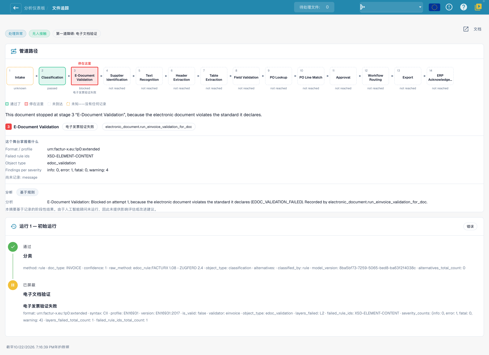

# 文档追踪

在 **Document ID** 中输入文档 ID，或从集群中打开一个示例文档，即可查看**这份文档发生了什么**。

<figure><figcaption>
当前中文界面的真实文档追踪：文档停在电子文档验证阶段，后续阶段尚未到达。身份信息已隐藏；阶段名称、部分说明及分析仍为英文，属于已确认的产品翻译缺口。本图没有运行新的 AI 分析，也不表示已成功导出。
</figcaption></figure>

顶部显示包含 14 个阶段的**流水线路径**：接收、分类、电子文档验证、供应商识别、文本识别、表头提取、表格提取、字段验证、采购订单查询、采购订单行匹配、审批、工作流路由、导出、ERP 确认。每个框都有一个状态：

| 状态                         | 含义                                   |
| ----------------------------- | ----------------------------------------- |
| **已通过**（绿色）            | 该阶段运行正常                        |
| **在此处停止**（红色）        | 该阶段阻止了文档            |
| **已跳过或不适用** | 该阶段不适用于此文档 |
| **尚未到达**               | 文档尚未到达此阶段           |
| **未知**（虚线）          | 此阶段没有记录任何内容       |

路径下方的句子说明停止原因。当前截图中，文档在第 3 阶段“电子文档验证”停止；规则 `XSD-ELEMENT-CONTENT` 失败，记录显示 1 个错误和 4 个警告。分类阶段已通过，后续阶段尚未到达；这不是第 8 阶段的必填字段错误。阶段详情列出格式、配置文件、规则 ID 及已记录的发现；**分析**区块区分基于规则的总结和 AI 分析。截图未运行 AI 分析，因此不能将现有总结当作 AI 给出的修复建议。部分说明仍显示英文。

下方的**运行历史**会列出每次运行（**运行 1 · 初始运行**，以及之后每次重新启动）及每个阶段记录的信息。如果文档经过更正并重新启动，备注会提醒你：该文档**仍计为已触达**。

**排查示例（与截图不同）。**如果多份文档都在第 8 阶段因相同必填字段停止，应比较原始文档、提取值、字段规则及默认值。相同症状只能提示共同原因，不能证明一定缺少默认值。先在代表性文档中验证原因和更改效果，再复测集群；不能保证修改一次就恢复全部文档。

## 相关页面

* [Touchless Intelligence](./)
* [供应商诊断和问题集群](touchless-supplier-diagnosis.md)
* [采购订单匹配诊断](touchless-po-matching-diagnosis.md)
