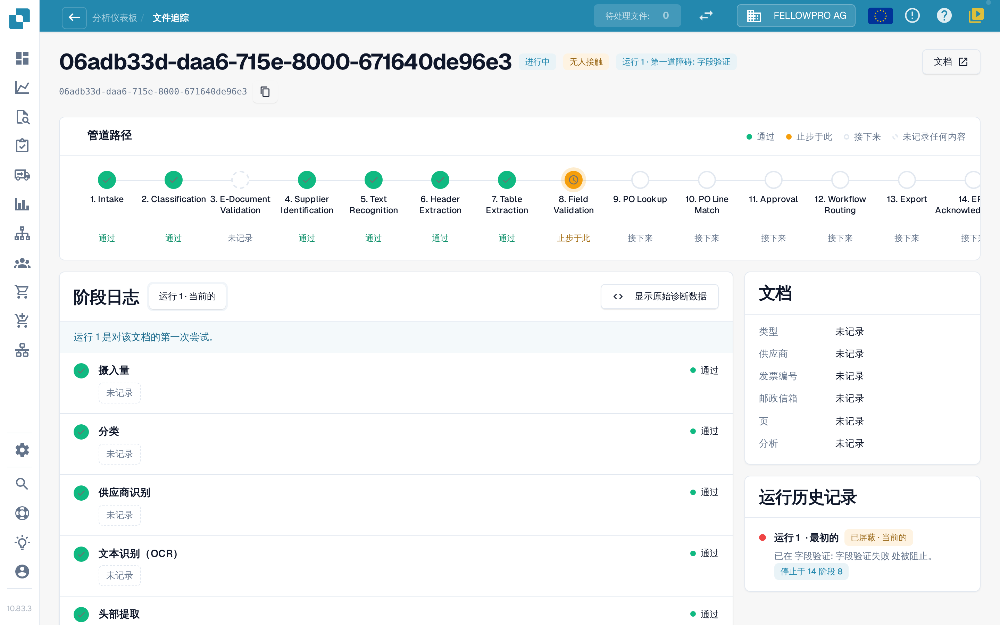
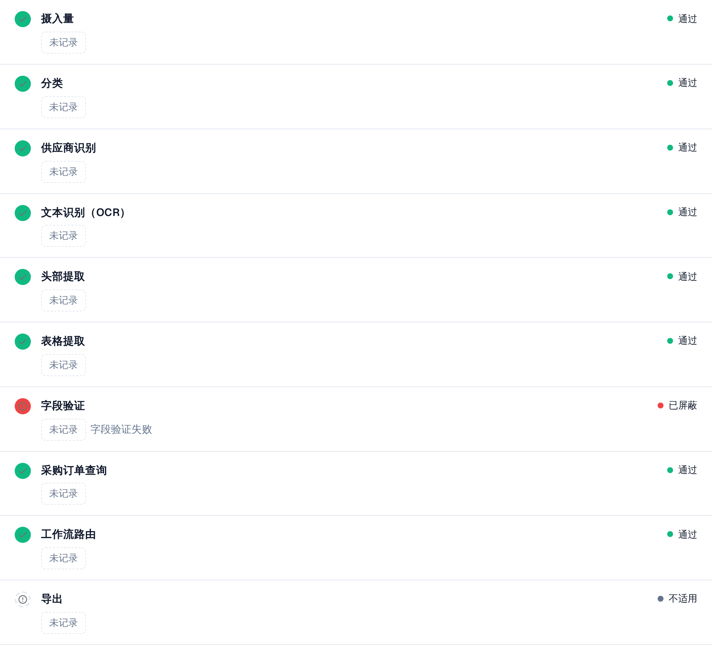

# 文档追踪

在 **Document ID** 中输入文档 ID，或从集群中打开一个示例文档，即可查看**这份文档发生了什么**。

页眉显示文件、其状态（例如**进行中**）、您正在查看的运行及其首个阻塞点，以及一个带有文档 ID 的**文档**按钮。

<figure><figcaption>
文档追踪：包含全部阶段的管道路径，以及记录各阶段详情的阶段日志。
</figcaption></figure>

**管道路径**显示 14 个阶段：Intake、Classification、E-Document Validation、Supplier Identification、Text Recognition、Header Extraction、Table Extraction、Field Validation、PO Lookup、PO Line Match、Approval、Workflow Routing、Export、ERP Acknowledgement。每个阶段带有一种状态：

| 状态 | 含义 |
| --- | --- |
| **通过**（绿色） | 该阶段顺利完成 |
| **止步于此**（橙色） | 该阶段阻止了文档 |
| **接下来** | 文档从未到达此处 |
| **未记录任何内容**（虚线） | 该阶段没有记录任何数据 |
| **不适用** | 该阶段不适用于此文档 |

### 阶段日志

路径下方的**阶段日志**列出相同的阶段以及各阶段记录的内容。每行左右两侧分别是状态圆点和状态词。

* 每个值都是一个**值标签**：带单位的数字，例如**置信度 100 %**、**阈值 60 %**、**失败规则 0**、**8 个缺失字段**或**0 个映射缺口**。百分比显示为 `97 %`，绝不显示为 `0.97`。
* **详情**会展开某个阶段记录的完整值列表，包括它考虑过的备选项。
* 阻止文档的阶段会说明原因，例如**字段验证失败**。
* 没有任何阶段记录的值显示为**未记录**，绝不显示为编造的值。值均为数字和固定词汇，绝不是文档正文。
* 当支持人员需要时，**显示原始诊断**可打开原始数据。

<figure><figcaption>
每个阶段都显示其记录的内容；被阻止的阶段会说明原因。
</figcaption></figure>

### 运行与变化

阶段日志顶部的运行选择器（**运行 1 · 当前**）可在文档的各次运行之间切换。右侧的**运行历史**列出每次运行的结果及其停止位置。如果文档运行过多次，可在选择器中选择某次运行，与当前运行进行比较：发生变化的值会带有显示差值及其单位的徽标，例如**−2 个字段**或 **+3 %**。

阶段日志旁边的**文档**卡片列出单据类型、供应商、发票号、采购订单、页数，以及该分析是基于**规则**还是由 AI 撰写。

**示例。** 某个供应商的文档全都停在第 8 阶段。在追踪中，您每次都看到相同的缺失字段。这不是单份文档的提取问题，而是字段配置中缺少默认值：修正一次，整个集群即可恢复。

## 相关页面

* [Touchless Intelligence](./)
* [供应商诊断和问题集群](touchless-supplier-diagnosis.md)
* [采购订单匹配诊断](touchless-po-matching-diagnosis.md)

本页面的屏幕截图显示中文界面。
