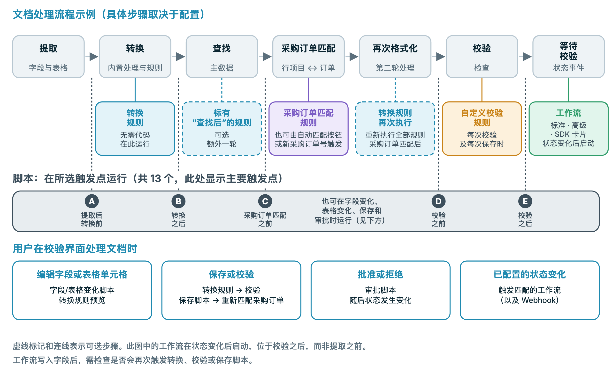
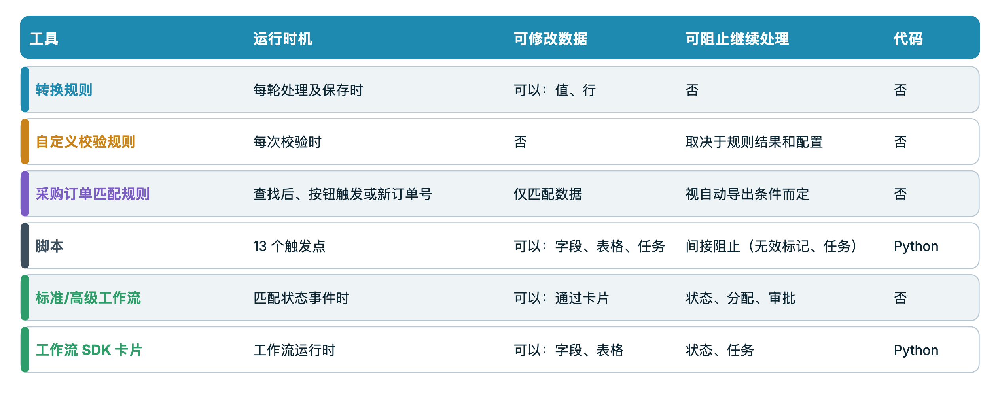
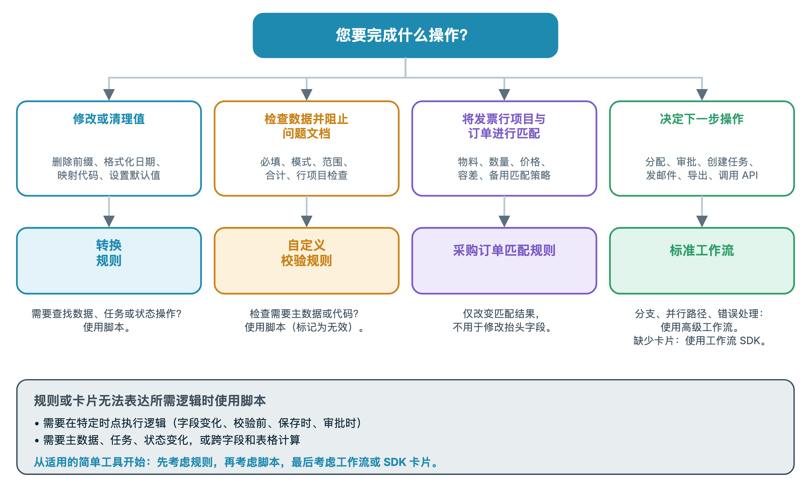

# 选择合适的自动化工具



这段五分钟的视频分为四部分，讲解相同的主题：**0:00** 各工具在文档流程中的运行位置，**1:27** 代码、工作流与对比，**2:33** 各工具能做什么和不能做什么，**3:33** 最佳实践和常见错误。

DocBits 提供了多种方式来更改、检查和路由文档：**转换规则**、**自定义验证规则**、**采购订单匹配规则**、**脚本**、**标准工作流**、**高级工作流**和 **Workflow SDK 卡片**。这些工具有意覆盖相同的一些功能。本页将说明该选择哪一种、**每种工具在文档流程中的运行时机**，以及各自能做什么和不能做什么。

## 简要回答

| 我想要…… | 使用 | 原因 |
| --- | --- | --- |
| 清理或重写一个值（去除空格、添加前缀、设置日期格式、映射单位、设置默认值） | [转换规则](settings/global-settings/document-types/transformation-rules.md) | 无需代码，可实时预览；每次处理和保存时都会运行 |
| 确保数据完整且合理，并阻止不符合要求的文档继续处理 | [自定义验证规则](settings/global-settings/document-types/custom-validation-rules.md) | 声明式检查，可报错或警告，并阻止自动导出 |
| 将发票行项目与采购订单行项目匹配 | [采购订单匹配规则](settings/global-settings/document-types/more-settings/purchase-order/purchase-order-matching-rules.md) | 支持容差、回退规则和可视化图表的规则集 |
| 执行规则无法表达的操作：查询、跨字段和表格计算、创建任务，或在特定时刻更改状态 | [脚本](settings/global-settings/document-types/script/README.md) | 使用 Python，在流程中的 13 个触发点运行 |
| 决定文档的**下一步操作**：分配、审批、创建任务、发送电子邮件、导出或调用 API | [标准工作流](workflow/standard-workflow-builder/README.md) | 根据状态事件执行 When / And / Then 卡片 |
| 执行相同操作，但需要分支、多个条件和错误路径 | [高级工作流](workflow/advanced-workflow-builder/README.md) | 可视化节点图 |
| 需要内置卡片未提供的操作 | [Workflow SDK（Card SDK）](workflow/card-sdk.md) | 创建自己的卡片，由 DocBits 审核 |

**经验法则：选择能够完成任务的最简单工具。** 优先使用规则，其次使用脚本，最后才使用工作流或 SDK 卡片。规则更容易阅读和测试，也不会破坏文档；代码功能更强，因此需要更谨慎地使用。

## 各工具在文档流程中的运行位置

每份文档都要经过相同的步骤。每种工具在流程中都有自己的位置，这决定了它能读取哪些内容，以及还能更改哪些内容。

<figure><figcaption>
自动化执行阶段示例。脚本仅在配置的触发点运行；具体规则轮次、保存及状态事件行为应使用测试文档验证。
</figcaption></figure>

具体来说：

1. **提取**会从文档中读取抬头字段和表格。脚本可以在**提取后**运行。
2. **转换**会应用内置格式设置和你的**转换规则**。脚本可以在转换前后运行。
3. **主数据查询**会填充供应商等字段。标记为**查询后运行**的转换规则会在此处额外执行一次。
4. **采购订单匹配**仅在文档类型启用了采购订单匹配时运行。此处会执行**采购订单匹配规则**。脚本可以在**采购订单匹配前**运行。
5. **重新格式化**：所有转换规则都会再次运行，因此查询或匹配写入的值也会得到格式化。
6. **验证**会运行你的**自定义验证规则**。脚本可以在验证**前后**运行。
7. 文档状态变为**Ready for validation**。这是**工作流**可以启动的第一个时机。工作流会响应状态变化，因此始终在验证后运行，绝不会在提取前运行。

用户在验证界面中操作时，还会触发其他事件：编辑字段或表格单元格会运行字段和表格更改脚本，并刷新转换规则预览。**保存**和**验证**会再次运行转换规则、验证和保存脚本；如果采购订单编号发生变化，还会再次进行采购订单匹配。**审批**会在状态更改前运行审批脚本。


工作流写入字段时，其行为类似于用户保存文档：此写入会再次触发转换规则、验证、自定义验证规则和保存脚本。若工作流和规则处理同一个字段，请将这一点考虑在内。


## 对比各工具

<figure><figcaption>
自动化工具能力对比。后续处理取决于规则结果、所选卡片及自动导出条件，应区分提示性警告与阻断错误。
</figcaption></figure>

| | 转换规则 | 自定义验证规则 | 采购订单匹配规则 | 脚本 | 标准工作流 | 高级工作流 | SDK 卡片 |
| --- | --- | --- | --- | --- | --- | --- | --- |
| **运行时机** | 每次转换和每次保存 | 每次验证 | 查询后、**Auto PO Match** 时、新的采购订单编号出现时 | 13 个触发点 | 状态更改后 | 状态更改后 | 所在工作流运行时 |
| **可读取内容** | 抬头字段、表格列 | 字段、表格单元格、跨行汇总值 | 表格、采购订单编号、采购订单行项目、容差 | 全部提取数据、查询结果、用户、用户组、全文搜索 | 文档数据、用户、用户组、变量 | 与标准工作流相同，另可读取先前节点的结果 | 字段、表格、查询结果、用户、用户组 |
| **可写入内容** | 字段和列的值、行、子组织 | 无：只能标记有效或无效 | 仅匹配数据 | 字段、表格、任务、状态 | 字段、状态、分配、任务、导出、电子邮件、API 调用 | 同样的卡片，另支持逻辑和变量 | 字段、表格、状态、任务 |
| **能否阻止文档** | 不能 | 能：错误会阻止自动导出和 **Validate** | 能：启用采购订单匹配时，未完成全部匹配会使自动导出等待 | 间接阻止：将字段标记为无效或创建任务 | 设置状态、分配、审批、拒绝 | 同标准工作流 | 与卡片类型相同 |
| **是否需要代码** | 不需要 | 不需要 | 不需要 | 需要，使用受限的 Python | 不需要 | 不需要 | 需要，在沙箱中运行 Python |
| **典型用途** | 规范化值 | 必填字段、格式、合计 | 行项目匹配 | 特殊逻辑 | 路由和审批 | 分支路由 | 合作伙伴专用操作 |

## 通过四个问题做出选择

<figure><figcaption>
自动化工具选择示意；根据所需修改、检查、采购订单匹配或流程动作，选择已配置且有权限使用的功能。
</figcaption></figure>

1. **需要更改某个值吗？** 使用**转换规则**。如果更改需要主数据、任务或状态，请使用**脚本**。
2. **需要检查某个值吗？** 使用**自定义验证规则**。它们可以阻止文档，但不会更改文档。如果检查需要主数据或代码，可以用**脚本**将字段标记为无效。
3. **需要将发票行项目与订单匹配吗？** 使用**采购订单匹配规则**。它们只生成匹配结果。若要在匹配前修正抬头字段，请使用转换规则。
4. **下一步操作是否取决于文档？** 使用**工作流**。需要分支、多个条件或错误路径时，选择**高级工作流**。只有在内置卡片无法满足需求时，才选择 **SDK 卡片**。

## 逐一了解各工具

### 转换规则

* **适用场景**：值本身正确，但格式不正确，例如前缀、空格、日期格式、单位代码、默认值、填错字段的采购订单编号，或需要汇总为一行的表格。
* **运行时机**：首次转换时、主数据查询后的可选执行阶段、采购订单匹配后，以及每次保存时。验证界面会显示预览。
* **可以执行**：更改抬头字段、表格列和行，以及子组织。每条规则都可以限制为特定供应商或条件。
* **无法执行**：阻止文档、调用其他系统、查询主数据或创建任务。无法应用规则时，值会保持不变。
* **了解更多：** [转换规则](settings/global-settings/document-types/transformation-rules.md)

### 自定义验证规则

* **适用场景**：数据错误时必须阻止文档继续处理，例如必填字段、格式模式、数值范围、允许值、两个字段之间的比较，以及必须正确相加的合计。
* **运行时机**：每次验证时，包括流程中的验证、每次保存时的验证，以及工作流写入数据后的验证。
* **可以执行**：将字段或表格单元格标记为**错误**（除非绕过，否则会阻止自动导出和 **Validate**）或**警告**（可见但不会阻止操作）。
* **无法执行**：更改数据、查询主数据或调用服务。先用转换规则修正数据，再进行检查。
* **了解更多：** [自定义验证规则](settings/global-settings/document-types/custom-validation-rules.md)

### 采购订单匹配规则

* **适用场景**：将发票行项目与采购订单行项目匹配，包括单项、多项和总额匹配、数量和价格容差，以及首条规则未匹配时的回退规则。
* **运行时机**：主数据查询后、点击 **Auto PO Match** 时，以及保存时采购订单编号发生变化后。
* **可以执行**：生成匹配结果和审批所需的数据。图表视图会显示各阶段应用的规则。
* **无法执行**：重写抬头字段、设置状态或运行自定义逻辑。启用采购订单匹配时，未完成全部匹配会使自动导出处于等待状态。
* **了解更多：** [采购订单匹配规则](settings/global-settings/document-types/more-settings/purchase-order/purchase-order-matching-rules.md)

### 脚本

* **适用场景**：规则无法表达所需逻辑，例如跨字段和表格的计算、查询、为用户创建任务、在特定时刻更改状态，或响应验证界面中的编辑。
* **运行时机**：在你选择的触发点运行，包括提取后、转换前后、采购订单匹配前、验证前后、字段和表格更改时、保存时以及审批时。
* **可以执行**：读取整个文档、查询主数据并进行全文搜索、更改字段、标记和表格、创建任务以及更改状态。
* **无法执行**：导入模块或调用外部服务。脚本使用受限的 Python。脚本出错时会记录日志，但不会中止文档处理，因此脚本**不能**作为可靠的文档拦截手段；应改为将字段标记为无效或创建任务。
* **了解更多：** [脚本](settings/global-settings/document-types/script/README.md)

### 标准工作流

* **适用场景**：下一步操作取决于文档，例如分配给用户或用户组、审批或拒绝、创建任务、发送电子邮件、导出、设置状态或调用 API。
* **运行时机**：文档达到你选择的状态时，也就是验证后。也可以从 Webhook、计划任务或手动操作启动。
* **可以执行**：按顺序执行一系列卡片：**When**（启动条件）、**And**（条件，必须全部满足）、**Then**（操作）。
* **无法执行**：创建分支、等待多个条件，或在独立路径中响应卡片错误。需要这些功能时，请使用高级工作流。
* **了解更多：** [标准工作流](workflow/standard-workflow-builder/README.md)

### 高级工作流

* **适用场景**：同一份文档需要走不同路径，例如按条件分支、组合多个 ALL / ANY 条件，以及为错误或未满足条件的情况设置路径。
* **运行时机**：与标准工作流响应相同的事件时运行。此功能需要 DocFlow Advanced 订阅。
* **可以执行**：使用与标准工作流相同的卡片，另可使用逻辑和变量卡片，并以图表形式绘制工作流。
* **无法执行**：处理验证前的操作，因为高级工作流从状态更改后开始运行。验证前的逻辑应放在脚本或规则中。
* **了解更多：** [高级工作流](workflow/advanced-workflow-builder/README.md)

### Workflow SDK（Card SDK）

* **适用场景**：需要创建当前不存在的卡片，例如针对合作伙伴应用的专用条件或操作。
* **运行时机**：包含该卡片的工作流运行时。
* **可以执行**：读取和写入字段及表格、保存文档、更改状态以及创建任务。
* **无法执行**：建立网络连接。每次运行最多 60 秒，最多进行 200 次 SDK 调用。只有经 DocBits 审核并批准后，卡片才能上线。
* **了解更多：** [Card SDK](workflow/card-sdk.md)

## 最佳实践

* **从最简单的工具开始。** 格式设置使用转换规则比使用脚本更合适；数据检查使用自定义验证规则比使用脚本更合适。只有规则或内置卡片无法完成任务时，才考虑使用脚本或 SDK 卡片。
* **先修正，再检查，最后路由。** 转换规则和脚本负责准备数据，自定义验证规则负责判断数据，工作流负责决定文档的后续操作。这就是流程顺序。
* **每个字段只由一个工具负责。** 如果转换规则和脚本都写入同一字段，结果将取决于执行顺序。请为每个字段指定唯一的修改工具。
* **不要用工作流修复数据。** 工作流在验证后启动，因此此时才修复数据为时已晚，而且会触发新一轮验证。请在验证前通过规则或脚本修复数据。
* **使用规则进行验证，不要使用脚本。** 脚本出错不会阻止文档；自定义验证规则可以。
* **保持脚本精简，并按用途命名。** 每项任务使用一个脚本，并在名称中注明触发点；出现问题时就能轻松将其停用。
* **先在开发环境或沙箱中测试。** 使用几份真实文档，在验证界面检查结果，然后再将规则或工作流启用于生产环境。
* **查看日志。** 文档日志和工作流日志会显示运行了哪些内容以及发生了哪些更改。

## 常见错误

| 错误做法 | 更好的做法 |
| --- | --- |
| 用脚本去除空格并添加前缀 | 使用转换规则 |
| 在验证后运行工作流来设置字段 | 使用转换规则或在验证前运行脚本 |
| 期望脚本阻止无效文档 | 使用自定义验证规则 |
| 期望自定义验证规则修正值 | 先使用转换规则，再使用验证规则 |
| 在采购订单匹配规则中重写采购订单编号 | 在匹配前，对 *Purchase Order* 字段使用转换规则 |
| 为单一 *When → Then* 使用高级工作流 | 使用标准工作流 |
| 为内置卡片已能完成的操作创建 SDK 卡片 | 使用内置卡片 |

## 相关页面

* [转换规则](settings/global-settings/document-types/transformation-rules.md)
* [自定义验证规则](settings/global-settings/document-types/custom-validation-rules.md)
* [采购订单匹配规则](settings/global-settings/document-types/more-settings/purchase-order/purchase-order-matching-rules.md)
* [脚本](settings/global-settings/document-types/script/README.md)
* [工作流](workflow/README.md)
