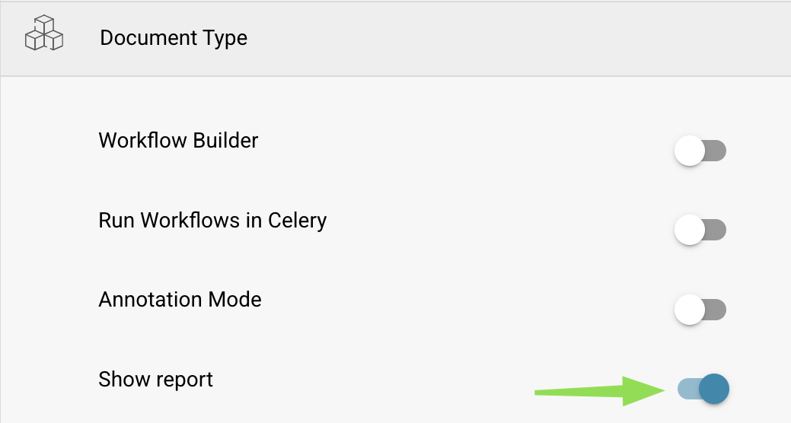
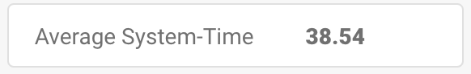

# 报告页面



### 1. 如何启用报告页面

前往 **设置** → **文档处理** → **模块** → **文档类型** → **显示报告**，切换按钮以启用此设置。

<figure><figcaption></figcaption></figure>

### 2. **如何访问报告页面**

按照以下步骤访问 DocBits 中的**报告页面**：

1. **登录 DocBits**
   * 打开 DocBits 并使用您的凭据登录。
2. **点击报告图标**
   * 在左侧边栏中找到并点击 **报告**图标（图标显示为图形或图表）。

<figure><figcaption></figcaption></figure>

### **3. 使用时间单位筛选器**

*   在页面顶部，您可以调整**时间单位**筛选器，为报告选择时间范围：

    * **最近 30 天**
    * **最近 7 天**
    * **自定义时间范围**（自定义日期范围）

    <figure><figcaption></figcaption></figure>

### **4. 新文档显示**

* 在**时间单位**筛选器旁边，有一个标记为**新文档**的信息显示区域。该区域显示所选时间范围内导入的新文档数量。

<figure><figcaption></figcaption></figure>

### **5. 平均系统处理时间显示**

* 在**新文档**标签后面，您会看到**平均系统处理时间**显示区域。该区域显示系统在所选时间范围内处理新文档所花费的平均时间，单位为秒。

<figure><figcaption></figcaption></figure>

### **6. 已更改字段部分**

* 在时间相关信息下方，您会看到**已更改字段**部分。此部分通过图表显示所选时间范围内用户手动修改各文档字段的频率。
* 图表中的每个字段都显示相应的更改次数，以条形形式呈现。

<figure><figcaption></figcaption></figure>

* **图表下载选项**
  * 在**已更改字段**图表的右侧，有一个小菜单，可用于下载不同格式的图表。您可以将图表下载为：
    * **SVG**
    * **PNG**
    * **CSV**
  * 要下载图表，请点击菜单并选择所需的文件格式。

### **7. 其他报告部分**

在**已更改字段**部分下方，您会看到另外四个按钮。点击每个按钮可展开并查看更详细的信息。

1.  **各类型文档总数**

    * 此按钮显示所选时间范围内每种文档类型的文档总数（例如，发票、采购订单等）。
    * 点击按钮后会展开一个列表，显示文档类型以及所选时间范围内处理的该类型文档数量。

    <figure><figcaption></figcaption></figure>
2.  **各文档类型的每日平均值**

    * 此按钮显示按文档类型分类的每日文档处理平均数量。
    * 点击按钮后会展开并显示文档类型及其对应的每日平均处理数量。

    <figure><figcaption></figcaption></figure>
3.  **状态统计**

    * 此按钮显示每种文档类型（例如，发票、采购订单等）的状态分布。点击后会展开并显示每种文档类型中文档的状态，以及各状态类别中的文档数量。

    <figure><figcaption></figcaption></figure>
4.  **导出统计**

    * 此按钮可用于查看文档的导出统计信息。点击后会展开并显示与文档导出相关的数据，例如导出次数、成功率/失败率及其他相关信息。

    <figure><figcaption></figcaption></figure>
