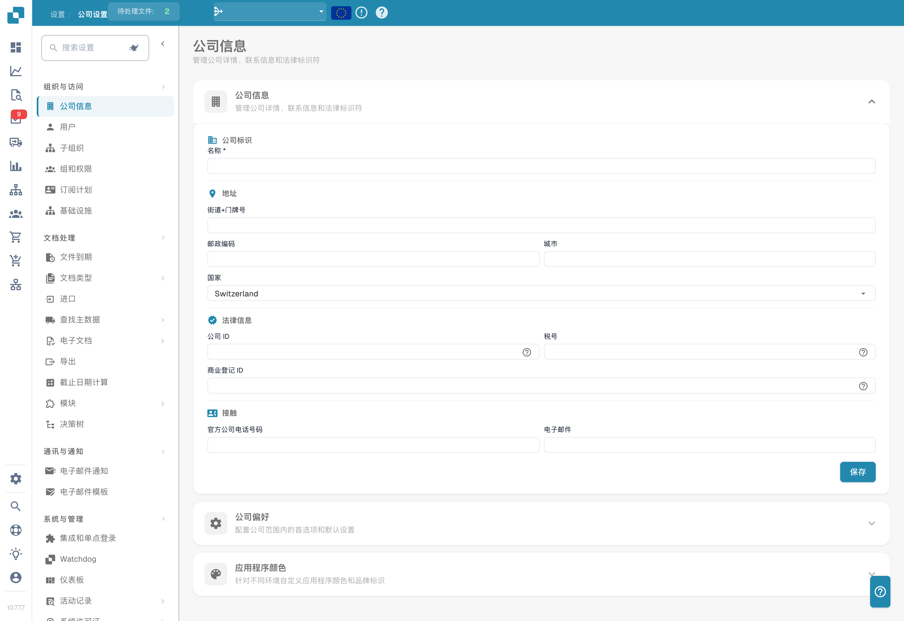

# 设置

<figure><figcaption>
中文公司信息页面；名称、地址及组织数据已隐藏。所示界面将导入导航误译为“进口”，联系信息区段误译为“接触”，分别指数据导入和联系方式。
</figcaption></figure>

设置区域是配置 DocBits 的中心。它分为五个主要部分：

## 1. 组织与访问

管理公司资料，并控制不同用户可以访问的内容。

* **公司信息**：输入公司名称、地址、税号及其他法定标识信息。
* **用户**：添加、编辑或停用用户账户，并分配角色（Admin、System Admin）。
* **子组织**：为多实体架构创建和管理子组织。
* **组和权限**：定义用户组，并为每个组配置细粒度权限。

## 2. 文档处理

配置文档的导入、处理和导出方式。

* **文档过期**：设置文档自动删除规则（例如，48 小时、一周后删除等）。
* **文档类型**：定义并配置 DocBits 处理的文档类型（发票、订单、交货单等），包括字段、表格列、脚本等。
* **导入**：设置文档进入 DocBits 的方式——通过电子邮件（IMAP/Office 365）、FTP 或文件上传。配置文件类型和页数限制。
* **规则管理**：定义发票与采购订单对账的冲突解决规则，包括容差设置和审批工作流。
* **OCR 设置**：配置光学字符识别质量阈值、E-Text 使用方式、AI OCR 版本和表格提取行为。
* **分类与提取**：设置文档拆分、金额格式、表格提取方法、分类规则和 AI 模型。
* **查询主数据**：配置如何根据 ERP 系统中的主数据验证提取的数据（例如，供应商账户、采购订单）。
* **值列表**：创建和管理用于下拉菜单和数据验证的预定义值列表。
* **导出**：配置处理后的文档发送方式和目标位置——通过 Webhook、SFTP、SMB 或 Infor 集成（IDM、ION、M3、LN）。
* **模块**：启用或禁用可选功能，例如 PO Dashboard、Auto Accounting、Supplier Portal、Workflow Builder、QR-Code Extraction 等。
* **决策树**：使用可视化设计器构建基于规则的决策逻辑。支持多种策略（Unique、First、Priority、Collect 等）。
* **代理设置**：创建和管理自动化代理及通信渠道，以支持自动化文档处理工作流。

## 3. 通信与通知

控制 DocBits 与用户的通信方式，以及对收到的电子邮件的处理方式。

* **电子邮件通知**：配置文档处理事件和状态变更的电子邮件提醒。
* **电子邮件模板**：创建和管理可重复使用的通知电子邮件模板，并按文档类型组织。
* **电子邮件接收**：配置如何自动对收到的电子邮件进行分类并将其转换为文档。包括分类、字段提取、处理、发件人管理和训练规则，并按文档类型（订单、发票、报价、交货单、COA、PO Confirm）组织。

## 4. 系统与管理

监控系统运行状况、管理集成并维护安全性。

* **集成与 SSO**：为外部集成配置 API 密钥，并通过身份提供商设置单点登录（SSO）。
* **Watchdog**：设置 Watchdog 服务，以便从本地目录自动导入文档。
* **仪表板**：自定义仪表板行为——筛选器、导出设置、操作权限和状态显示选项。
* **活动日志**：按严重级别（Debug、Info、Warning、Error）、时间范围和服务筛选并查看实时系统事件日志。
* **分析**：访问详细的分析仪表板，包括日志分析、身份验证安全监控和采用 Real User Monitoring（RUM）的 API 指标。
* **访问审计**：启用并查看审计跟踪，追踪整个组织中的所有 Create、Update 和 Delete 操作，以满足合规和安全要求。
* **系统许可证**：查看和管理 API 许可证信息及用量。
* **缓存管理**：配置 Received Delivery、Purchase Order 和 Task/Notification 缓存的自动清理间隔（TTL）。
* **全文搜索设置**：配置文档和数据的全文搜索功能（需要启用 Fulltext Search 模块）。

## 5. 供应商设置

配置 Supplier Portal 并管理与供应商相关的工作流。

* **供应商常规设置**：设置供应商门户邀请字段，配置工作流状态（Not Invited、Open、Pending Registration、Approved、Rejected），并管理审批设置。
* **电子邮件模板**：创建和管理专用于供应商通信的电子邮件模板。
* **供应商布局**：自定义 Supplier Portal 的布局和外观。
* **导出配置**：配置供应商数据导出到外部系统的方式。
* **供应商组**：创建和管理供应商组，以便对供应商进行分类和组织。
* **用户与供应商组映射**：将内部用户关联到特定供应商组，以控制可见内容和访问权限。
