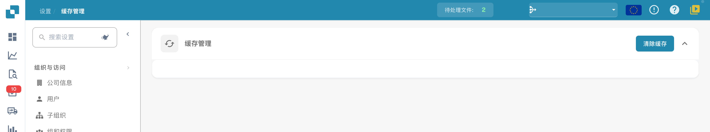

# 缓存管理

<figure><figcaption>
中文缓存管理入口提供全局“清除缓存”操作。本页没有单项缓存开关或 TTL 表格；本图未执行清除。
</figcaption></figure>

缓存可减少重复读取数据的开销。当前缓存管理页面提供全局清除操作，不提供逐项缓存开关或 TTL 设置表。

## 清除缓存

在**设置 → 缓存管理**中选择**清除缓存**，可请求清除缓存。此操作会影响组织正在使用的缓存；执行前请确认需要刷新缓存，并等待操作结果。

## 验证结果

清除后，返回原来的业务页面并重新加载，检查相关数据是否已更新。若问题仍存在，请记录发生时间、涉及的页面及错误提示，再联系支持团队。本文截图只展示入口，没有执行清除。
