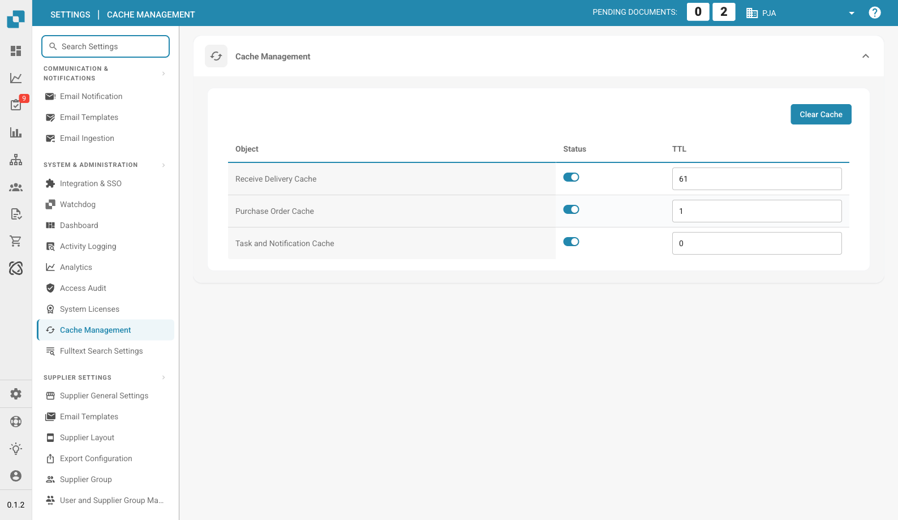

# 缓存管理

<figure><figcaption>
缓存管理页面
</figcaption></figure>

缓存管理用于控制频繁访问数据的自动清除。启用缓存可减少重复的 API 调用，从而提升性能。

## 清除缓存

点击右上角的 **Clear Cache** 按钮，即可立即手动使所有缓存数据失效。

## 缓存表

| 列 | 说明 |
|--------|-------------|
| **对象** | 缓存数据的类型（例如，收货缓存、采购订单缓存）。 |
| **状态** | 切换此对象的缓存启用或禁用状态。 |
| **TTL** | 生存时间，以分钟为单位——缓存数据在自动刷新前保持有效的时长。设置为 `0` 可禁用自动过期。 |

## 可用缓存

| 缓存 | 说明 |
|-------|-------------|
| **收货缓存** | 缓存用于采购订单匹配的收货数据。 |
| **采购订单缓存** | 缓存采购订单数据，以便在文档处理中更快地查找。 |
| **任务和通知缓存** | 缓存仪表板中显示的任务数量和通知数据。 |
