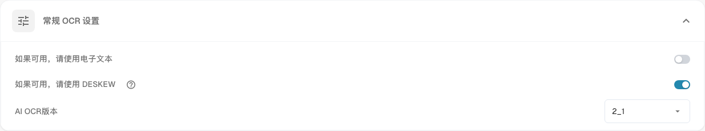

# 文档处理

**文档处理**设置决定 DocBits 如何读取文档、补充数据并导出文档。打开**设置**，然后在**文档处理**下选择所需区域。

* [OCR 设置](ocr-settings.md): 如何读取文档中的文本。
* [主数据查询](master-data-lookup.md): 如何将提取的值与主数据进行比对。
* [到期日计算](due-date-calculation.md): 如何计算到期日期。
* [导出](export/README.md): 将处理后的文档导出到哪里以及如何导出。

例如，打开 **OCR设置**，查看 **常规 OCR 设置**。选项 **如果可用，请使用电子文本** 用于读取文档中嵌入的电子文本；选项 **如果可用，请使用 DESKEW** 用于校正扫描页面的倾斜；**AI OCR版本** 用于选择识别引擎版本。有关各控件的详细说明，请参阅 [OCR设置](ocr-settings.md)。

<figure><figcaption>
常规 OCR 设置是文档处理的一个区域。所选值取决于您所在的组织。
</figcaption></figure>

本节还包括：[导入](import/README.md)、[分类与提取](classification-and-extraction/README.md)、[规则管理](rule-manager/README.md)、[值列表](list-of-values.md)和[模块](module/README.md)。

如果某项设置的行为不符合预期，请先使用测试文档进行检查。此处的更改可能影响组织中的每个新文档。
