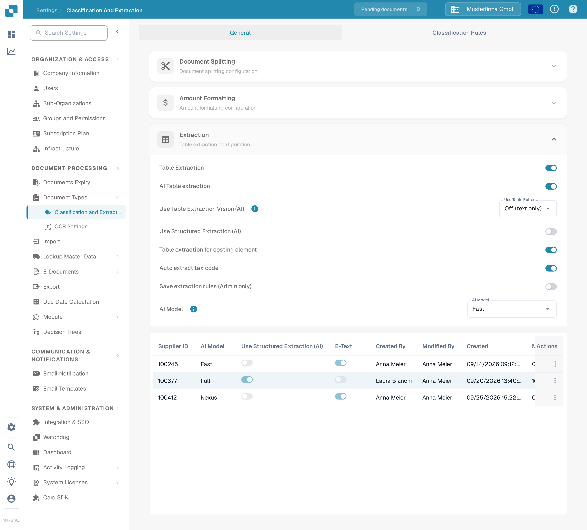
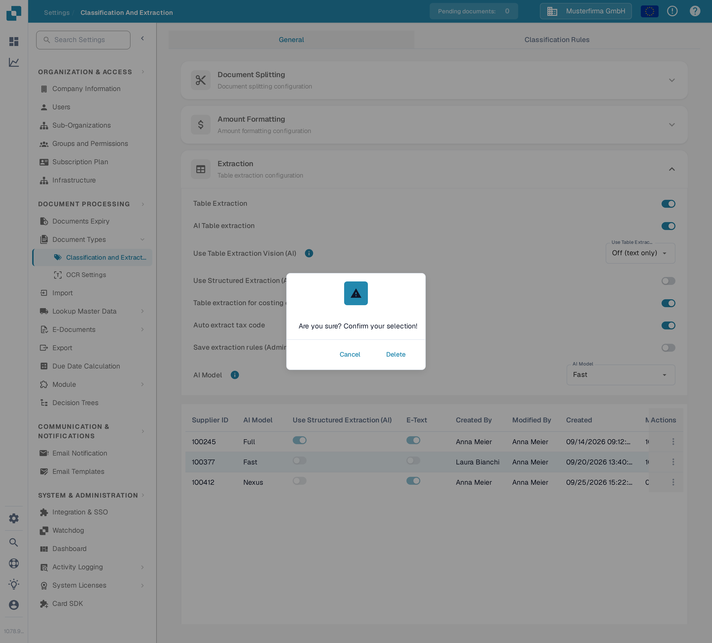

# AI 模型

## 概述

**AI 模型**设置用于定义文档处理期间默认用于**字段提取**和**表格提取**的 AI 模型。\
在本部分中，您可以查看每种模型的令牌成本，以及当前为每个供应商分配的模型。

## 如何访问

1.  前往 **Settings** → **Document Processing** → **Classification and Extraction**

    <figure><figcaption>
打开 <strong>Settings → Document Processing → Classification and Extraction</strong>。
</figcaption></figure>
2.  向下滚动到 **Table Extraction** 部分

    <figure><figcaption>
<strong>Extraction</strong> 部分包含 <strong>AI Model</strong> 设置和供应商分配表。
</figcaption></figure>

## AI 模型选项

DocBits 为字段提取和表格提取提供六种 AI 模型选项。它们在**提取准确性**、**处理速度**和**每份文档的令牌成本**之间各有侧重，您可以根据所处理文档的类型选择合适的选项。将鼠标悬停在设置旁的信息图标上，即可查看当前所选选项的令牌成本。如果未为某个供应商设置模型，则会使用 Fast。

* **Full** – 最全面的选项，提取准确性最高。最适合布局复杂、扫描质量较差或对精确度要求最高的文档。作为功能最强的选项，它的处理速度也最慢，每份文档消耗 **2 个令牌**。
* **Fast** – 平衡选项，以较低成本兼顾良好的准确性和更快的处理速度。这是默认级别：未单独设置 AI 模型的供应商会使用 Fast，每份文档消耗 **1 个令牌**。
* **Nexus** – 可选启用的选项，使用不同的模型系列（Qwen 3.8 Max）。当您希望对 Fast 和 Full 结果不一致的供应商进行交叉核对，或替代模型更擅长读取特定布局时，可使用此选项。每份文档消耗 **1 个令牌**。
* **Nexus Flash** – Nexus 系列中速度更快的级别（GLM-5.3 Flash）。令牌成本相同，但处理文档的速度比 Nexus 更快，每份文档消耗 **1 个令牌**。
* **Auto** – 它本身不是一种模型：DocBits 会针对每份文档判断 Fast 是否足够，还是需要使用 Full，因此复杂文档会自动使用更强的模型。每份文档消耗 **1 个令牌**。
* **Auto Nexus** – 与 Auto 类似，但仅限于 Nexus 模型系列（Nexus Flash 和 Nexus）。文档始终不会使用标准模型系列处理，每份文档消耗 **1 个令牌**。

| 选项 | 最适用场景 | 准确性 | 速度 | 令牌成本 |
|--------|----------|----------|-------|------------|
| **Full** | 布局复杂、扫描质量较差或对精度要求高的文档 | 最高 | 最慢 | 2 / 文档 |
| **Fast** | 日常文档（未设置时的默认选项） | 高 | 快 | 1 / 文档 |
| **Nexus** | 替代模型系列表现更好的供应商（可选启用） | 高 | 快 | 1 / 文档 |
| **Nexus Flash** | Nexus 质量，处理速度更快 | 高 | 更快 | 1 / 文档 |
| **Auto** | 文档质量不一且无需手动调整 | 按文档决定 | 按文档决定 | 1 / 文档 |
| **Auto Nexus** | 将 Auto 决策限定在 Nexus 系列 | 按文档决定 | 按文档决定 | 1 / 文档 |

<figure><figcaption>
<strong>AI Model</strong> 下拉菜单及其六种可用选项。
</figcaption></figure>

## AI 模型分配表

您也可以直接在**验证界面**中为特定供应商配置专属的 **AI 模型**，从而针对各个供应商微调提取准确性。\
\
更多信息请参阅相应文档[此处](../../../../end-user-and-partner-section/end-user-section/validation-screen/supplier-specific-ai-model-for-field-and-table-extraction.md)。

分配表会显示每个供应商的 AI 模型设置，并包含以下详细信息：

* **Supplier ID** – 供应商的唯一标识符
* **AI Model** – 当前分配给该供应商的 AI 模型级别
* **Use Structured Extraction (AI)** – 是否为该供应商启用了结构化提取
* **E-Text** – 指示是否启用了 E-Text 功能
* **Created By / Modified By / Created On / Modified On** – 设置条目的人员以及设置或修改时间
* **Action** – 包含删除条目的选项

<figure><figcaption>
分配表会显示每个供应商对应的级别标签，不会显示原始模型 ID。
</figcaption></figure>

### 删除条目 – 重置供应商专属设置

要将供应商的 AI 模型设置重置为默认值：

1.  点击供应商条目旁 **Action** 列中的三点菜单，然后选择 **Delete**。

    <figure><figcaption>
打开行操作菜单并选择 <strong>Delete</strong>。
</figcaption></figure>
2.  系统会显示确认对话框，请确认要删除该条目。

    <figure><figcaption>
在对话框中确认删除。
</figcaption></figure>

删除后，该供应商将恢复使用默认 **AI 模型**进行**字段提取**和**表格提取**。
