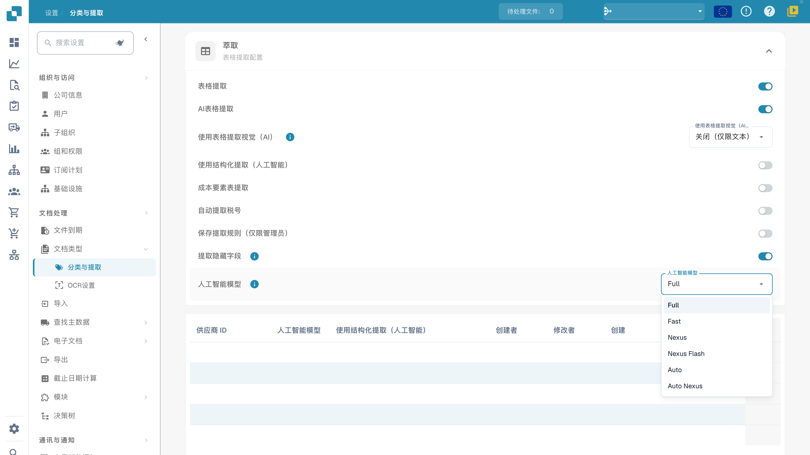

# AI 模型

## 概述

**AI 模型**设置用于定义文档处理期间默认用于**字段提取**和**表格提取**的 AI 模型。\
在本部分中，您可以查看每种模型的令牌成本，以及当前为每个供应商分配的模型。

## 如何访问

1.  前往**设置 → 文档处理 → 分类与提取**。

    <figure><figcaption>
当前中文全局提取设置的实际模型菜单：Full、Fast、Nexus、Nexus Flash、Auto 和 Auto Nexus。图中当前选中 Full；只展开菜单，未更改模型或开关。产品将税码选项误标为“税号”，此处指税码（tax code），不指纳税人识别号。
</figcaption></figure>
2.  展开提取设置并找到 **AI 模型**菜单。

## AI 模型选项

当前界面提供 **Full、Fast、Nexus、Nexus Flash、Auto、Auto Nexus** 六个选项。它们是产品级别名称；实际可用项和令牌费用以当前环境中的菜单、信息提示及订阅约定为准。不要把固定的底层模型名称或历史费用当作长期承诺。

| 选项 | 选择时应验证的内容 |
| --- | --- |
| **Full** | 用代表性复杂文档检查提取效果、处理时间和费用。 |
| **Fast** | 用日常文档比较效果与处理时间；名称不保证每份文档更快。 |
| **Nexus** | 作为替代级别，与其他选项比较同一组文档。 |
| **Nexus Flash** | 对实际文档验证速度和质量，不只根据名称判断。 |
| **Auto** | 自动选择模式；检查实际处理结果和费用。 |
| **Auto Nexus** | Nexus 系列的自动选择模式；同样需要验证结果。 |

没有针对当前提取模板设置覆盖值时，会回退到组织的全局配置；不能一概认为所有未配置的供应商都使用 Fast。截图中的全局选择是 Full。模型切换不保证必填字段、采购订单匹配、审批或导出一定成功。

## AI 模型分配表

您也可以在**验证界面**中通过供应商特定模型入口设置覆盖值。该设置按组织和当前提取模板（`tfidf_id`）保存，不应理解为无条件覆盖同一供应商的所有模板和历史文档。详细步骤见[供应商专属 AI 模型](../../../../end-user-and-partner-section/end-user-section/validation-screen/supplier-specific-ai-model-for-field-and-table-extraction.md)。

分配表汇总模板相关的提取设置。可见列随版本而异；请按当前表头检查供应商标识、模型、提取选项和审计信息：

* **Supplier ID** – 供应商的唯一标识符
* **AI Model** – 该模板条目的 AI 模型级别
* **Use Structured Extraction (AI)**（如当前版本显示）– 该条目的结构化提取设置
* **E-Text** – 指示是否启用了 E-Text 功能
* **Created By / Modified By / Created On / Modified On** – 设置条目的人员以及设置或修改时间
* **Action** – 包含删除条目的选项

### 删除条目 – 重置供应商专属设置

管理员移除条目前，应核对它对应的提取模板和其他覆盖设置。删除操作可能移除该模板条目的多项偏好，而不仅是 AI 模型：

1.  点击供应商条目旁 **Action** 列中的三点菜单，然后选择 **Delete**。

    <!-- Obsolete illustration retired: Obsolete English menu/example illustration retired; instructions remain, and no unsafely opened menu, saved rule, or completed operation is claimed. -->
2.  系统会显示确认对话框，请确认要删除该条目。

    <!-- Obsolete illustration retired: Obsolete English menu/example illustration retired; instructions remain, and no unsafely opened menu, saved rule, or completed operation is claimed. -->

删除后，该模板失去相应覆盖值，后续处理按组织配置和系统回退逻辑读取设置；同一供应商的其他模板条目可能仍有独立设置。此操作不会自动重处理历史文档。本文没有执行删除或验证删除后的提取结果。
