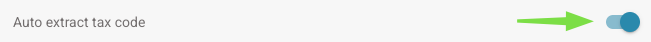
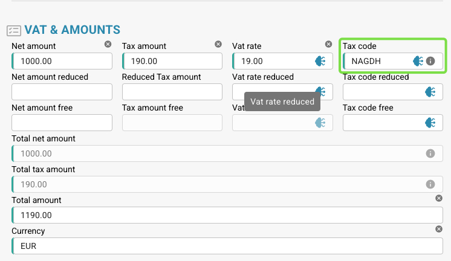

# 自动提取税码

## **在哪里启用**

1. 前往 **Settings → Document Processing → Classification and Extraction**。
2. 启用 **Auto extract tax code**。

<figure><figcaption></figcaption></figure>

## **此功能的作用**

* 启用后，只要已设置**税码字段**，系统就会在**验证界面**中**自动填充税码字段**。

<figure><figcaption></figcaption></figure>

* 下表列出了用于确定税码的逻辑。

<table data-full-width="true"><thead><tr><th>发票文档类型</th><th></th><th>税码</th><th>或在文本字段中</th><th>采购订单号</th><th>供应商所在国家/地区</th><th>规则</th></tr></thead><tbody><tr><td>费用发票</td><td>含税额</td><td>NAGDH</td><td>LD + %（按最高 ABS 金额取整）</td><td>空</td><td>可以是 TaX Id 的前两位数字 或供应商地址所在国家/地区 tccom120.cadr  -->  tccom130.cadr 字段 tcom130.ccty</td><td>当国家/地区为公司所在国家/地区时</td></tr><tr><td>费用发票</td><td>不含税额</td><td>NAGD0</td><td>LD + %（按最高 ABS 金额取整）</td><td>空</td><td>可以是 TaX Id 的前两位数字 或供应商地址所在国家/地区 tccom120.cadr  -->  tccom130.cadr 字段 tcom130.ccty</td><td>当国家/地区为公司所在国家/地区时</td></tr><tr><td>费用发票</td><td>不含税额</td><td>EUDH</td><td>ED 0 %</td><td>空</td><td>可以是 TaX Id 的前两位数字 或供应商地址所在国家/地区 tccom120.cadr  -->  tccom130.cadr 字段 tcom130.ccty</td><td>当国家/地区与公司所在国家/地区不同，且属于国家/地区表 (tcmcs010) 中的欧盟国家/地区时</td></tr><tr><td>订单发票</td><td>含税额</td><td>NAHGH</td><td>IG + %（按最高 ABS 金额取整）</td><td>非空</td><td>可以是 TaX Id 的前两位数字 或供应商地址所在国家/地区 tccom120.cadr  -->  tccom130.cadr 字段 tcom130.ccty</td><td>当国家/地区为公司所在国家/地区时</td></tr><tr><td>订单发票</td><td>不含税额</td><td>NAHG0</td><td>IG + %（按最高 ABS 金额取整）</td><td>非空</td><td>可以是 TaX Id 的前两位数字 或供应商地址所在国家/地区 tccom120.cadr  -->  tccom130.cadr 字段 tcom130.ccty</td><td>当国家/地区为公司所在国家/地区时</td></tr><tr><td>订单发票</td><td>含税额</td><td>EUGH</td><td>ED 0 %</td><td>非空</td><td>可以是 TaX Id 的前两位数字 或供应商地址所在国家/地区 tccom120.cadr  -->  tccom130.cadr 字段 tcom130.ccty</td><td>当国家/地区与公司所在国家/地区不同，且属于国家/地区表 (tcmcs010) 中的欧盟国家/地区时</td></tr><tr><td>费用发票</td><td>不含税额</td><td>IMGD</td><td>ID 0 %</td><td>空</td><td>可以是 TaX Id 的前两位数字 或供应商地址所在国家/地区 tccom120.cadr  -->  tccom130.cadr 字段 tcom130.ccty</td><td>当国家/地区与公司所在国家/地区不同，且不是国家/地区表 (tcmcs010) 中的欧盟成员国时</td></tr><tr><td>订单发票</td><td>含税额</td><td>IMHG</td><td>IG 0 %</td><td>非空</td><td>可以是 TaX Id 的前两位数字 或供应商地址所在国家/地区 tccom120.cadr  -->  tccom130.cadr 字段 tcom130.ccty</td><td>当国家/地区与公司所在国家/地区不同，且不是国家/地区表 (tcmcs010) 中的欧盟成员国时</td></tr></tbody></table>
