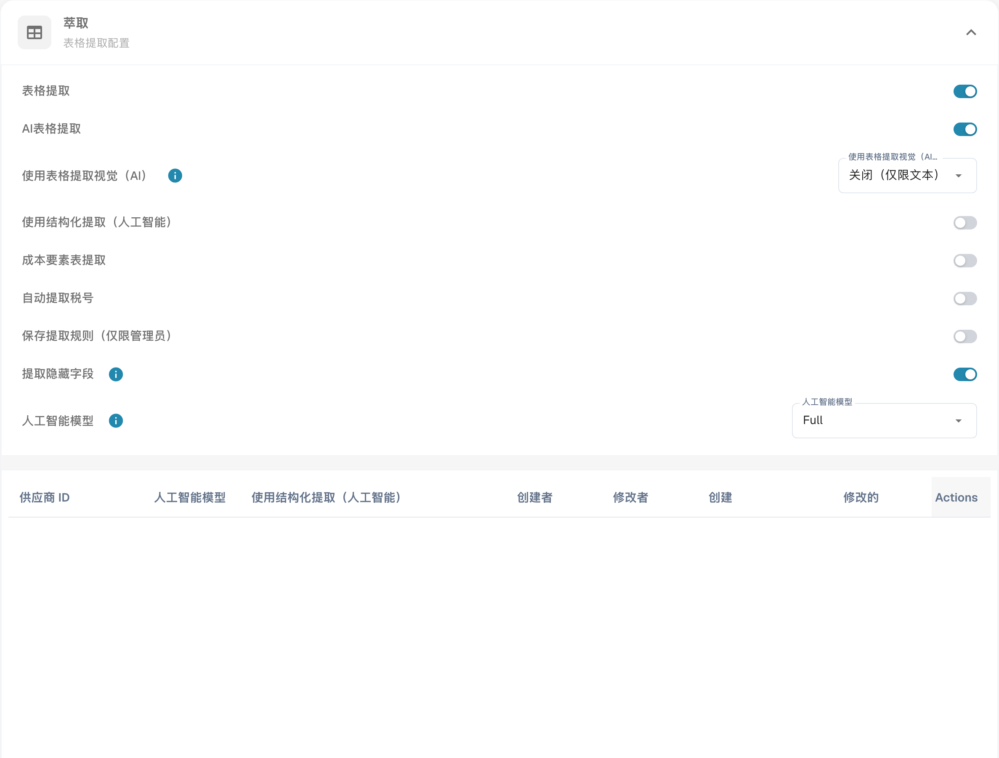

# 自动提取税码

打开文档类型的分类和提取设置，找到自动提取税码选项。启用并保存前，先检查预期配置。

<figure><figcaption>
自动提取税码的设置。 “Full”和“Actions”仍是当前界面保留的英文标签；ERP 技术代码保持原样。
</figcaption></figure>

启用功能并配置税码字段后，DocBits 可以在验证时自动填写该字段。将识别出的代码与文档及 ERP 配置比较。这里指集成使用的税码，不是个人税务身份号码。图片展示设置，并不证明已验证税码提取结果。表格保留集成示例的技术代码和规则；请检查自己组织的实际值。

<table data-full-width="true"><thead><tr><th>发票文档类型</th><th></th><th>税码</th><th>或在文本字段中</th><th>采购订单号</th><th>供应商所在国家/地区</th><th>规则</th></tr></thead><tbody><tr><td>费用发票</td><td>含税额</td><td>NAGDH</td><td>LD + %（按最高 ABS 金额取整）</td><td>空</td><td>可以是 TaX Id 的前两位数字 或供应商地址所在国家/地区 tccom120.cadr  -->  tccom130.cadr 字段 tcom130.ccty</td><td>当国家/地区为公司所在国家/地区时</td></tr><tr><td>费用发票</td><td>不含税额</td><td>NAGD0</td><td>LD + %（按最高 ABS 金额取整）</td><td>空</td><td>可以是 TaX Id 的前两位数字 或供应商地址所在国家/地区 tccom120.cadr  -->  tccom130.cadr 字段 tcom130.ccty</td><td>当国家/地区为公司所在国家/地区时</td></tr><tr><td>费用发票</td><td>不含税额</td><td>EUDH</td><td>ED 0 %</td><td>空</td><td>可以是 TaX Id 的前两位数字 或供应商地址所在国家/地区 tccom120.cadr  -->  tccom130.cadr 字段 tcom130.ccty</td><td>当国家/地区与公司所在国家/地区不同，且属于国家/地区表 (tcmcs010) 中的欧盟国家/地区时</td></tr><tr><td>订单发票</td><td>含税额</td><td>NAHGH</td><td>IG + %（按最高 ABS 金额取整）</td><td>非空</td><td>可以是 TaX Id 的前两位数字 或供应商地址所在国家/地区 tccom120.cadr  -->  tccom130.cadr 字段 tcom130.ccty</td><td>当国家/地区为公司所在国家/地区时</td></tr><tr><td>订单发票</td><td>不含税额</td><td>NAHG0</td><td>IG + %（按最高 ABS 金额取整）</td><td>非空</td><td>可以是 TaX Id 的前两位数字 或供应商地址所在国家/地区 tccom120.cadr  -->  tccom130.cadr 字段 tcom130.ccty</td><td>当国家/地区为公司所在国家/地区时</td></tr><tr><td>订单发票</td><td>含税额</td><td>EUGH</td><td>ED 0 %</td><td>非空</td><td>可以是 TaX Id 的前两位数字 或供应商地址所在国家/地区 tccom120.cadr  -->  tccom130.cadr 字段 tcom130.ccty</td><td>当国家/地区与公司所在国家/地区不同，且属于国家/地区表 (tcmcs010) 中的欧盟国家/地区时</td></tr><tr><td>费用发票</td><td>不含税额</td><td>IMGD</td><td>ID 0 %</td><td>空</td><td>可以是 TaX Id 的前两位数字 或供应商地址所在国家/地区 tccom120.cadr  -->  tccom130.cadr 字段 tcom130.ccty</td><td>当国家/地区与公司所在国家/地区不同，且不是国家/地区表 (tcmcs010) 中的欧盟成员国时</td></tr><tr><td>订单发票</td><td>含税额</td><td>IMHG</td><td>IG 0 %</td><td>非空</td><td>可以是 TaX Id 的前两位数字 或供应商地址所在国家/地区 tccom120.cadr  -->  tccom130.cadr 字段 tcom130.ccty</td><td>当国家/地区与公司所在国家/地区不同，且不是国家/地区表 (tcmcs010) 中的欧盟成员国时</td></tr></tbody></table>
