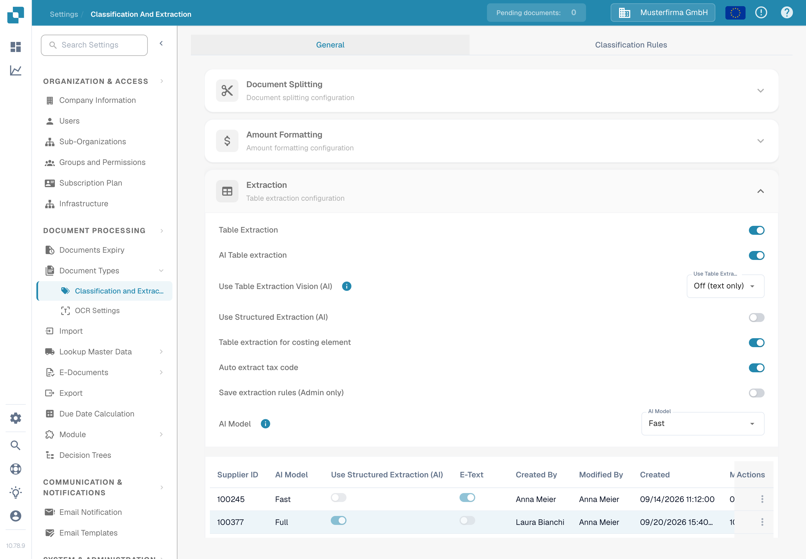

# 成本要素表格提取

成本要素是以发票表格行表示的费用或其他金额。启用此功能后，如果文档中已提取行项目，DocBits 可以根据组织配置的成本要素对这些行进行分类。审核人员可以在文档表格中更正行项目的分类。

## 启用设置

1. 打开 **设置 → 文档处理 → 分类与提取**。
2. 保持在 **常规** 页面，并展开 **提取**。
3. 在表格提取所需字段下方找到 **成本要素表格提取**。管理员可以为组织启用此开关。

<figure><figcaption>
在合成的 Test A 组织中，此开关处于关闭状态。本指南未更改此设置。
</figcaption></figure>


仅启用此开关不会创建成本要素或发票行。请先配置成本要素并导入所需数据。关联的[成本要素设置指南](../../../../infor-integration-and-configuration/importing-customer-master-data/m3/table-extraction-for-costing-element.md)介绍了 M3 示例。其他提取控制项请参阅[分类与提取](README.md)。


## 审核或更正行项目

打开一份发票表格中包含已提取行项目的文档，并查看相关行旁的成本要素图标。选择该图标以打开可用的分类选项。选择正确的已配置成本要素；如果该行是普通项目，则选择 **取消分类**。然后检查生成的行项目和总额，再保存文档。

如果缺少该图标或分类选项，请先确认文档中有已提取行项目、已启用此功能，并且组织已配置成本要素。用于本次文档检查的合成 Test A 文档没有已提取的发票行，因此无法展示或操作分类菜单。上述步骤反映了当前的文档控件；本次检查未保存任何分类。
