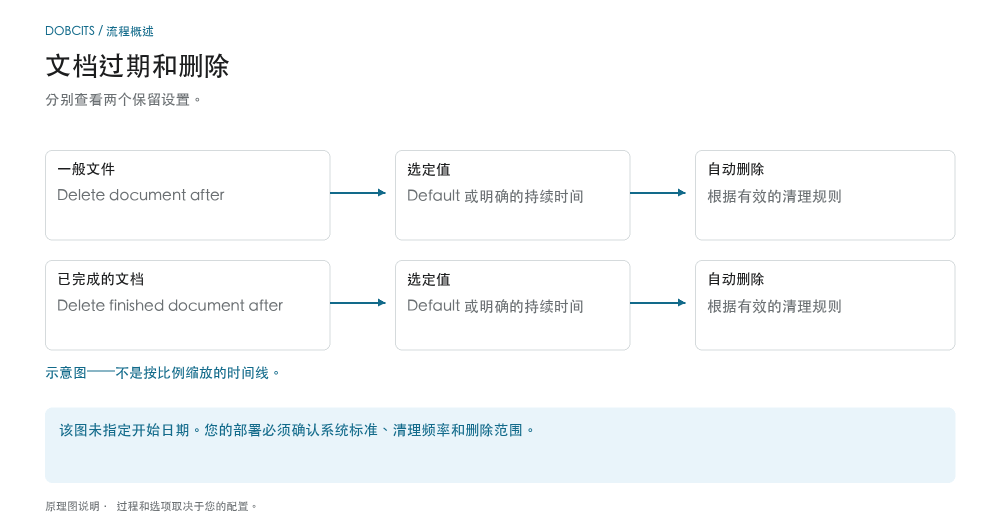
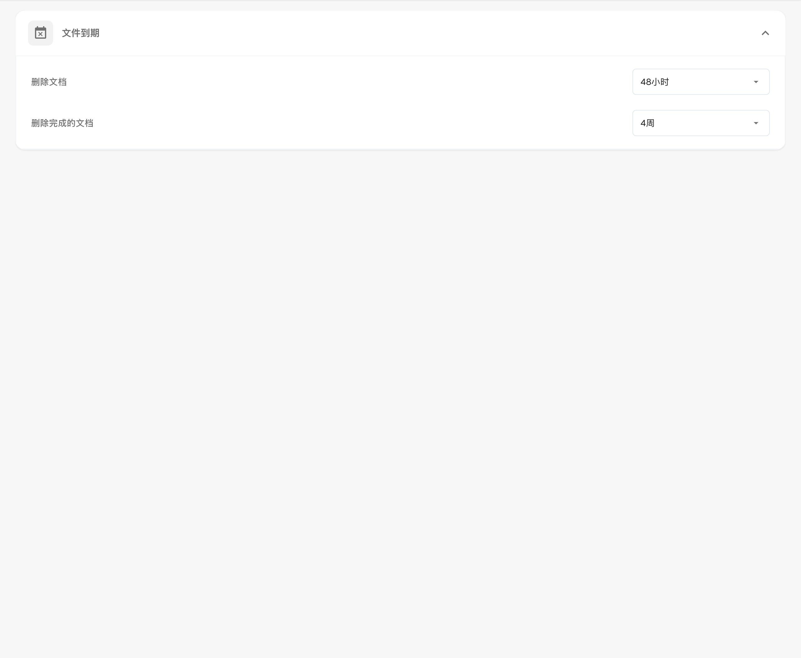

# 文档过期时间

## 两个保留规则而不是一般删除期限

<figure><figcaption>
分别查看两个保留设置。 该图是示意性的；您组织的活动设置决定了实际行为。
</figcaption></figure>

文档过期将一般文档保留与完整文档保留区分开来。检查这两个设置以及流程的要求和预期的目标归档。

| 设置 | 你应该澄清什么 |
| --- | --- |
| **Delete document after** | 哪种文档保留价值在您的组织中实际上是有效的。 |
| **Delete finished document after** | 哪个值适用于已完成、完全处理和导出的文档。 |
| **Default** | 您的部署中存储了哪个系统标准。名称本身并不表示持续时间。 |

该图**不是按比例绘制的时间线**。它既没有指定保留期的技术开始时间，也没有指定哪个设置优先。单独的下拉值并不能建立精确到秒的删除时间。为了进行可靠的规划，还要确认清理运行的频率。

### 单独的导出、保留和备份

成功导出并不证明 DocBits 副本已被删除。相反，删除 DocBits 中的文档不会删除独立存储的 ERP 或存档副本。备份可能有单独的保留规则；从实时系统中删除文档并不能证明每个备份副本已同时删除。

在进行更改之前检查截止日期，并就目标存档和备份处理达成一致。 [数据存储、保留和删除](../../../security/data-storage-and-retention.md) 概述解释了文档、OCR 中间文件、日志和备份之间的差异。

<figure><figcaption>
中文文档保留期限设置，包含一般文档和已完成文档两个独立选项；图示值仅为当前测试配置，未作更改。
</figcaption></figure>

在文档处理 → 文档过期下，配置文档保留。在更改之前检查您组织的有效设置、目标存档和删除范围。

## 两个独立选项

| 选项 | 用途 |
| --- | --- |
| **删除文档** | 设置一般文档的自动删除期限。 |
| **删除完成的文档** | 单独设置已完成文档的自动删除期限。 |

## 可选期限

| 选项 | 含义 |
| --- | --- |
| **默认** | 使用系统的默认期限，不设置自定义覆盖。 |
| **48 小时** | 明确保留值48小时；分别确认期间的开始和清理时间表。 |
| **1 周** | 明确保留值为一星期。 |
| **2 周** | 明确保留值为两周。 |
| **4 周** | 明确保留值为四个星期。 |

这些设置支持计划的文档保留。它们不能取代确认组织的有效保留期、目标归档和备份处理。
