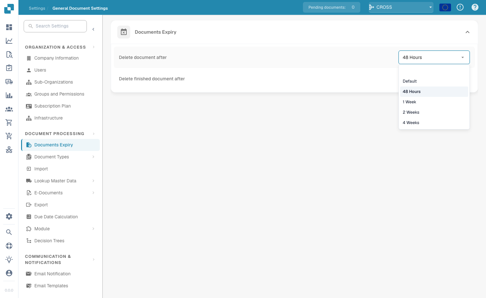

# 文档过期时间

<figure><figcaption>
文档过期时间设置
</figcaption></figure>

在 **Document Processing → Documents Expiry** 下，您可以设置 DocBits 在自动删除文档前保留文档的时长。这有助于管理存储空间、执行数据保留策略，并遵守关于文档存储时长的法律或组织规定。

以下两项设置用于控制自动删除：

| 设置 | 控制内容 |
|---------|------------------|
| **Delete document after** | 任何已处理文档在自动删除前的保留时长。 |
| **Delete finished document after** | 已完成（已完整处理并导出）文档在自动删除前的保留时长。 |

对于每项设置，您都可以从下拉菜单中选择一个时间段：

<figure><figcaption>
可用的保留期限
</figcaption></figure>

| 选项 | 含义 |
|--------|---------|
| **Default** | 使用系统默认保留期限（不进行自定义覆盖）。 |
| **48 Hours** | 在处理 48 小时后删除。 |
| **1 Week** | 一周后删除。 |
| **2 Weeks** | 两周后删除。 |
| **4 Weeks** | 四周后删除。 |

这两项设置可确保文档不会在系统中保留超过必要的时间，避免占用不必要的存储空间，并让文档工作流保持整洁。对于必须遵守特定文档保留法规要求的组织，这些设置尤为重要。
