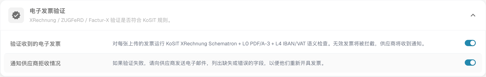
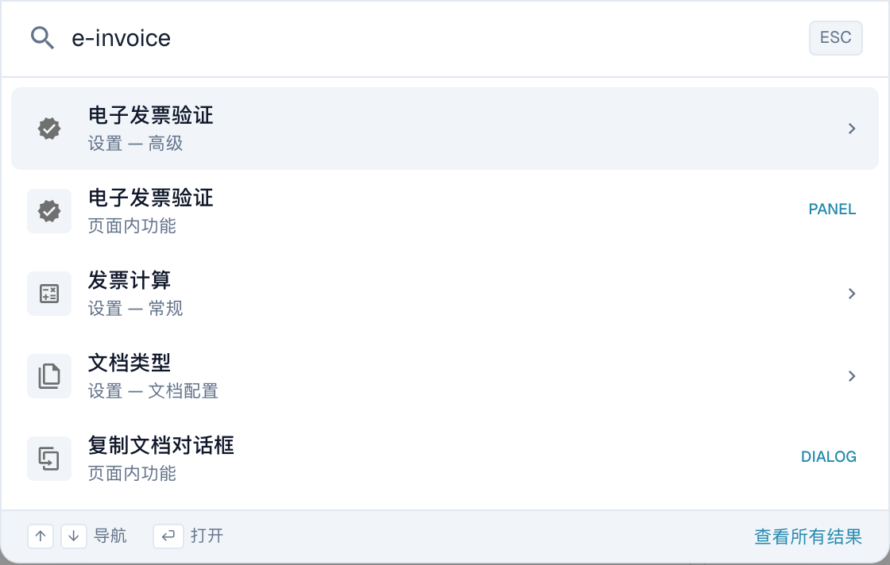

# 电子文档

DocBits 会根据官方标准——**XRechnung**、**ZUGFeRD** 和 **Factur-X**——验证收到的电子发票（e-invoice），并将发现的问题转交给相应的处理人员。**电子文档**设置组（位于**文档处理**下）包含以下页面：

* [**电子发票验证**](validation-rules/) — 选择接受哪些电子发票版本和配置文件，并为组织设置每条验证规则的严重级别。
* [**验证报告**](validation-rules/validation-report.md) — 发票未通过验证时用户会看到的内容：通俗易懂的问题说明、后续步骤，以及拒绝文档的选项。
* [**按文档类型验证**](validation-rules/validation-per-document-type.md) — 管理员可按文档类型启用验证并设置是否阻止处理，同时查看变更日志。
* [**通知路由**](notification-routing.md) — 将验证问题分配给负责处理的 AI Workforce 代理。

这些设置共同决定收到的**电子发票中哪些情况算作问题**，以及**由谁处理**。

## 启用或停用电子发票验证 

只有在**为文档类型启用电子发票验证**后，电子文档下的两个页面才会生效。开关位于文档类型本身，而不在电子文档菜单中。

前往**设置 → 文档处理 → 文档类型 → 发票 → 高级设置**，然后打开**电子发票验证**部分。

<figure><figcaption>
当前中文发票高级设置中的电子发票验证及供应商通知开关。图示是测试环境当前值；没有更改开关、验证发票或发送供应商邮件。
</figcaption></figure>

* **验证收到的电子发票** — 主开关。开启后，每张上传的发票都会根据 KoSIT XRechnung Schematron 规则以及 L0 PDF/A-3 和 L4 IBAN/VAT 语义检查进行验证，并应用[验证规则](validation-rules/)页面中设置的严重级别。是否阻断处理应结合规则严重级别和文档类型配置检查；不要将警告等同于阻断错误。关闭后，发票将完全跳过电子发票验证，电子发票验证和通知路由页面也不会生效。
* **拒绝时通知供应商** — 启用验证后显示。开启后，发票被拒绝时会向供应商发送电子邮件，列出缺失或错误的字段，以便供应商重新开具发票。每个问题由谁接收和处理，可在[通知路由](notification-routing.md)页面配置。

> 电子发票验证按**文档类型**配置。目前适用于**发票**文档类型；请在每个需要验证的文档类型上启用此功能。

也可以通过**全局快速搜索**直接跳转到此处：在 DocBits 的任意位置按 <kbd>Cmd</kbd> + <kbd>K</kbd>（Windows 和 Linux 上按 <kbd>Ctrl</kbd> + <kbd>K</kbd>），然后输入 _e-invoice_。

<figure><figcaption>
当前中文命令搜索中输入 e-invoice 后的实际结果，包含电子发票验证设置和页内功能。PANEL、DIALOG 分类标记仍为英文；这里只显示搜索结果，没有打开结果或更改设置。
</figcaption></figure>
