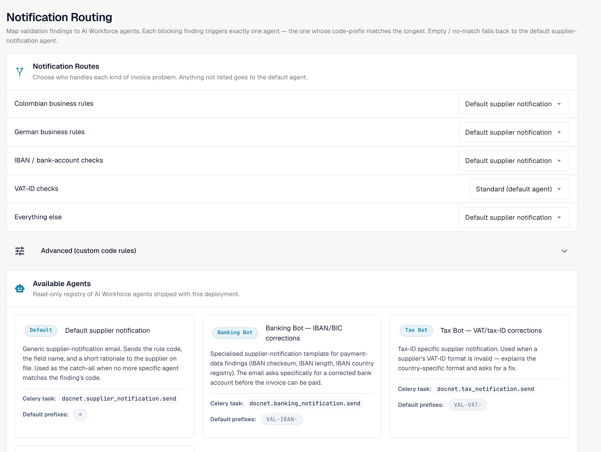
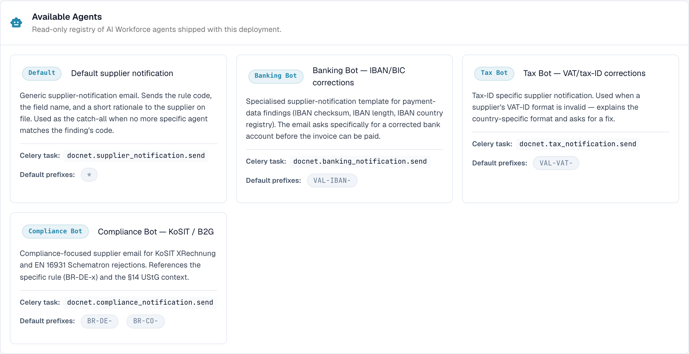

# 通知路由

<figure><figcaption>
将验证结果映射到代理
</figcaption></figure>

**通知路由**页面（**电子文档 → 操作**）用于将验证结果映射到**AI Workforce 代理**。每个阻止性结果只会触发一个代理：其代码前缀与结果匹配度最高的代理。没有匹配项时，将回退到默认供应商通知代理。

## 通知路由

选择由谁处理各类发票问题。未列出的情况将交由默认代理处理：

| 路由                          | 涵盖的结果                                      |
| ------------------------------ | ------------------------------------------------------- |
| **哥伦比亚业务规则**   | 哥伦比亚特定业务规则的验证结果。               |
| **德国业务规则**   | 德国特定业务规则的验证结果。                |
| **IBAN / 银行账户检查** | 付款数据相关的验证结果（IBAN 校验和、长度、国家/地区）。 |
| **VAT ID 检查**              | VAT/税号格式相关的验证结果。                             |
| **其他所有情况**            | 未匹配上述路由时使用的默认回退选项。    |

对于每条路由，请从下拉列表中选择处理代理。需要更精细的控制时，可使用 **高级（自定义代码规则）**，按完全匹配的结果代码进行路由。

## 可用代理

<figure><figcaption>
AI Workforce 代理的只读注册表
</figcaption></figure>

**可用代理**部分是随部署提供的 AI Workforce 代理只读注册表，例如：

| 代理                             | 用途                                                                                 |
| --------------------------------- | --------------------------------------------------------------------------------------- |
| **默认供应商通知** | 通用供应商通知电子邮件；没有更具体的代理匹配时使用的兜底选项。 |
| **银行机器人**                   | 用于付款数据相关验证结果的专用模板（IBAN/BIC 更正）。                  |
| **税务机器人**                       | 用于 VAT/税号相关供应商通知。                                              |
| **合规机器人**                | 处理合规相关的验证结果。                                                            |

每个代理都会显示其 Celery 任务，以及默认处理的结果代码前缀。
