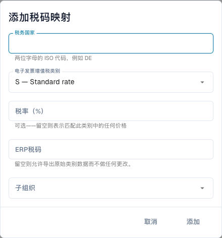

# 将电子发票税类别映射到 ERP 税码

<figure><figcaption>
保存记录前的税码映射表单。 当前界面中的部分税类别说明仍为英文，技术类别代码保持不变。税率提示中的“任何价格”实际指“任何税率”，并非发票价格。
</figcaption></figure>

电子发票可能包含 **S** 等增值税类别，而 ERP 需要具体税码。税码映射定义这种转换，与修改税额或电子发票验证规则不同。

## 前提条件

需要管理员权限、发票的税收国家、类别和税率，以及与 ERP 管理员确认的有效税码。核对组织和子组织，并确认当前版本提供此页面。

## 添加并验证

1. 打开**设置 → 电子文档 → 税码映射**，先检查现有记录。
2. 选择**添加税码映射**。
3. 输入两位 ISO 税收国家代码，例如 `DE`。
4. 选择税类别：**S** 标准税率、**Z** 零税率、**E** 免税或 **O** 税收范围之外。类别含义不同，不要为绕过错误而互换。
5. 如仅匹配特定税率，填写百分比。根据表单说明，税率留空表示匹配该类别的任何税率。
6. 填写 ERP 税码，并在适用时选择相关子组织。ERP 税码为空会明确允许原始类别不经转换直接导出，仅在目标接受该类别时使用。
7. 添加后检查已保存的国家、类别、税率、ERP 税码、适用范围和启用状态。
8. 使用代表性电子发票和受控导出目标测试，核对实际 ERP 税码和响应；还应测试映射缺失或错误的情况，确认失败处理。

例如德国发票的类别 `S`、税率 `19` 需要为该情形配置的 ERP 税码。请从实际 ERP 配置获取，不要把演示代码当成生产默认值。

## 处理错误

提示缺少映射时，对照实际国家、类别、税率、范围和启用状态。导出结果不明确时，先检查集成响应再重试。移除映射只影响后续匹配，不会撤销此前的导出。

另见[电子发票验证](validation-rules/README.md)和[导出](../export/README.md)。
