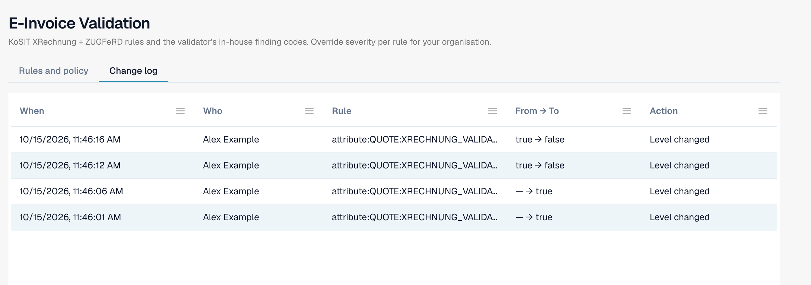

# 更改日志

**更改日志**记录验证设置的每次更改。它属于 [电子发票验证](validation-rules.md)。只有组织管理员可以查看。

打开 **更改日志** 标签页，该标签页位于 **规则和策略** 旁边。

<figure><figcaption>
更改日志中的四条示例记录。用户名已替换为示例名称。
</figcaption></figure>

| 列 | 显示内容 |
| --- | --- |
| **时间** | 更改发生的时间。 |
| **操作人** | 进行更改的用户。 |
| **规则** | 已更改的设置或规则。 |
| **从旧值 → 到新值** | 旧值和新值。 |
| **操作** | 更改类型。可以打开设置向导中的记录，查看具体更改。 |

每页显示 50 条记录。

在表格 [每种文档类型的验证](validation-per-document-type.md) 中进行的每项更改，都会在确认后生成一条记录。
