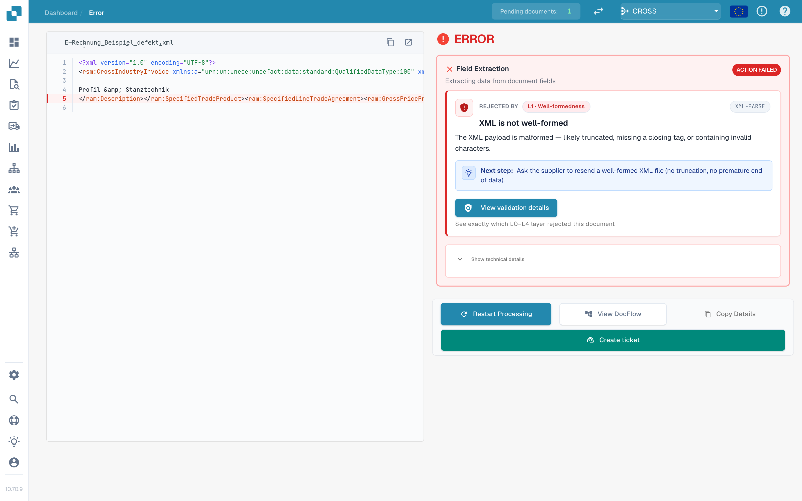
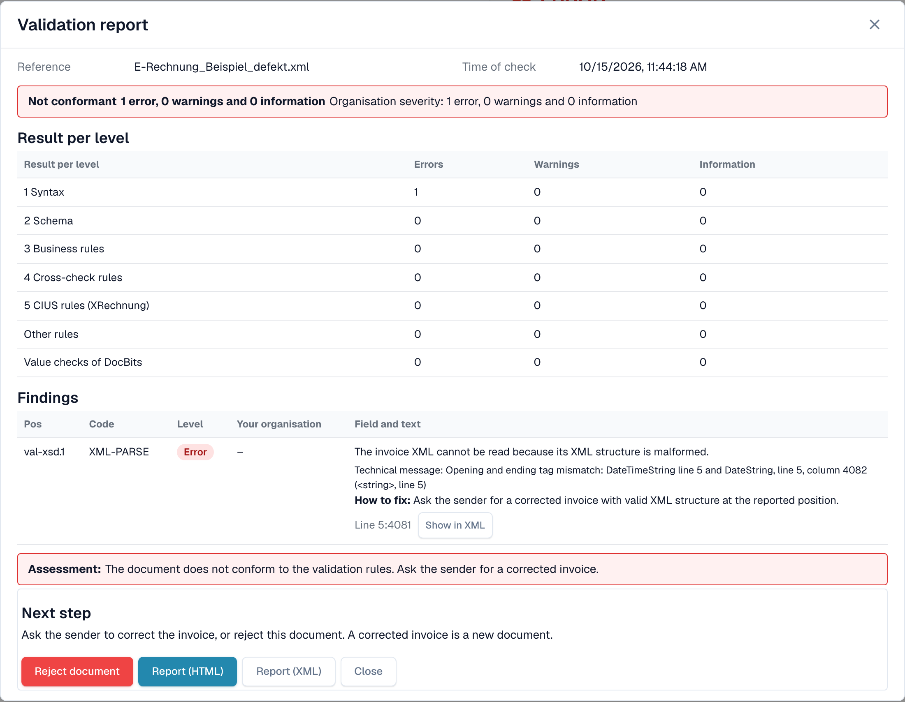

# 被拒绝的电子发票错误屏幕

上传的电子发票有误时，DocBits 不会丢弃它。文档会被标记为 **错误**，错误屏幕会告诉你问题是什么、出在哪里，以及接下来该怎么做。本页展示两个示例：格式不正确的 XML 文件，以及违反业务规则的发票。

> 只有在验证已对相应文档类型启用且设为**阻止处理**时，发票才会被标记为 **错误**。请参阅[各文档类型的验证](validation-per-document-type.md)。

## 示例 1：XML 文件已损坏

供应商发送的 XML 文件中，结束标签与开始标签不匹配。文件无法读取，因此 DocBits 会在第一项检查 **L1 · 格式良好性** 处停止。

<figure><figcaption>
XML 文件损坏时的错误屏幕。XML 中的错误行已标出。示例文件使用虚构数据。
</figcaption></figure>

屏幕分为两部分：

* **左侧：XML 文件。** DocBits 会显示带行号的文件。出问题的行会以红色标出。使用文件上方的按钮复制 XML，或在新标签页中打开。
* **右侧：说明。** **拒绝原因**卡片会显示导致文件处理停止的检查项（此处为 **L1 · 格式良好性**）和规则代码（此处为 `XML-PARSE`）。下方会显示通俗易懂的标题（*XML 格式不正确*）、简短说明和 **下一步** 区块。

选择 **查看验证详情**，打开完整的[验证报告](validation-report.md)。

<figure><figcaption>
损坏文件的报告：级别 1 语法中有一项错误，并附有技术消息和位置
</figcaption></figure>

报告会指出确切位置（此处为第 5 行、第 4081 列），并提供 XML 解析器的技术消息。选择 **在 XML 中显示** 可跳转到该行。**如何修复**提示会建议你向发送方索取更正后的文件。

## 示例 2：发票违反业务规则

XML 没有问题，但缺少必填字段。例如，发票中没有销售方标识符、注册标识符或增值税标识符，因此无法识别销售方（规则 `BR-CO-26`）。

<figure><figcaption>
业务规则错误的错误屏幕：显示层 <strong>L3 · 业务规则</strong>、规则代码和下一步
</figcaption></figure>

此处的卡片会显示层 **L3 · 业务规则** 和代码 `BR-CO-26`。报告会列出该发票的所有发现项，请参阅[验证报告](validation-report.md)。

## 卡片下方的按钮

| 按钮 | 功能 |
| --- | --- |
| **重新开始处理** | 重新处理文档，例如在你更改设置后。检查会使用当前设置。 |
| **查看 DocFlow** | 显示文档的工作流。 |
| **复制详情** | 复制错误详情，例如用于向管理员发送消息。 |
| **创建工单** | 使用错误详情创建支持工单。 |

选择卡片上的 **显示技术详情** 可查看原始技术信息。

## 接下来该怎么做

* **错误：**向发送方索取更正后的发票，或[拒绝文档](validation-next-step-and-reject.md)。更正后的发票属于新文档。
* **只有警告：**文档不会被阻止。你可以继续处理。

## 相关页面

* [验证报告](validation-report.md)：按级别列出所有发现项。
* [下一步和拒绝文档](validation-next-step-and-reject.md)
* [各文档类型的验证](validation-per-document-type.md)：启用验证并设置阻止处理。
