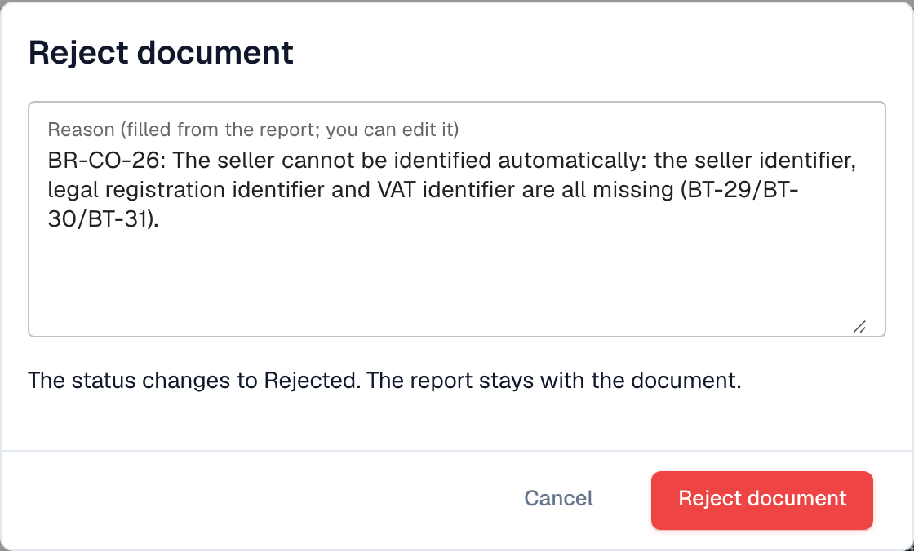

# 下一步操作与拒绝文档

阅读[验证报告](validation-report.md)后，报告会告知你该怎么做。你也可以拒绝该文档。

## 下一步操作

<figure><figcaption>
报告末尾的评估结果、下一步操作和按钮
</figcaption></figure>

**Assessment**（评估结果）用一句话说明发票是否符合要求。**Next step**（下一步）区域会告诉你该怎么做：

| 结果 | 下一步操作 |
| --- | --- |
| 至少有一项**错误** | 请发件人提供更正后的发票，或拒绝该文档。更正后的发票属于新文档。 |
| 仅有**警告** | 你可以继续处理该文档。 |

报告末尾的按钮：

* **Reject document**（拒绝文档）：打开拒绝对话框（见下文）。
* **Report (HTML)** 和 **Report (XML)**：下载报告，例如发送给供应商。
* **Close**（关闭）或 **Back to document**（返回文档）：返回该文档。

## 拒绝文档

<figure><figcaption>
拒绝原因根据报告中的错误自动填入。你可以编辑该原因。
</figcaption></figure>

1. 在报告中，选择 **Reject document**（拒绝文档）。
2. 检查 **Reason**（原因）。DocBits 会根据报告中的错误自动填入原因。你可以编辑文本。
3. 选择 **Reject document**（拒绝文档）进行确认。状态会变为 **Rejected**（已拒绝）。原因会保存为备注，报告会保留在该文档中。

选择 **Cancel**（取消）可保持文档不变。

> 只有获准编辑文档的用户才能看到 **Reject document**（拒绝文档）。如果文档已被拒绝或已完成，该按钮会隐藏。
