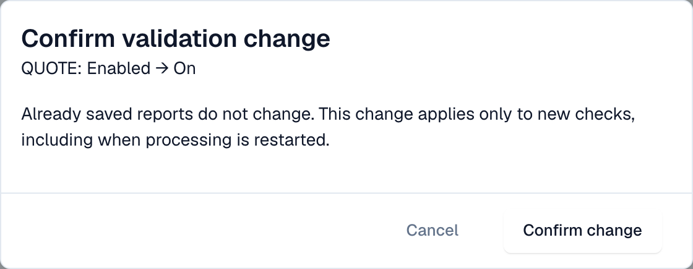

# 每种文档类型的验证

管理员可针对每种文档类型决定 DocBits 是否验证收到的电子发票，以及检查未通过时是否阻止该文档。每项更改都会经过确认并写入[更改日志](validation-change-log.md)。

> 只有**组织管理员**可以更改这些设置。其他用户只能只读查看该表，或无法看到该表。

## 表格

前往 **设置 → 电子文档 → 电子发票验证**。**规则和策略**选项卡首先显示 **每种文档类型的验证**表格。

<figure><figcaption>
每种文档类型各占一行，包含已启用和阻止开关。示例组织。
</figcaption></figure>

| 开关         | 功能                                                                                                                                                                                                         |
| ------------ | ------------------------------------------------------------------------------------------------------------------------------------------------------------------------------------------------------------ |
| **已启用**   | DocBits 会验证此文档类型的每份收到的电子发票，并保存[验证报告](validation-report.md)。                                                                                                                        |
| **阻止**     | 如果发现错误，则停止处理该文档，并将其状态设为 **错误**。关闭阻止后，DocBits 会保存报告并继续处理该文档。只有在**已启用**的情况下，才能开启**阻止**。 |

如果某种文档类型设有子类型覆盖项，表格中会显示相关说明。

## 更改设置

1. 选择要更改的开关。
2. DocBits 会显示 **确认验证更改**，其中包含文档类型和更改内容，例如 _报价：已启用 → 开启_。

<figure><figcaption>
每项更改都需要确认
</figcaption></figure>

3. 阅读说明：**已保存的报告不会更改。**此更改仅适用于新的检查，包括重新启动文档处理时执行的检查。
4. 选择 **确认更改**，或选择 **取消**以保留原设置。

如果您没有相应权限，DocBits 会提示需要组织管理员，且不会进行任何更改。

## 相关页面

* [电子发票验证](./)
* [更改日志](validation-change-log.md)
* [验证设置和接受的版本](validation-setup.md)
* [验证报告](validation-report.md)
* [启用或停用电子发票验证](../#enable-or-disable-e-invoice-validation)
