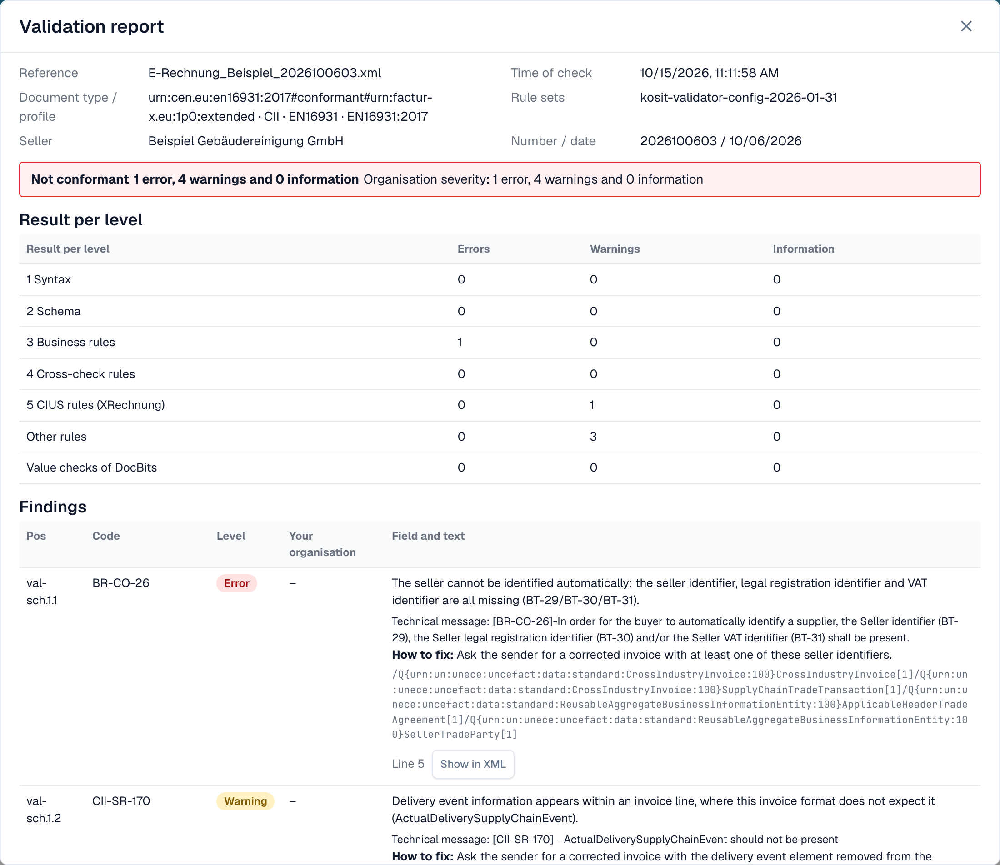
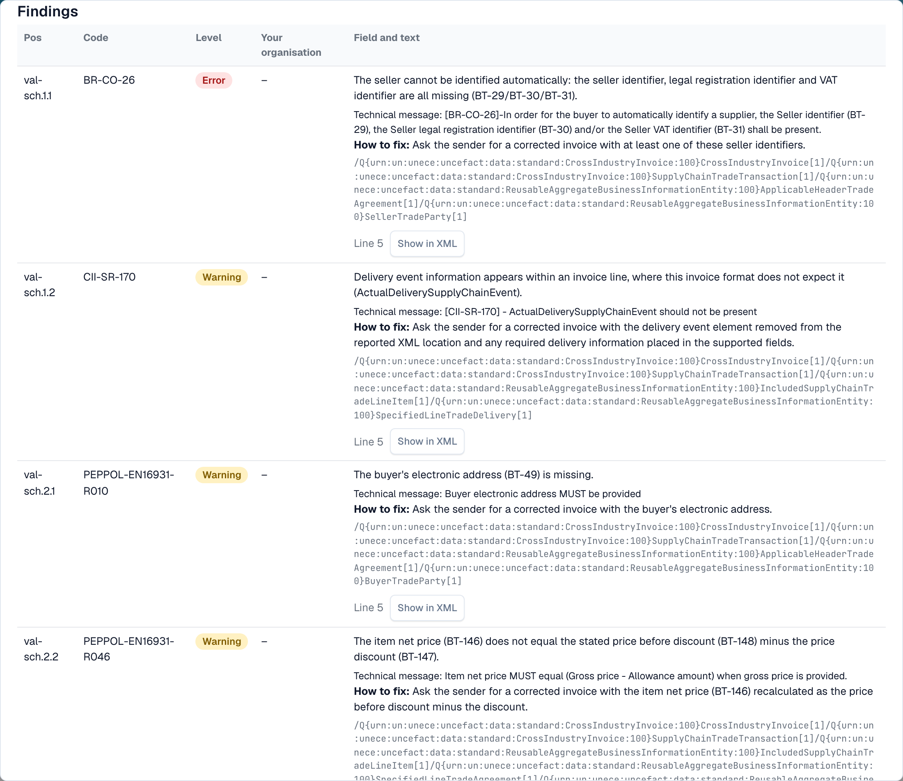

# 验证报告

当 DocBits 拒绝一张电子发票时，你可以准确了解原因。**验证报告**会以通俗易懂的语言列出每项发现，告诉你需要修正什么，并显示下一步操作。你可以从文档中打开报告，而不是从设置中打开。查找报告的界面请参阅[被拒绝电子发票的错误界面](validation-error-screen.md)。

本页面向处理发票的人员。管理员会在[电子发票验证](./)页面设置规则，并按文档类型选择检查失败时是否阻止发票，详见[各文档类型的验证](validation-per-document-type.md)。

## 文档出现错误时

如果该文档类型的验证已**启用**且设为**阻止**，那么出现阻止性发现的发票状态会变为**错误**。从仪表板打开文档。错误视图左侧显示 XML，右侧显示原因。

<figure><figcaption>
错误视图：发票 XML，以及首个阻止性发现和下一步操作。示例发票使用虚构名称。
</figcaption></figure>

右侧卡片会显示拒绝发票的层级（例如 **L3 · 业务规则**）、规则代码（例如 `BR-CO-26`）、简短说明和**下一步**。选择**查看验证详情**以打开完整报告。

## 阅读报告

<figure><figcaption>
报告顶部：文件数据、判定结果和各级别的结果
</figcaption></figure>

报告开头列出文件信息：

| 字段                       | 显示内容                                                     |
| --------------------------- | ----------------------------------------------------------------- |
| **引用**               | 发票的文件名。                                     |
| **检查时间**           | DocBits 执行检查的时间。已保存的报告之后不会改变。 |
| **文档类型 / 配置文件** | 发票的格式，例如 CII 和 EN 16931。          |
| **规则集**               | DocBits 使用的规则集版本。                   |
| **卖方**                  | 从 XML 中读取的卖方。                                    |
| **编号 / 日期**           | 从 XML 中读取的发票编号和发票日期。       |

文件信息下方会显示**判定结果**，例如**不符合规范**，并列出错误、警告和信息消息的数量。如果你的组织更改了某条规则的严重级别，第二行**组织严重级别**会显示应用组织设置后的数量。

### 各级别的结果

**各级别的结果**表格会显示每项检查发现的错误、警告和信息消息数量。各项检查逐级进行：

| 级别                        | 检查内容                                          |
| ---------------------------- | ------------------------------------------------------- |
| **1 语法**                 | XML 格式良好。                                 |
| **2 架构**                 | 结构符合官方 XML 架构。          |
| **3 业务规则**         | 必填字段齐全且正确（规则 `BR-…`）。 |
| **4 交叉检查规则**      | 字段之间相互一致，例如金额合计。         |
| **5 CIUS 规则（XRechnung）** | XRechnung 的附加德国规则。                  |
| **其他规则**              | 其他规则，例如 PEPPOL 规则。            |
| **DocBits 值检查**  | DocBits 添加的检查，例如 IBAN 和 VAT ID。  |

> 对于使用 EN 16931 或 EXTENDED 配置文件的发票，XRechnung 专用规则会显示为**警告**，而非错误。

## 检查发现

<figure><figcaption>
每项发现都包含代码、级别、易读的说明以及修正提示
</figcaption></figure>

每项发现占一行：

* **位置**和**代码**：报告中的位置和规则代码，例如 `BR-CO-26`。
* **级别**：**错误**、**警告**或**信息**。
* **你的组织**：应用组织设置后的级别。短横线表示你的组织未更改该级别。
* **字段和文本**：用通俗语言说明问题、指出相关字段（例如 _BT-29 卖方标识符_）、显示验证器的技术消息，并提供**修正方法**。
* **行**和**在 XML 中显示**：选择**在 XML 中显示**以关闭报告，并跳转到 XML 查看器中的相应行。

DocBits 为最常见的规则提供通俗易懂的说明。如果某条规则没有此类说明，报告会显示验证器的技术消息。

## 下一步

* [下一步操作并拒绝文档](validation-next-step-and-reject.md)：阅读报告后要采取的操作。

## 相关页面

* [电子发票验证](./)：受支持的版本、配置文件以及各条规则的严重级别。
* [各文档类型的验证](validation-per-document-type.md)：启用验证并设置阻止选项。
* [通知路由](../notification-routing.md)：由谁处理各项发现。
