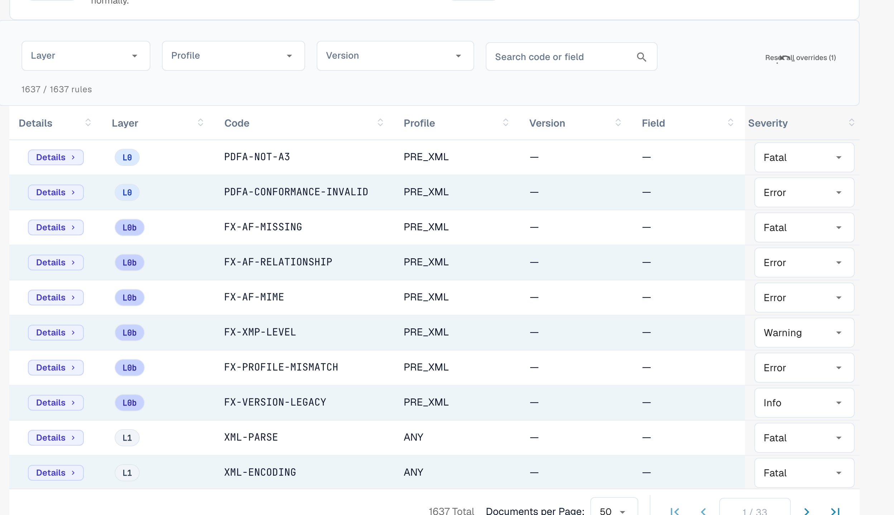

# 规则严重性

每条验证规则都有一个严重性级别。您可以更改组织中每条规则的严重性。本页面属于 [电子发票验证](./)。只有组织管理员可以更改严重性。

<figure><figcaption>
包含每条规则严重性覆盖设置的完整规则表
</figcaption></figure>

规则表列出了所有验证规则（总计超过 1,600 条）。您可以按 **Layer**、**Profile** 或 **Version** 筛选，也可以按代码或字段搜索。对于每条规则，您都可以通过下拉菜单覆盖 **Severity**，使其符合组织的政策——例如，将规则从 `ERROR` 调低为 `WARNING`，这样该规则就不会再拒绝文档。

[FATAL]、[ERROR]、[WARNING] 和 [INFO] 的含义请参阅[验证设置和接受的版本](validation-setup.md#accepted-profiles-and-severity-model)。更改后的严重性也会显示在[验证报告](validation-report.md)的 **Your organisation** 列中。
