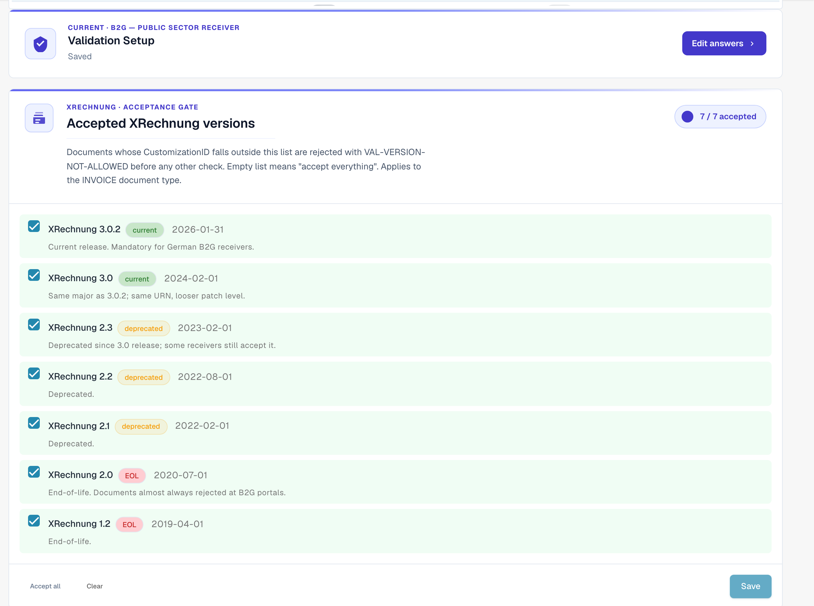

# 验证设置和接受的版本

本页介绍设置向导、接受的 XRechnung 版本，以及 [电子发票验证](validation-rules.md) 页面中接受的配置文件。只有组织管理员可以更改这些设置。

## 验证设置

<figure><figcaption>
验证设置和接受的 XRechnung 版本
</figcaption></figure>

**验证设置**卡片显示当前的验证配置文件（例如 *B2G — 公共部门接收方*）。点击 **编辑答案** 可重新运行设置向导，并更改要依据哪个标准进行验证。

## 接受的 XRechnung 版本

**接受的 XRechnung 版本**开关列表列出了所有 XRechnung 版本。勾选要接受的版本——CustomizionID 不在此列表中的文档会在执行其他任何检查之前被拒绝，并返回 `VAL-VERSION-NOT-ALLOWED`。列表为空表示“全部接受”。每个版本都会标注 **当前**、**已弃用**或 **生命周期结束（EOL）**，并显示其发布日期。

## 接受的配置文件和严重性模型 

<figure><figcaption>
接受的配置文件以及各严重性级别的含义
</figcaption></figure>

使用 **全部接受** / **清除** 选择要接受的**配置文件**（BASIC WL、BASIC、EN 16931 / COMFORT、EXTENDED、XRECHNUNG (CIUS)），然后点击 **保存**。

每条验证规则都有一个**严重性**，用于决定规则触发时的处理方式：

| 严重性 | 影响 |
|----------|--------|
| **FATAL** | 立即停止处理。不再检查后续层；文档进入错误状态。 |
| **ERROR** | 拒绝该文档。仍会显示同一文档上的其他发现；如果启用了供应商通知，则会触发通知。 |
| **WARNING** | 在验证报告中显示，但文档仍按正常流程继续处理。 |
| **INFO** | 仅记录在审计日志中。不会影响用户，也不会拒绝文档。 |

### 向导会更改什么

页面下方的**验证设置**卡片会打开一个包含 **编辑答案** 的向导。该向导会替换组织的整套规则覆盖项。保存前，DocBits 会向你发出警告。请仔细检查 **审核并应用** 步骤。

下一页：[规则严重性](validation-rule-severities.md) 和 [各文档类型的验证](validation-per-document-type.md)。
