# 导入

<figure>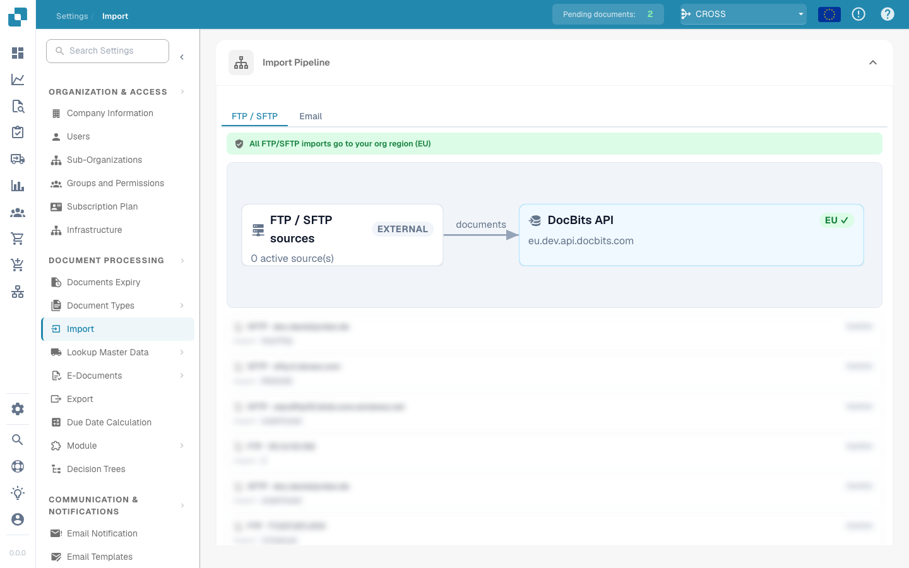<figcaption>
导入设置页面
</figcaption></figure>

## 概述

在 **导入** 设置中，您可以配置文档专属的导入选项，也可以通过 FTP 或电子邮件设置自动导入。本页详细介绍了所有可用设置。

## 如何访问

1.  前往 **设置** -> **文档处理** -> **导入**

    <figure><figcaption></figcaption></figure>

## **文档设置**

* **限制页数**：此设置可限制每份文档的处理页数。默认值为 **60 页**，也就是说，超过此限制的文档会被截断至 **60 页**，**其余页面将被丢弃。**
* **付款期限天数**：定义可应用于文档的默认付款期限（天数）。
* **日期格式**：设置导入文档中日期的识别和格式化方式。

<figure>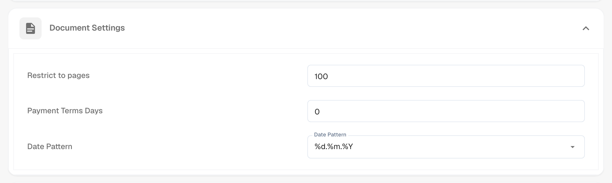<figcaption></figcaption></figure>

## **FTP 导入**

### 要求

要使用 FTP 自动导入数据，请确保满足以下要求：

* 已正确配置且兼容 Linux 的 FTP 服务器
* FTP 主机名、用户名和密码
* 专用导入文件夹

### 添加新连接

1.  要添加新连接，请点击 FTP 区域中的 **添加** 按钮。

    <figure>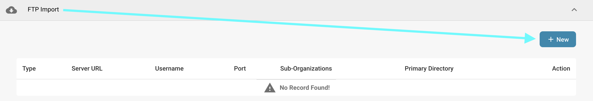<figcaption></figcaption></figure>
2.  在指定字段中输入 FTP 凭据。API Key 字段会自动填充。

    * **类型：**指定要使用的 FTP 协议。您可以选择 **FTP**、**FTPS** 或 **SFTP**。
    * **端口：**指定所选 FTP 协议要使用的端口号。
    * **服务器名称（必填）：**用于获取文档的服务器地址。
    * **用户名（必填）：**用于访问 FTP 服务器的登录名。
    * **密码（必填）：**与用户名关联、用于访问 FTP 服务器的密码。
    * **文件名匹配模式：**指定根据文件名导入哪些文件。
    * **子组织：**选择此 FTP 导入适用的子组织。
    * **API Key（必填）：**此字段会根据您当前登录的组织自动填充。
    * **主目录：**指定 FTP 服务器上用于导入文件的目录。
    * **导入目录：**指定主目录下用于导入文件的子目录。
    * **导入后归档：**允许您在导入后归档文件。启用后，您可以指定成功导入后文件要移至的目录。
    * **包含子文件夹中的文件：**启用后，系统也会在主目录下的子目录中查找待导入文件。

    <figure>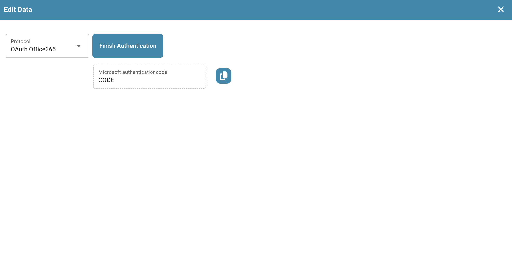<figcaption></figcaption></figure>
3. 输入所有必要的 FTP 连接信息后，点击 **保存**。
4. 保存连接后，点击该连接 **操作** 列中的三个点，然后选择 **激活**，即可启用连接。

### FTP 操作

点击 **操作** 列中的三个点，可以访问以下连接选项：

<figure>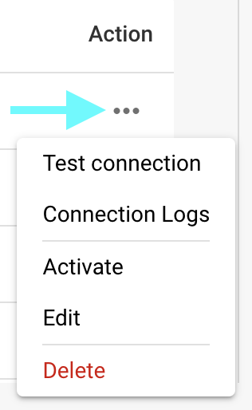<figcaption></figcaption></figure>

* **测试连接：**测试与 FTP 服务器的连接。
* **连接日志：**打开 FTP 连接日志；如果发生问题，日志中会显示错误消息。
* **激活/停用：**激活或停用连接。
* **编辑：**修改连接。
* **删除：**删除连接。

## **电子邮件导入** 

您可以设置电子邮件导入，在邮件到达收件箱后自动导入其中的文档。您可以选择配置 IMAP 或 OAuth 连接。

<mark style="color:red;">**注意**</mark>：仅导入以下文件类型的文档：

* `.pdf`
* `.tiff` / `.tif`
* `.eml`
* `.dat`
* `.xml`
* `.edi`
* `.purchaseorder`


**如何识别附件**

除了上述文件扩展名外，DocBits 还会根据文档的**实际文件内容**（文件签名）识别文档，而不只是依赖发送邮件系统声明的内容类型。这对于**转发的**邮件尤其重要：中间邮件服务器或网关经常会将附件重新标记为通用类型（`application/octet-stream`），而不是例如 `application/pdf` 或 `application/xml`。DocBits 仍可正确识别并导入此类附件。

* **转发的 `.eml`** 邮件和 Outlook **`winmail.dat`**（TNEF）附件会被解包，其中的文档也会被导入。
* **XML 编码：**如果 XML 发票被重新标记为通用类型（`application/octet-stream`），DocBits 会根据其 `<?xml` 声明识别该文件，并容许文件开头带有 **UTF-8** 或 **UTF-16**（LE/BE）字节顺序标记（BOM）——目前只会根据内容自动检测这些 BOM 编码。保留 `.xml` 文件名的附件无论采用何种编码都会被导入。
* **忽略的文件：**邮件中附带的内嵌图片（签名徽标或嵌入的图形文件，如 PNG、JPG、GIF、BMP）会被静默跳过，且**不会**计为导入失败。

如果附件无法导入，且已为入站地址启用 **“Reply to this email if import can not be done”** 选项，系统会通知已配置的回复地址。


### 添加新的 IMAP 连接

1.  要添加新的 IMAP 连接，请点击 **电子邮件导入** 区域中的 **添加** 按钮。

    <figure>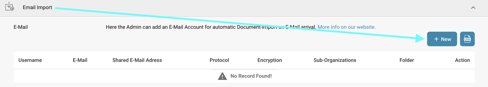<figcaption></figcaption></figure>
2. 选择 IMAP 作为协议。
3. 在指定字段中输入电子邮件凭据。API Key 字段会自动填充。
   * **加密：**选择要使用的加密类型：**SSL** 或 **TLS**。
   * **服务器名称：**电子邮件服务器的地址。
   * **用户名：**在 DocBits 中用于标识邮件导入配置的名称。
   * **电子邮件：**用于向系统导入文档的电子邮件地址。
   * **密码：**与所提供电子邮件地址关联的密码。
   * **子组织：**选择此电子邮件导入适用的子组织。
   * **API Key：**此字段会根据您当前登录的组织自动填充。
   * **将导入错误通知发送至此电子邮件地址：**指定接收导入过程中错误通知的电子邮件地址。
   * **端口：**指定所选电子邮件导入配置要使用的端口号。
   * **文件夹：**选择用于导入文档的文件夹。\
     <mark style="color:red;">**注意**</mark>：只有成功创建 IMAP 连接后，**文件夹**选项才会显示。创建后要添加文件夹，请点击 **操作** 列中的三个点，然后选择 **编辑**。此时该选项应会显示。
   * **将邮件移至其他文件夹：**启用后，可以指定成功导入后要将邮件移至的文件夹。\
     <mark style="color:red;">**注意**</mark>：只有成功创建 IMAP 连接后，**将邮件移至其他文件夹**选项才会显示。要启用此设置，请点击 **操作** 列中的三个点，然后选择 **编辑**。此时该选项应会显示。
   * **合并附件文档：**将多个附件合并为一份文档。
   * **导入后向发件人发送电子邮件：**导入完成后，向原始发件人发送确认邮件。启用后，您可以指定邮件的主题和正文。
   * **阻止导入重复文件名：**如果已存在同名文档，则阻止导入。
4. 保存连接后，点击该连接 **操作** 列中的三个点，然后选择 **激活**，即可启用连接。

### IMAP 操作

点击 **操作** 列中的三个点，可以访问以下连接选项：

<figure>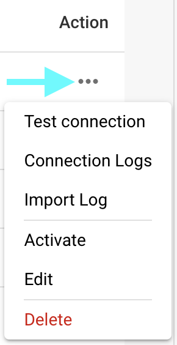<figcaption></figcaption></figure>

* **测试连接：**测试与 IMAP 客户端的连接。
* **连接日志：**打开电子邮件连接日志，其中包含过程中出现的错误消息。
* **导入日志：**打开相应连接以往导入记录的日志，其中包含过程中出现的错误消息。
* **激活/停用：**激活或停用连接。
* **编辑：**修改连接。
* **删除：**删除连接。

### 添加新的 OAuth Office365 连接

1.  要添加新的 OAuth Office365 连接，请点击 **电子邮件导入** 区域中的 **添加** 按钮。

    <figure><figcaption></figcaption></figure>
2.  选择 **OAuth Office365** 作为协议，然后点击 **Authenticate**。

    <figure>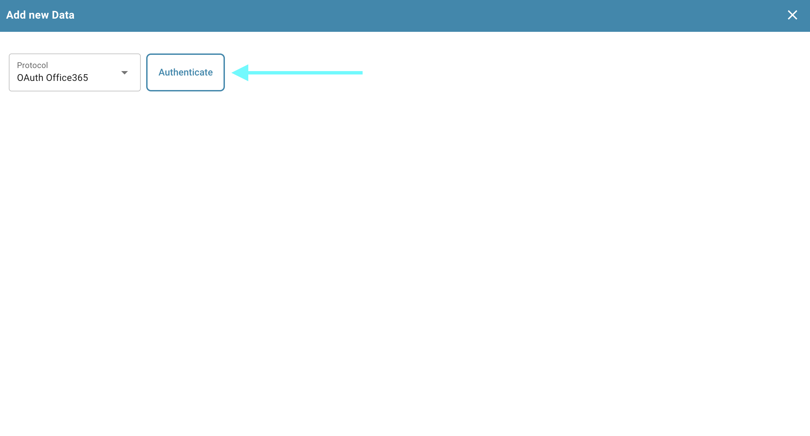<figcaption></figcaption></figure>
3.  您将被重定向到 Microsoft 页面，系统会要求您输入代码。要获取代码，请返回 DocBits，代码会显示在那里，如下图所示。复制代码并在 Microsoft 页面中输入。随后，系统会提示您输入 Microsoft 凭据。

    <figure><figcaption></figcaption></figure>
4. 按照 Microsoft 页面上的步骤操作。完成后，返回 DocBits 并点击 **Finish Authentication**。
5.  您现在可以配置以下设置：

    * **子组织：**选择此电子邮件导入适用的子组织。
    * **使用文件夹：**选择用于导入文档的文件夹。
    * **使用共享邮箱：**指定要从中导入文档的共享电子邮件地址。
    * **将邮件移至其他文件夹：**指定成功导入后要将邮件移至的文件夹。
    * **将导入错误通知发送至此电子邮件地址：**指定接收导入过程中错误通知的电子邮件地址。

    <figure>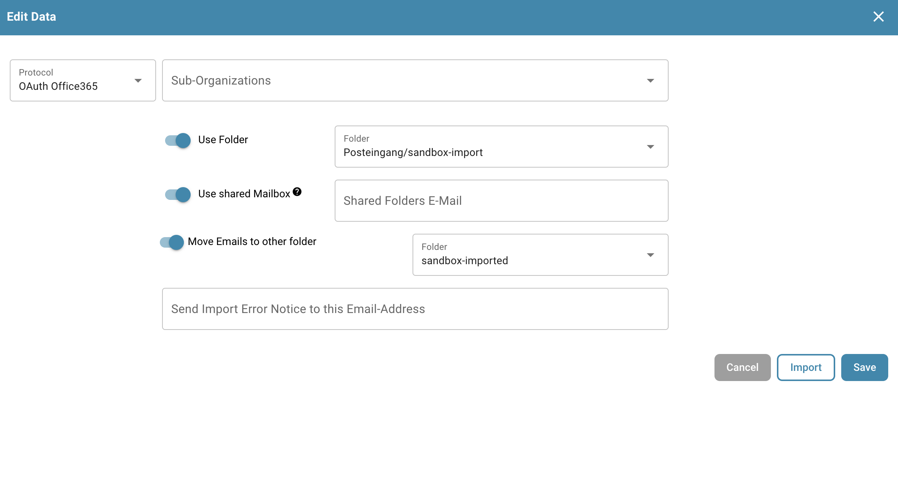<figcaption></figcaption></figure>
6. 配置所需行为后，您可以点击 **Import** 开始导入电子邮件，或点击 **Save** 保存更改。
7. 保存连接后，点击该连接 **操作** 列中的三个点，然后选择 **激活**，即可启用连接。

### OAuth Office365 操作

点击 **操作** 列中的三个点，可以访问以下连接选项：

<figure>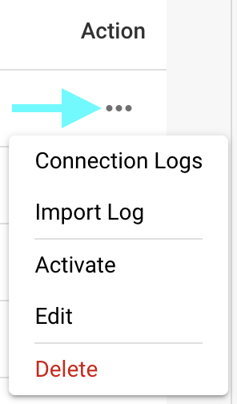<figcaption></figcaption></figure>

* **连接日志：**打开电子邮件连接日志，其中包含过程中出现的错误消息。
* **导入日志：**打开相应连接以往导入记录的日志，其中包含过程中出现的错误消息。
* **激活/停用：**激活或停用连接。
* **编辑：**修改连接。
* **删除：**删除连接。

### 导入日志

点击电子邮件导入区域右上角的 **导入日志** 按钮，即可查看所有已创建电子邮件连接的导入日志，其中包含过程中出现的错误消息。

<figure>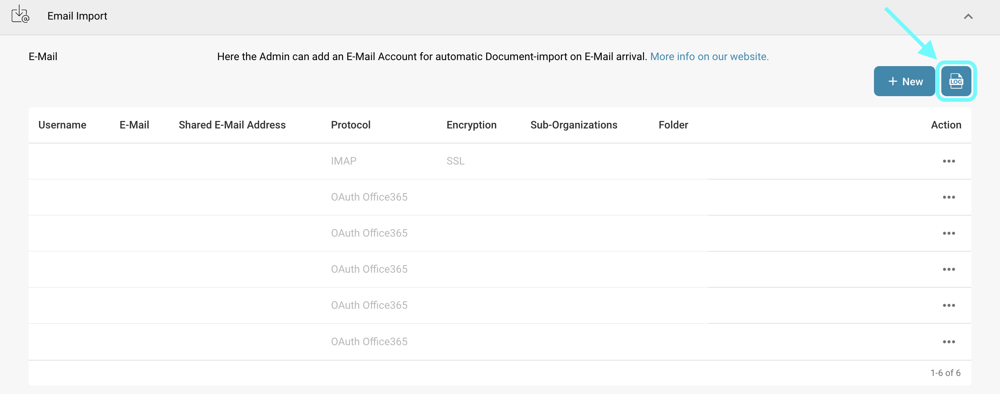<figcaption></figcaption></figure>

您可以按主题或发件人筛选日志，点击列标题可按升序或降序排列列，也可以通过拖放重新排列列。
