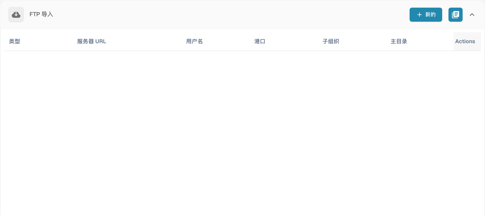
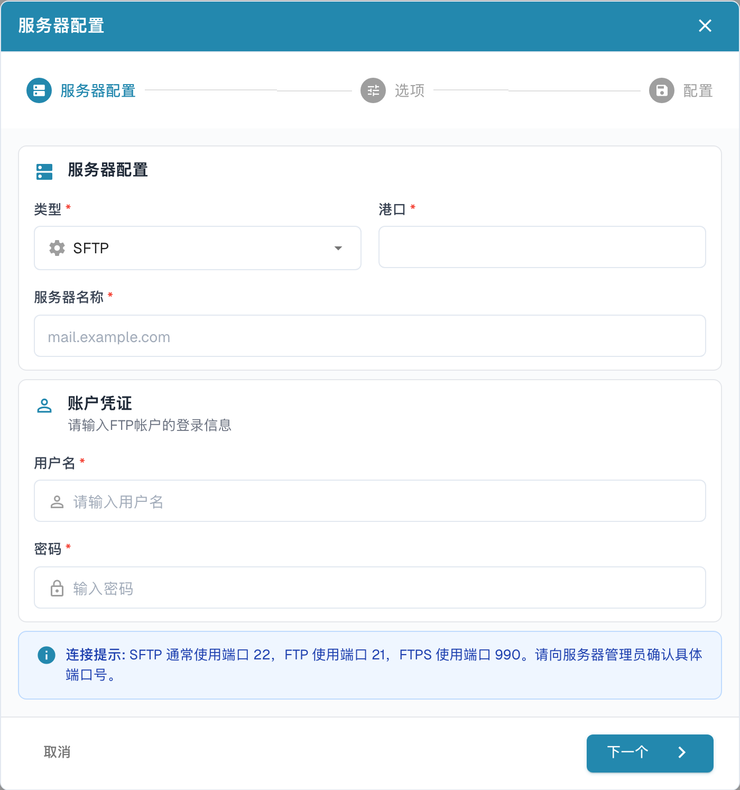
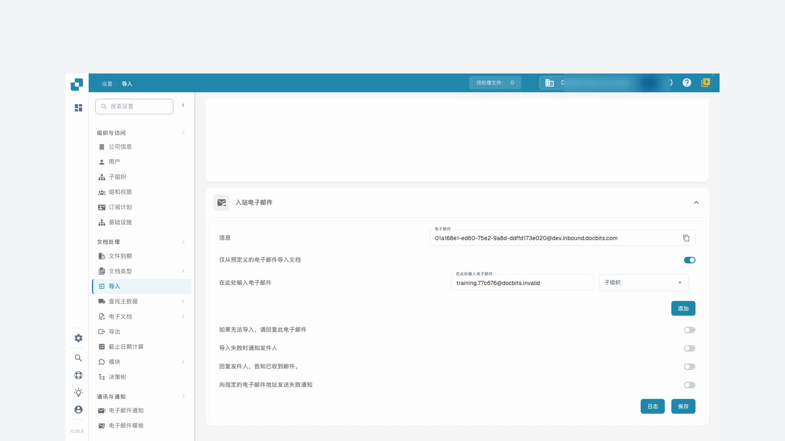
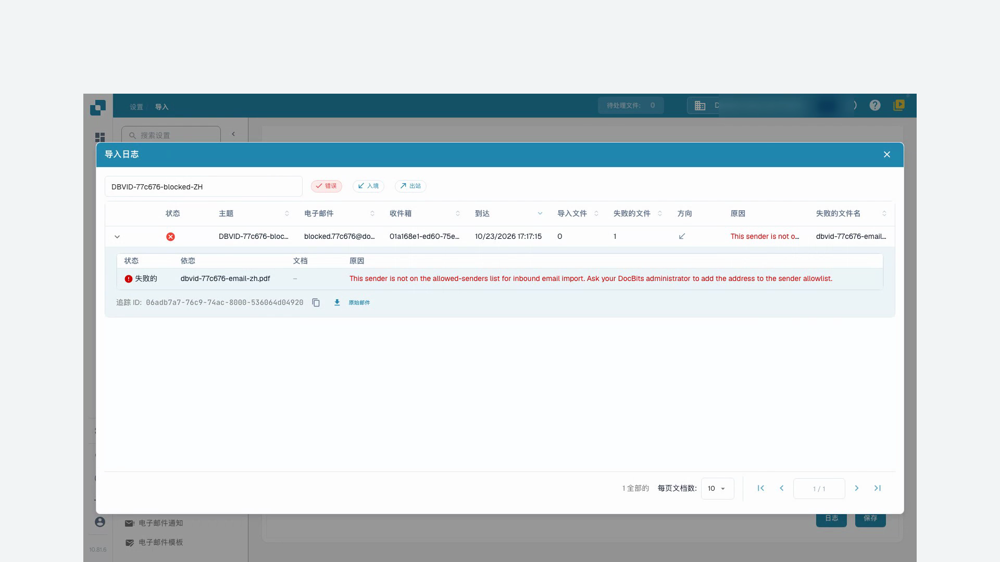

# 导入

导入设置用于确定文档的处理方式，并通过 FTP 或电子邮件自动接收文档。打开 **设置 → 文档处理 → 导入**。

## 文档选项

检查页数限制、默认付款期限天数及日期格式。超过配置上限的页面可能被丢弃。此功能记录的默认值为 60 页；导入前请确认自己组织的配置。

## FTP 导入

需要兼容的 FTP 服务器、获准的连接信息，以及服务器账户可访问的专用导入文件夹。

<figure><figcaption>
FTP 导入连接概览。 “Actions”列尚未翻译；连接信息保持空白。
</figcaption></figure>

### 配置连接

新建连接。向导从服务器配置开始，然后进入选项和导入配置。

<figure><figcaption>
FTP 导入向导中的服务器配置。
</figcaption></figure>

| 设置 | 含义 |
| --- | --- |
| 协议和端口 | 选择 FTP、FTPS 或 SFTP，以及服务器管理员确认的端口。 |
| 服务器和凭据 | 服务器地址及获准读取导入文件夹的账户。 |
| 文件名模式 | 仅导入文件名匹配的文件。 |
| 子组织 | 确定导入文档的归属。 |
| API 密钥 | 如果配置显示此项，密钥必须对应正确组织。不要公开其值。 |
| 主文件夹和导入文件夹 | 指定服务器上文件的位置。 |
| 导入后归档 | 将成功导入的文件移到指定归档文件夹。账户需要相应权限。 |
| 包含子文件夹 | 将文件搜索扩展到下级文件夹。 |

保存前检查向导的所有步骤。保存后，单独确认连接是否已启用。可用操作包括测试连接、查看日志、启用、停用、编辑和删除。开始常规导入前，先查看测试结果和日志。图片展示连接列表和未保存的向导第一步，不代表服务器连接已验证。

## 邮件导入 {#email-import}

邮件连接通过 IMAP 或 Microsoft365 OAuth 从自有邮箱获取文档。转发到 DocBits 提供的地址是另一种方式，参阅[入站邮件](../module/inbound-emails.md)。

### 支持的附件

可导入的文档类型包括 `.pdf`、`.tiff` / `.tif`、`.eml`、`.dat`、`.xml`、`.edi` 和 `.purchaseorder`。

除邮件服务器声明的类型外，DocBits 还会按实际内容识别文档。例如转发附件可能被标记为通用 `application/octet-stream`，而非 `application/pdf` 或 `application/xml`。

* 转发的 `.eml` 邮件及 Outlook `winmail.dat`（TNEF）附件会被解包，以导入其中的文档。
* 通用类型的 XML 可通过 `<?xml` 声明识别，支持开头的 UTF-8 或 UTF-16（LE/BE）BOM。目前仅这些 BOM 编码可按内容自动检测。文件名以 `.xml` 结尾时，可以不依赖编码导入。
* 邮件内嵌图片，例如签名标志及 PNG、JPG、GIF、BMP 图片，会被忽略，不计为导入失败。
* 如果入站地址启用了导入失败回复，通知会发送到配置的回复地址。

### IMAP 连接

在邮件导入区域创建连接并选择 IMAP。检查 SSL 或 TLS 加密、服务器、端口、配置名称或用户名、邮件地址及密码。选择子组织和错误通知地址。如果显示 API 密钥，确认组织上下文。

连接创建后，可以选择邮箱文件夹，以及将处理完的邮件移到另一文件夹。如果暂时没有这些选项，打开已保存的连接进行编辑。根据配置，还可以合并附件文档、向发件人发送确认，以及阻止重复文件名导入。启用前检查确认邮件的主题和内容。

保存和启用是不同操作。连接菜单可能提供连接测试、连接日志、导入日志、编辑、启用、停用和删除。

### Office365 OAuth

新建邮件连接并选择 OAuth Office365，启动 Microsoft 身份验证。如果出现设备代码，将 DocBits 中的代码复制到指定的 Microsoft 页面，并登录正确账户。返回 DocBits 完成身份验证。

检查子组织、文件夹、可选共享邮箱、已处理邮件的目标文件夹及错误通知地址。如果提供相关选项，还应确认文档路由到 DocBits 还是 AI Workforce。保存配置，并明确决定何时启用或开始导入。OAuth Office365 – Tenant 方式需要组织的应用注册信息；请与管理员确认，并参阅[入站邮件](../module/inbound-emails.md)。

### 导入日志

连接日志用于调查通信问题；导入日志显示过去的导入结果。邮件区域的汇总日志涵盖已配置的连接。可以按主题或发件人筛选，按列标题排序，以及调整列顺序。再次导入前，请先调查日志消息。

## 视频教程: 收件箱与错误排查

人物与声音均为合成。录屏展示真实的 DocBits 测试界面，使用合成培训发票。


收件箱与错误排查


[查看带字幕和章节的视频](https://docbits-videos.fra1.cdn.digitaloceanspaces.com/settings-assistant/email-import-admin/v2/zh.html)

部分产品原生标签可能仍为其他语言。技术字段标识符保持不变。

在设置和导入下，我在此示例中使用DocBits的入站地址。直接连接的邮箱是一种独立的导入方法。在本次培训中，我在一个专属的演示组织中使用合成发票进行操作。通知保持关闭状态。

首先，我检查显示的接收地址和范围。该地址完全属于这个组织及其环境。对于其他公司或生产环境，我总是使用那里实际显示的地址。

在这里，我将收件箱限制为我们批准的测试发件人。只有当分配给子组织属于预期流程时，我才会进行选择。我保存设置并再次打开它。允许的发件人已保留；在本次培训中，自动回复邮件仍保持关闭。

<figure><figcaption>
保存允许的发件人并关闭通知
</figcaption></figure>

本次培训将一封测试邮件直接提交给DocBits的邮件接收处理流程。此测试不能确认外部电子邮件是否送达。在日志中，我检查对应的主题、发件人和导入的附件，然后核对实际创建的单据。

我打开相应的单据，并将PDF附件与DocBits中的发票进行比较。文件名、发票号码、供应商和金额必须一致。成功的导入并不能说明已审批或已在ERP中过账。

第二个受控测试来自未经批准的发件人。在日志中，我专门搜索此入站并激活错误过滤器。详细信息列出了被拒绝的发件人。我使用主题和追踪ID来检查原因，而不是多次触发导入。

在实际情况中，我首先要弄清楚该发件人是否获得了授权。对发件人列表的批准更改会被保存并再次检查。之后，我验证一个新的唯一测试入站，直到单据被创建。对于技术错误，我会移交追踪ID和具体的错误信息。

<figure><figcaption>
失败导入的附件、原因和跟踪标识
</figcaption></figure>
