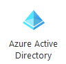
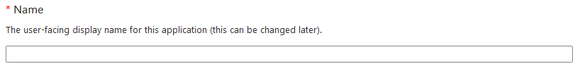
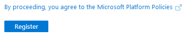
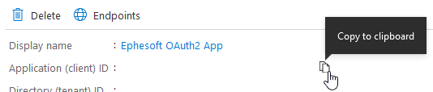
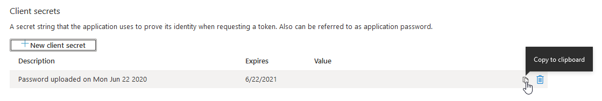
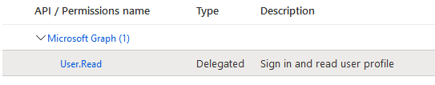
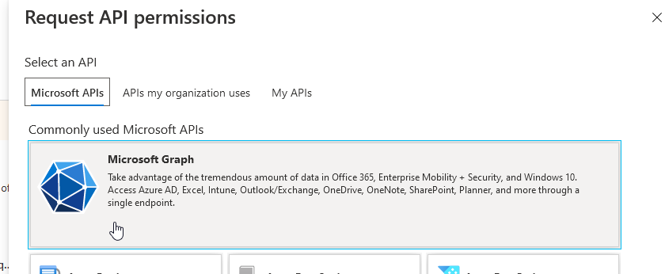
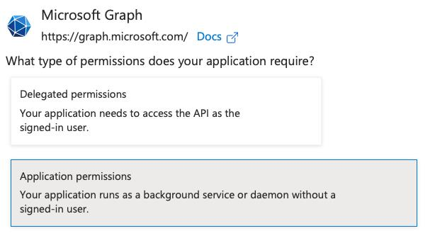
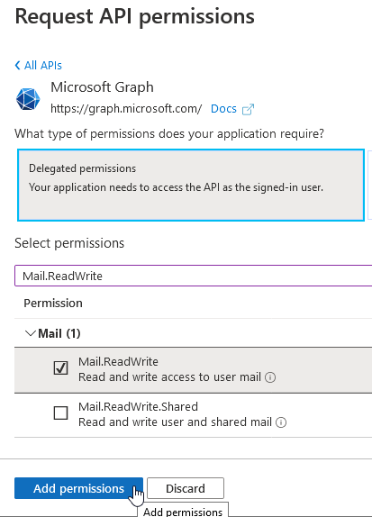

# O365 租户

## 在 Azure AD 中注册应用

<mark style="color:red;">**注意**</mark>：这些权限可能需要管理员授权。

1. 使用您的凭据登录 [Azure 门户](https://portal.azure.com/)。
2. 在 Azure 服务中找到并打开 Azure Active Directory（也称为 Azure AD）。

<figure><figcaption></figcaption></figure>

3. 在 **Manage** 部分中，选择 **App registrations**。

<figure><figcaption></figcaption></figure>

4. 在 App registrations 页面中，点击 **+ New registration**。

<figure><figcaption></figcaption></figure>

5. 此时会显示 **Register an application** 页面。在 **Name** 中输入应用面向用户显示的名称。

<figure><figcaption></figcaption></figure>

6. 根据需要选择以下帐户类型之一：

* **Accounts in any organizational directory (Any Azure AD directory Multitenant) and personal Microsoft accounts (e.g. Skype, Xbox)**（任何组织目录中的账户〔任何 Azure AD 目录，多租户〕及个人 Microsoft 账户，例如 Skype、Xbox）
* **Accounts in any organizational directory (Any Azure AD directory Multitenant)**（任何组织目录中的帐户，即任何 Azure AD 目录中的多租户帐户）

<figure><figcaption></figcaption></figure>

7. 保持 **Redirect URI (optional)** 选项不变。

<figure><figcaption></figcaption></figure>

8. 点击 **Register** 完成应用注册。随后会返回新应用的页面。
9. 在应用页面中找到 **Application (client) ID**。复制此 ID，以便在为 **DocBits** 配置电子邮件导入时使用。

<figure><figcaption></figcaption></figure>

10. 在左侧面板中选择 **Certificates & secrets**：

<figure><figcaption></figcaption></figure>

11. 在 **Certificates & secrets** 页面中，点击 **Client secrets** 部分下的 **+ New client secret** 按钮：

<figure><figcaption></figcaption></figure>

12. 在 **Add a client secret** 对话框中，点击 **Add** 按钮：

<figure><figcaption></figcaption></figure>

建议填写描述，以便在多个密钥中识别此密钥（目前每个应用最多可创建 2 个密钥）。

<figure><figcaption></figcaption></figure>

<mark style="color:red;">**注意**</mark>：请根据公司的策略选择过期日期。密钥过期后，需要创建新的客户端密钥，并在之前使用该密钥的每项电子邮件配置中指定新密钥。

13. 新生成的客户端密钥将会显示。复制此客户端密钥，以便在配置 DocBits 电子邮件导入时使用。

<figure><figcaption></figcaption></figure>

**重要提示：**请确保已复制客户端密钥。关闭后将无法再次查看该密钥。

14. 在左侧面板中选择 **Authentication**。右侧将显示 **Authentication** 页面。

<figure><figcaption></figcaption></figure>

15. 在 **Advanced settings** 部分中，将 **Default client type** 设置为 **Yes**。

<figure><figcaption></figcaption></figure>

16. 点击 **Save** 以确认更改。

<figure><figcaption></figcaption></figure>

17. 在左侧面板中选择 **API permissions**。随后会显示 API permissions 页面。

<figure><figcaption></figcaption></figure>

18. 默认情况下，**Microsoft Graph** 的 **User.Read** 权限已存在，请保持不变。

<figure><figcaption></figcaption></figure>

<mark style="color:red;">**注意**</mark>：此权限为必需权限。如果没有此权限，请按照下方添加 **Mail.ReadWrite** 权限的步骤添加该权限。

19. 点击 **+ Add a permission**。这将打开 **Request API permissions** 面板。

<figure><figcaption></figcaption></figure>

20. 点击 **Microsoft Graph**。

<figure><figcaption></figcaption></figure>

21. 从两个子类别中选择 **App Permissions**。

<figure><figcaption></figcaption></figure>

22. 在搜索框中输入 **Mail.ReadWrite**。勾选该权限对应的 **Mail.ReadWrite** 复选框。

<figure><figcaption></figcaption></figure>

23. 面板底部将启用 **Add permissions** 按钮。点击 **Add permissions**。

<figure><figcaption></figcaption></figure>

24. 这会将 **Mail.ReadWrite** 权限添加到应用的 **Configured permissions** 列表中。

<mark style="color:red;">**注意**</mark>：可能需要管理员权限。管理员必须授权应用使用这些权限。授权后，授予状态将如下所示：

<figure><figcaption></figcaption></figure>
