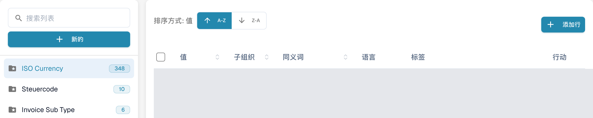
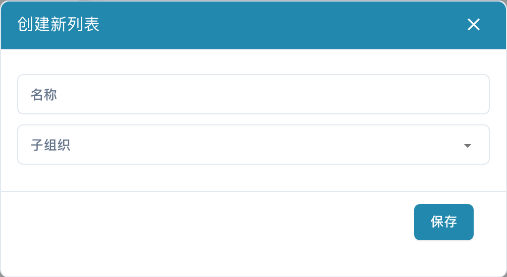
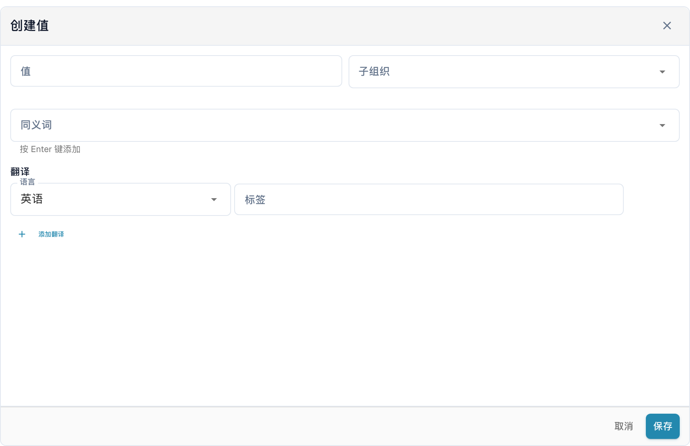

# 值列表

## 视频教程：主数据与值列表


DocBits 中的主数据来源、值列表与主数据设置


视频演示了主数据来源、值列表以及文档类型的主数据设置。

值列表为文档字段提供预定义选项。字段可以使用列表在验证时显示选项。标签可以有翻译，技术值在各语言中保持一致。

## 打开列表

在设置中打开主数据及值列表。使用左侧的 **搜索列表** 查找列表，再点击名称，在右侧打开其条目。带星号的文件夹表示系统列表；名称旁的数字表示已加载的条目数量。

<figure><figcaption>
值列表；已配置的名称已隐藏。
</figcaption></figure>

<figure><figcaption>
选中的系统列表在右侧打开条目表格。A-Z 和 Z-A 对值排序；添加行打开表单。条目值和自定义名称已隐藏；ISO Currency 等系统列表名称是已有配置数据。
</figcaption></figure>

## 创建列表

1. 点击列表名称上方的 **新的**。
2. 输入 **名称**，并在需要限制范围时选择 **子组织**。
3. **保存** 创建列表；**X** 关闭窗口，不创建列表。

<figure><figcaption>
点击“新的”会打开空白的“创建新列表”窗口，其中包含名称、子组织、X 和保存。此图不表示已经保存了列表。
</figcaption></figure>

要删除本组织创建的列表，使用名称旁三点菜单中的删除选项，并只确认需要删除的列表。系统列表没有此删除菜单，不能删除。

## 添加和修改值

1. 在左侧选择列表，然后点击表格上方的 **添加行**。
2. 输入技术 **值**，并按需要选择 **子组织**。
3. 添加所需的 **同义词**；输入每个同义词后按 **Enter**，将其加入字段。
4. 在 **翻译** 下选择 **语言**，并填写非空的 **标签**。新条目至少需要一个完整的翻译。
5. **保存** 创建条目；**取消** 或 **X** 关闭表单，不保存草稿。

<figure><figcaption>
点击“添加行”会在表格下方打开“创建值”表单，包含值、子组织、同义词、语言、标签和添加翻译。保存创建条目；取消放弃尚未保存的草稿。
</figcaption></figure>

要编辑条目，点击相应行，或使用 **行动** 列中的编辑选项。受保护的字段为只读；已有翻译时，技术值也可能被锁定。**取消** 放弃尚未保存的修改。

行菜单中的复制选项创建另一条记录。要复制多条记录，勾选其复选框，再使用表格上方的复制按钮。删除操作只适用于本组织的条目，并删除选中的条目；系统条目没有此操作。一个系统列表内可以同时存在受保护的条目和本组织的条目。

在条目表单中选择 **语言** 并填写 **标签**。点击 **添加翻译**，加入另一种语言及其标签。保存前，填写完整或移除额外的空翻译行。可以移除的翻译行旁有垃圾桶；点击后先从表单中移除该行，再保存以应用修改。系统条目或继承的翻译可能有受保护字段，只修改本组织可编辑的数据。

## 导入和导出

当前列表界面不提供批量导入或导出命令，也没有从 **行动** 菜单导入 CSV 的入口。请使用 **添加行** 逐条录入值，并在保存前核对技术值、语言和标签。

## 关联字段并测试

在文档类型的字段配置中选择相应列表，保存预期配置。用代表性文档检查显示选项、实际保存的值、验证和 ERP 映射。

列表中的标签翻译不改变技术值。没有当前语言的标签时，会显示技术值。本页图片展示列表浏览和未保存的空白表单，不表示已经创建、删除、导入条目或验证了保存后的配置及 ERP 映射结果。
