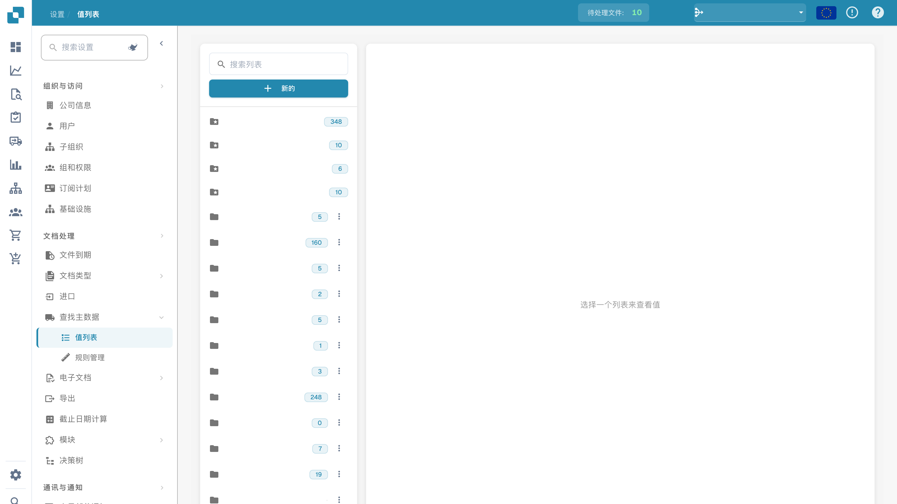

# 值列表

## 视频教程：主数据与值列表


DocBits 中的主数据来源、值列表与主数据设置


视频演示了主数据来源、值列表以及文档类型的主数据设置。

值列表为文档字段提供预定义选项。字段可以使用列表在验证时显示选项。标签可以有翻译，技术值在各语言中保持一致。

## 打开列表

在设置中打开主数据及值列表，选择列表以查看其值。已配置的名称已隐藏。

<figure><figcaption>
值列表；已配置的名称已隐藏。
</figcaption></figure>

## 创建列表

1. 选择新建列表。
2. 输入名称，并在需要时将其限制到子组织。
3. 保存前检查输入。

默认列表由系统提供，不能删除。删除自定义列表前，检查哪些字段使用该列表；删除可能立即生效。

## 添加和修改值

打开相应列表，添加或修改条目。每个条目通常有技术值和显示标签。根据需要填写其他语言的标签。技术值用于规则和集成，不应仅为了翻译显示标签而改变。

## 导入和导出

需要批量处理时，使用界面提供的导入和导出功能。检查支持的文件格式和列，先导出示例或现有列表再编辑。导入前保留原数据，并核对技术值、语言及重复项。

## 关联字段并测试

在文档类型的字段配置中选择相应列表，保存预期配置。用代表性文档检查显示选项、实际保存的值、验证和 ERP 映射。列表中的标签翻译不改变技术值。图片只展示列表概览，没有创建、删除或导入列表。
