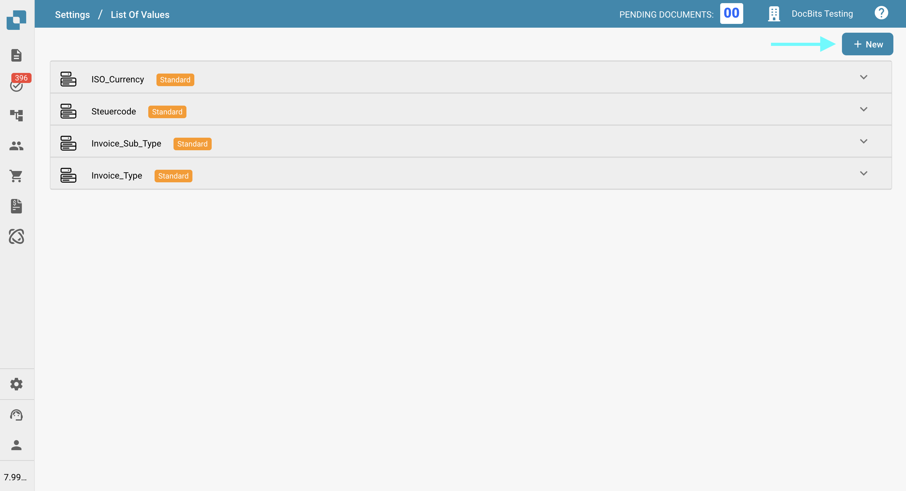
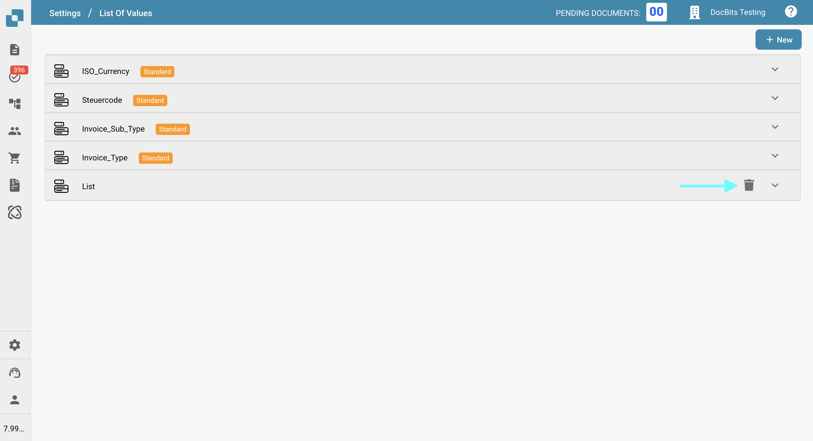
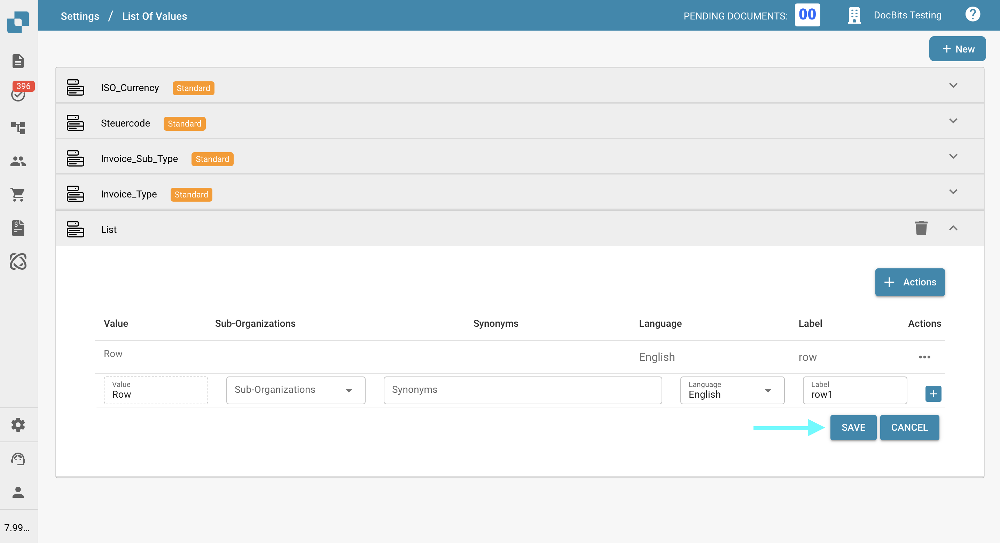
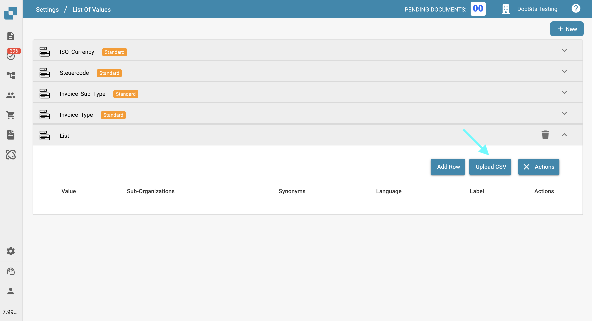
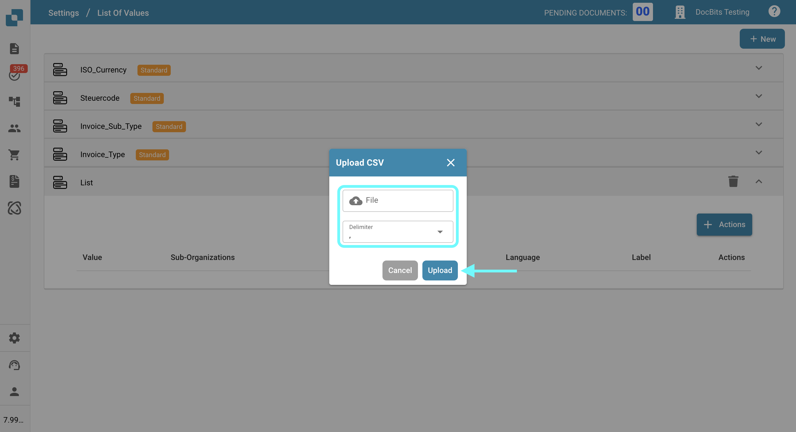
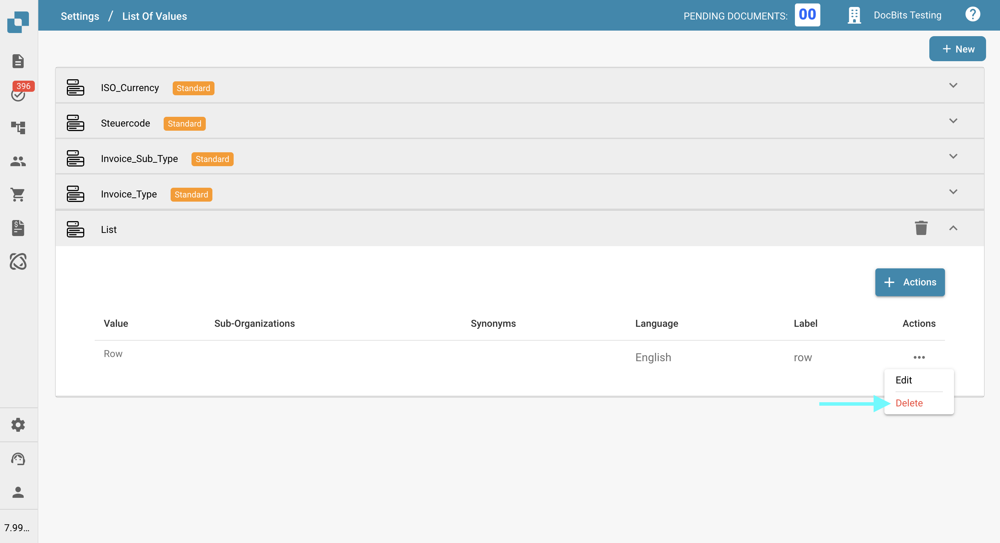
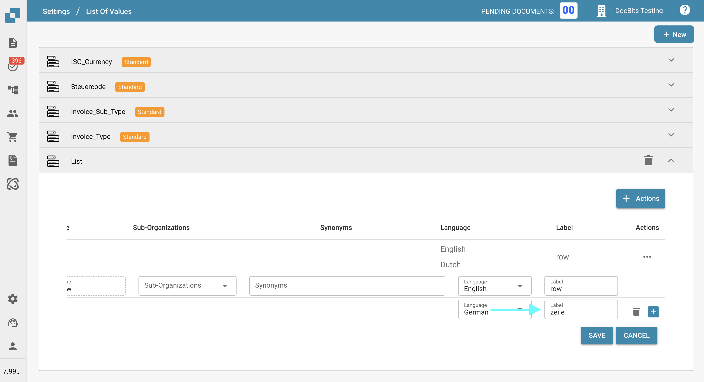
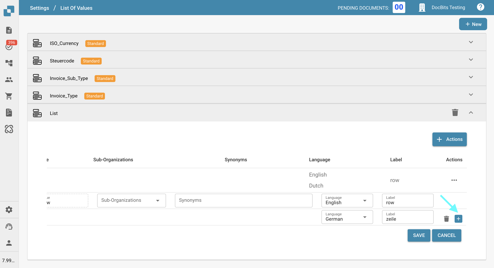
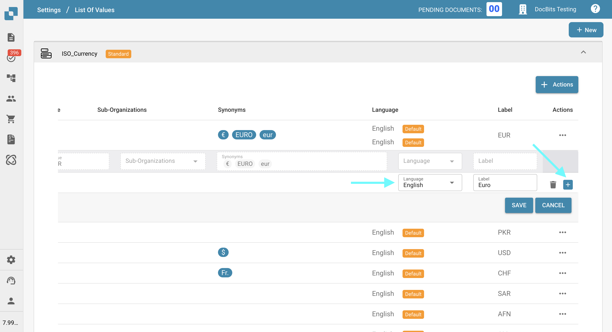

# 值列表

## 概述

**值列表**功能可用于创建和管理预定义的值集合。它尤其适合在[**字段**](../global-settings/document-types/fields/)部分配置下拉菜单，之后可在**字段验证**中使用这些菜单。

这些列表可以针对不同的子组织进行自定义，并支持多种语言，让 **DocBits** 使用更加灵活。

## 如何访问？

前往**设置 → 文档处理 → 值列表**即可访问**值列表**。

<figure><figcaption></figcaption></figure>

## 如何添加或删除列表

### 创建值列表

1.  点击屏幕右上角的**新建**。

    <figure><figcaption></figcaption></figure>
2. 为列表输入**名称**。
3. _(可选)_ 选择该列表要在哪个**子组织**中启用。
4.  点击**保存**以创建列表。

    <figure><figcaption></figcaption></figure>

### 如何删除列表

点击相应列表旁边的垃圾桶图标即可删除该列表。

<figure><figcaption></figcaption></figure>

<mark style="color:red;">**注意**</mark>：列表会立即删除。标有[**标准**](list-of-values.md#system-defined-lists-and-rows)标签的列表无法删除。

## 如何为现有列表添加、编辑或移除值

你可以通过以下任一方式管理现有**值列表**中的值：

* [**手动添加值**](list-of-values.md#manually-add-values) – 通过界面逐项输入值。
* [**从 CSV 文件导入值**](list-of-values.md#import-values-from-a-csv-file) – 上传 CSV 文件，一次添加多个值。

### 手动添加值 

1.  点击要修改的列表。

    <figure><figcaption></figcaption></figure>
2.  点击**操作**。

    <figure><figcaption></figcaption></figure>
3.  点击**添加行**。

    <figure><figcaption></figcaption></figure>

现在，你可以为每个条目指定多个属性：

<figure><figcaption></figcaption></figure>

**值**：该值是在 **DocBits** 中存储的内容。它在所有语言中保持不变；如果所选语言没有指定标签，它也会作为字段验证时显示的默认文本。

**标签**：根据所选语言，在验证页面上显示的文本。如果 DocBits 中没有当前语言对应的标签，系统将默认显示**值**。

**语言**：指定标签所使用的语言。\
详细说明请参阅[此处](list-of-values.md#add-translations-to-your-values)。

**子组织**：指定该行在哪些**子组织**中启用。如果留空，该行将对所有组织开放。

**同义词**：你可以在此指定有助于训练文档的其他值。\
例如，如果 **EUR** 是主要**值**，你可以将 EURO 和 € 添加为**同义词**。使用任一**同义词**训练文档时，**DocBits** 会自动识别并从列表中选择对应的 EUR 值。\
<mark style="color:red;">**注意**</mark>：必须按 **Enter** 确认每个同义词，才能将其添加到列表中。

4.  输入所需的所有属性后，点击**保存**按钮以添加该行。

    <figure><figcaption></figcaption></figure>

### 从 CSV 文件导入值 

<mark style="color:red;">**注意：**</mark>导入 CSV 文件时，系统只会处理以下列：**值**、**子组织**、**同义词**、**语言**和**标签**。\
CSV 文件中的任何其他列在导入时都会被**忽略**。

通过 CSV 导入一次添加多个值：

1.  点击要更新的列表。

    <figure><figcaption></figcaption></figure>
2.  点击**操作**。

    <figure><figcaption></figcaption></figure>
3.  点击**上传 CSV**。

    <figure><figcaption></figcaption></figure>
4. 点击**文件**，浏览并选择要上传的 CSV 文件。
5. 选择 CSV 文件中使用的**分隔符**（`;` 或 `,`）。
6.  点击**上传**以导入这些值。

    <figure><figcaption></figcaption></figure>

### 编辑现有值

1. 找到要编辑的行。
2. 点击**操作**列中的三个点。
3.  在下拉菜单中选择**编辑**。

    <figure><figcaption></figcaption></figure>
4. 进行所需的更改。
5.  点击**保存**以应用更改。

    <figure><figcaption></figcaption></figure>

### 删除值

1. 找到要删除的行。
2. 点击**操作**列中的三个点。
3.  在下拉菜单中选择**删除**。

    <figure><figcaption></figcaption></figure>

<mark style="color:red;">**注意**</mark>：该行会立即删除。标有[**默认**](list-of-values.md#system-defined-lists-and-rows)标签的行无法删除。

## 为值添加翻译 

你可以为 **DocBits** 支持的每种语言添加翻译。

添加翻译的步骤：

1.  点击加号 (+) 图标。

    <figure><figcaption></figcaption></figure>
2.  从下拉菜单中选择一种语言。

    <figure><figcaption></figcaption></figure>
3.  在**标签**字段中输入所需的翻译。

    <figure><figcaption></figcaption></figure>
4.  如需添加另一条翻译，请再次点击加号 (+) 图标。

    <figure><figcaption></figcaption></figure>
5.  如需移除翻译，请点击垃圾桶图标。

    <figure><figcaption></figcaption></figure>
6.  完成后，点击**保存**按钮以保存翻译。

    <figure><figcaption></figcaption></figure>

<mark style="color:red;">**注意**</mark>：如果当前语言没有可用的**标签**，DocBits 将默认显示**值**。

## 系统定义的列表和行 

某些列表由系统预先创建，并标有**标准**标签。这些列表无法删除，但你可以向其中添加新行，并在需要时移除自行添加的行。

<figure><figcaption></figcaption></figure>

在这些标准列表中，某些行标有**默认**标签，这些是系统定义的条目。你可以添加其他语言的**标签**，但无法删除这些默认行。

<figure><figcaption></figcaption></figure>
