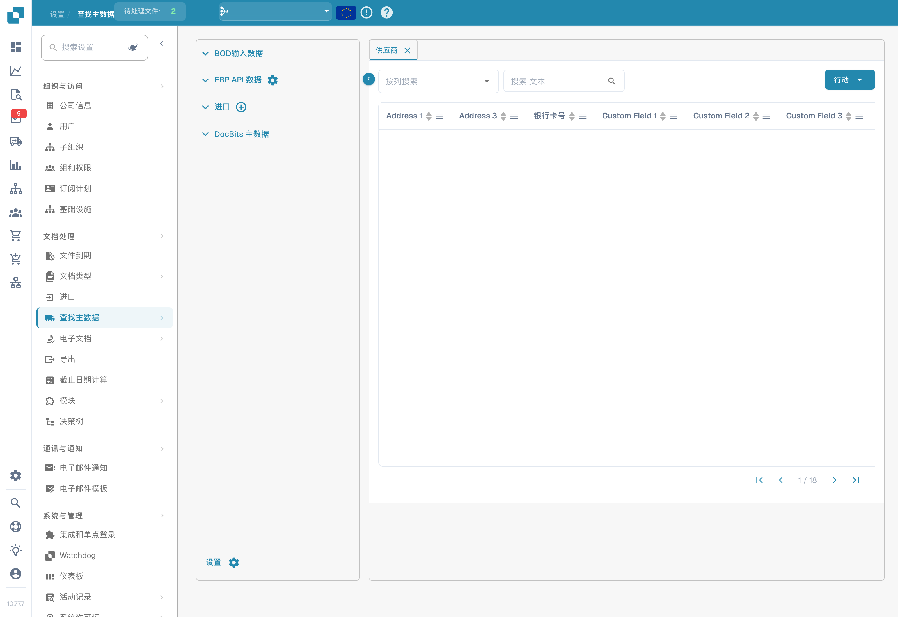
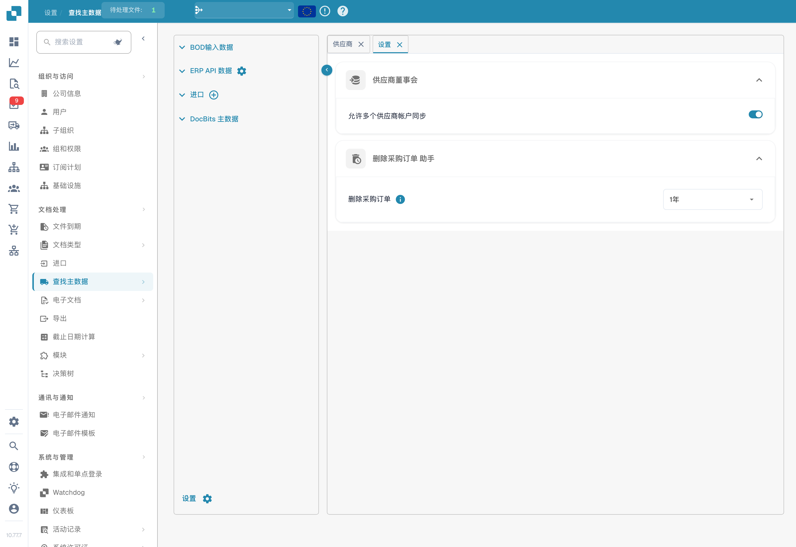

# 主数据查询




**主数据查询**（侧边栏：**Lookup Master Data**）可让您查看和管理 DocBits 用于将提取的文档数据与 ERP 系统进行验证的主数据。它对于准确匹配采购订单、验证供应商以及自动补全字段至关重要。请从 **Settings → Document Processing → Lookup Master Data** 打开此页面。

<figure><figcaption>
中文主数据页面；已隐藏供应商及组织数据，所示配置的英语列标题保留原文。
</figcaption></figure>

## 数据源

左侧面板列出四种数据源类别：

| 来源 | 说明 |
|--------|-------------|
| **BOD Input Data** | 通过 Infor BOD（业务对象文档）消息接收的数据。 |
| **ERP API Data** | 通过 API 从 ERP 系统直接获取的数据。点击齿轮图标可配置 API 连接。 |
| **Imported** | 手动导入的数据（例如通过 CSV 上传）。点击 **+** 图标可添加新数据。 |
| **DocBits Master Data** | 在 DocBits 中管理的内部主数据。 |

## 数据表

选择数据源后，其数据会显示在右侧可搜索、可排序的表格中：

* **Tabs** — 每个标签页对应一种主数据类型（例如供应商、采购订单、物料）。
* **Search** — 按列筛选（**Search by column**）或按文本搜索（**Search String**）。
* **Actions** — 更新列标签、隐藏空列、更新别名，或将数据下载为 CSV。
* **Pagination** — 使用页面控件浏览大型数据集。

供应商和采购订单表格包含供应商 ID、供应商名称、地址、银行 ID、采购订单号、物料 ID、描述、数量、单价、总金额、币种和状态等列，以及任何自定义字段。

## 设置

点击数据源面板左下角的 **Settings**（齿轮图标）可打开主数据设置。

<figure><figcaption>
供应商 BOD 与采购订单保留期限设置。界面中的“供应商董事会”实际指供应商 BOD 设置，BOD 不是董事会。未保存更改。
</figcaption></figure>

### 供应商 BOD

**允许同步多个供应商账户**

* **Enabled**：单个供应商在 BOD 中可以有多个 `<FinancialParty>` 元素（通常是因为有多个 IBAN 或财务账户）。系统会提取所有 `<FinancialParty>` 条目并保存到供应商表中，因此可以存储多个财务属性。
* **Disabled**：系统仅提取为该供应商找到的最后一个 `<FinancialParty>` 元素。此前的财务属性（例如其他 IBAN）会被忽略，且只保存最后一次出现的数据。

### 采购订单删除助手

**删除采购订单的时间** — 选择何时删除已关闭的采购订单。所选时间段结束后，记录将自动删除。


要了解如何将主数据加载到 DocBits，请参阅[导入主数据](../../../infor-integration-and-configuration/importing-customer-master-data/)。

