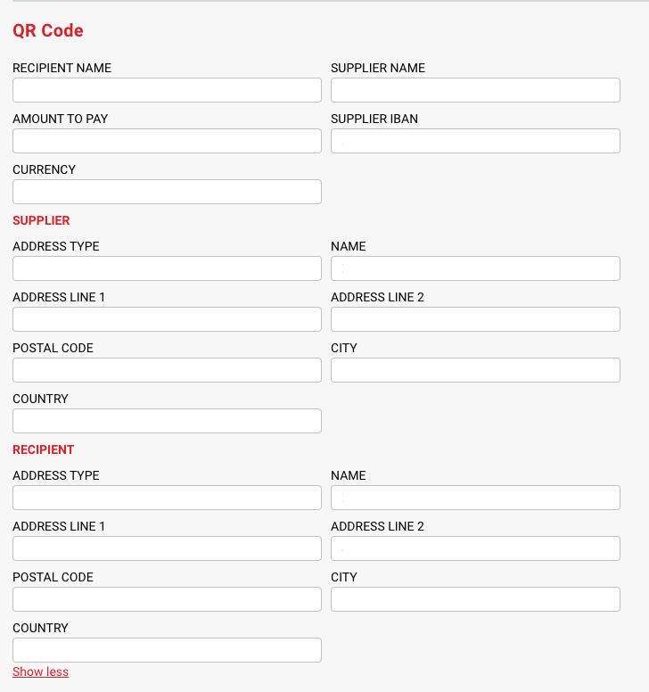

# 瑞士 QR 账单

## 概述

**瑞士 QR 账单**是瑞士国家级支付单标准，自 2020 年 6 月 30 日起取代了橙色和红色瑞士支付单。如今，每张瑞士境内发出的发票——无论来自公用事业公司、保险公司还是业务合作伙伴——都带有瑞士 QR 账单二维码。DocBits 会自动解码这些二维码，并通过 API 响应提供所有支付字段。

### 功能概览

瑞士 QR 账单遵循 **ISO 20022** 支付标准，共有两个版本：**v1.0**（早期推出）和 **v2.0**（当前版本）。DocBits 提取器支持这两个版本。识别出的数据会解码为一组完整的支付字段，包括债权人、债务人、IBAN / QR-IBAN、金额、货币、参考类型（QRR、SCOR 或 NON）、结构化和非结构化消息，以及替代支付方案。

<figure><figcaption></figcaption></figure>

#### 主要优势

* 瑞士发票**无需手动录入**：IBAN、金额、参考信息和债权人信息会直接写入文档。
* **覆盖两个版本**：系统会自动检测 v1.0 和 v2.0。
* **保留参考类型**：QRR、SCOR 和 NON 会按打印内容原样保留，确保后续对账正常进行。

***

### 检测

* 魔数前缀：`SPC\n0100`（v1.0）或 `SPC\n0200`（v2.0）
* 符合 ISO 20022 标准
* 如果存在，解析器也会提供 `alt-schemes`（替代支付流程）

### 提取字段

所有字段均使用 `swissqr_` 前缀：

| 字段                                                                                                  | 描述                                    |
| ------------------------------------------------------------------------------------------------------ | ---------------------------------------------- |
| `swissqr_account`                                                                                      | 债权人的 IBAN 或 QR-IBAN                |
| `swissqr_creditor_name`                                                                                | 债权人名称                                  |
| `swissqr_creditor_street`                                                                              | 债权人街道 / 地址行                 |
| `swissqr_creditor_city`                                                                                | 债权人所在城市                                  |
| `swissqr_creditor_postal_code`                                                                         | 债权人邮政编码                           |
| `swissqr_creditor_country`                                                                             | 债权人所在国家/地区（ISO 3166 alpha-2）            |
| `swissqr_debtor_name`                                                                                  | 债务人名称（如有打印）                       |
| `swissqr_debtor_street`, `swissqr_debtor_city`, `swissqr_debtor_postal_code`, `swissqr_debtor_country` | 债务人地址                                 |
| `swissqr_amount`                                                                                       | 金额（小数）                               |
| `swissqr_currency`                                                                                     | 货币（ISO 4217）——通常为 `CHF` 或 `EUR` |
| `swissqr_reference`                                                                                    | 结构化参考信息（QRR 或 SCOR）             |
| `swissqr_reference_type`                                                                               | `QRR`、`SCOR` 或 `NON`                         |
| `swissqr_unstructured_message`                                                                         | 自由文本汇款信息                           |
| `swissqr_bill_information`                                                                             | 结构化账单信息（S1 / Swico）       |
| `swissqr_alt_schemes`                                                                                  | 替代支付流程（如存在）            |

### API 响应示例

```json
{
  "swissqr_account": "CH4431999123000889012",
  "swissqr_creditor_name": "Robert Schneider AG",
  "swissqr_creditor_street": "Rue du Lac 1268",
  "swissqr_creditor_city": "Biel",
  "swissqr_creditor_postal_code": "2501",
  "swissqr_creditor_country": "CH",
  "swissqr_amount": 1949.75,
  "swissqr_currency": "CHF",
  "swissqr_reference": "210000000003139471430009017",
  "swissqr_reference_type": "QRR",
  "swissqr_unstructured_message": "Bill No. 3139 for services 2026"
}
```

***

### 如何启用

瑞士 QR 账单解析由通用的 **条形码 / QR 码提取**模块开关控制，无需针对特定标准进行配置。

1. **前往设置**：
   * 从仪表板进入 **设置**。
   * 选择 **文档处理**，然后选择 **模块**。
2. **启用功能**：
   * 向下滚动，找到 **条形码 / QR 码提取**选项。
   * 切换滑块以启用该功能。

<figure><figcaption></figcaption></figure>

如需查看支付 QR 码标准的完整列表，请参阅[概览](./)页面。
