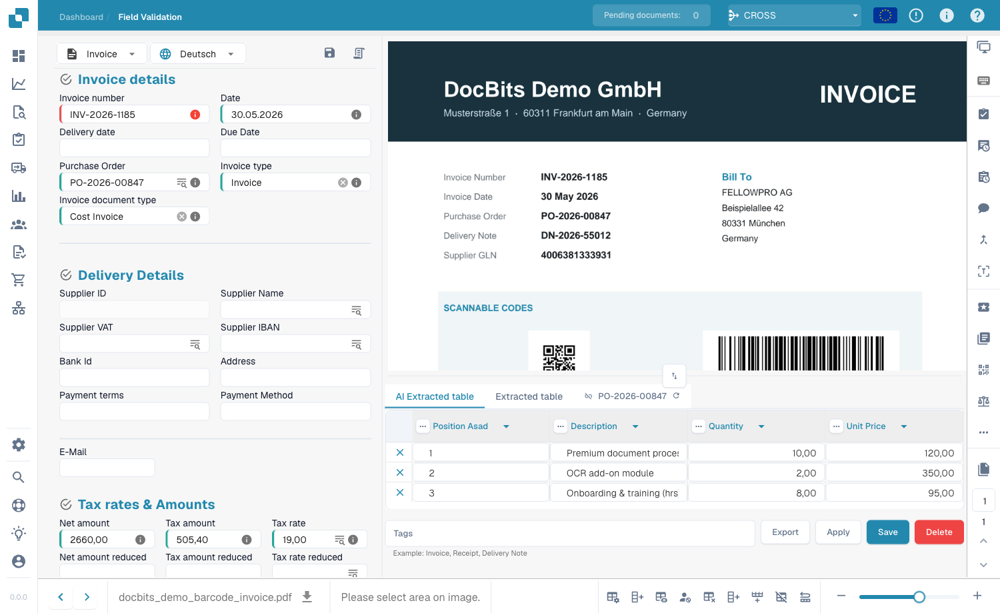
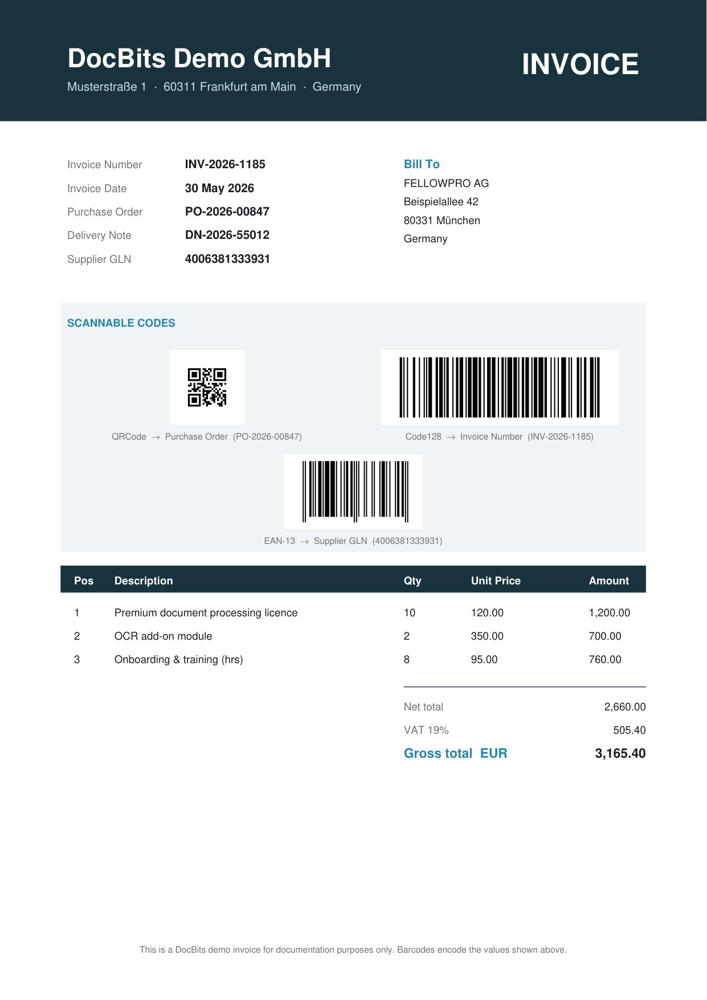
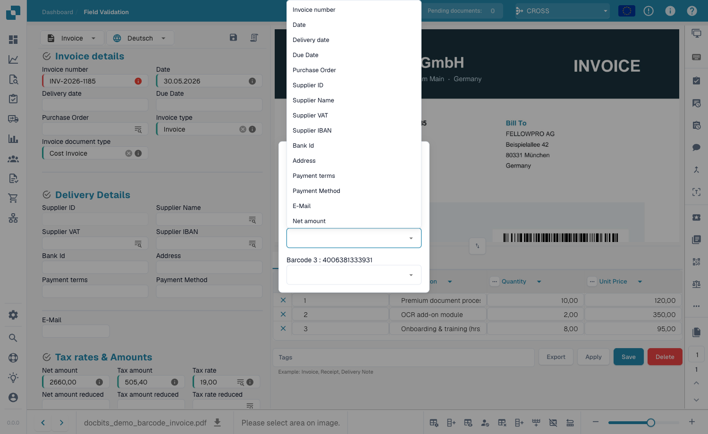
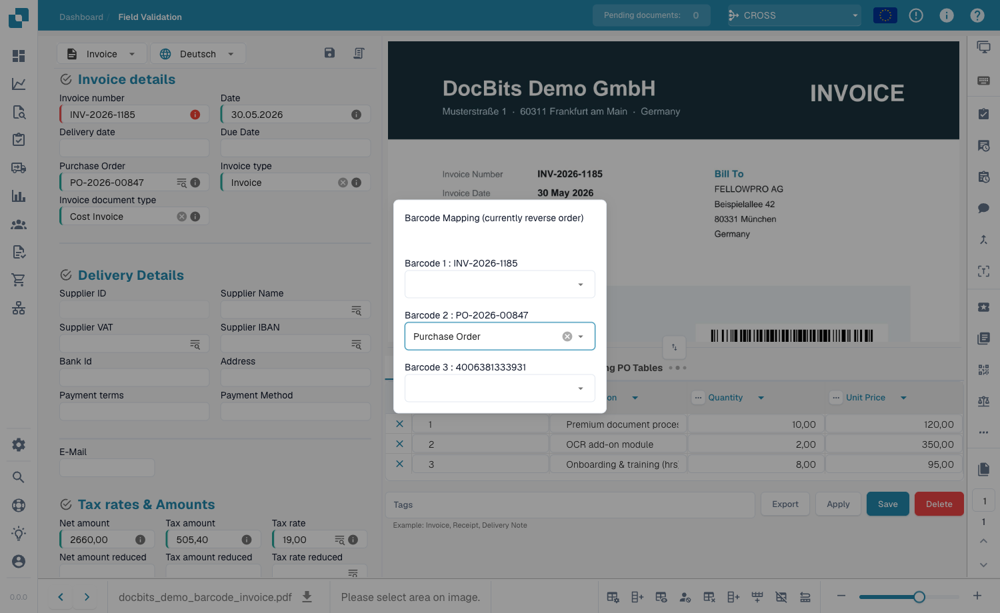

# 条码分配

### 概述

**条码分配**设置会在**文档验证界面**中添加一个条码工具。该工具会读取 DocBits 在文档中找到的条码和 QR 码，并让您**将其值分配给文档字段**，例如，从条码中填入采购订单号、参考编号或送货单号，无需手动输入。

此设置默认**处于禁用状态**。

### 启用后可用的功能

启用此设置后，**验证界面**（`/field_validation_v1/…`）右侧工具栏中会出现一个新的**条码按钮**（QR 码图标）。这是使用整个功能的入口；如果未启用此设置，该图标会被隐藏。

<figure><figcaption>
启用此设置后，验证工具栏中会显示条码图标。
</figcaption></figure>

以下是在验证界面中查看文档时的图标位置：

<figure><figcaption>
验证界面——只有启用条码分配后才会显示条码图标（已突出显示，位于右侧工具栏）。
</figcaption></figure>

### 条码的读取方式

DocBits 会在文档处理期间检测条码，并提供解码后的值供您分配。单个文档中可能包含多种条码类型，例如 **QR 码**、**Code 128** 和 **EAN-13**，每种条码编码的值都可能不同，例如采购订单号、发票编号或供应商 GLN。

<figure><figcaption>
DocBits 演示发票示例，包含三种条码类型（QR 码 → 采购订单，Code 128 → 发票编号，EAN-13 → 供应商 GLN），每种条码都编码了一个可映射到字段的值。
</figcaption></figure>


检测哪些条码类型由**条码/QR 码提取**设置（`Barcode Extraction Types`）控制。如果对话框显示 *“no barcodes extracted found”*，请确认已启用条码提取，并已选择预期的类型（例如 `QRCODE`、`CODE128`、`EAN13`）。请参阅[条码/QR 码提取](bar-code-qr-code-extraction/README.md)。


### 使用条码分配对话框

1. 在**验证界面**中打开一份文档。
2. 点击右侧工具栏中的**条码图标**。
3. **条码分配**对话框会列出 DocBits 在文档中检测到的所有条码，显示为 `Barcode <n> : <value>`。

<figure><figcaption>
条码分配对话框会列出每个检测到的条码，并提供一个下拉菜单以选择目标字段。
</figcaption></figure>

4. 对于每个条码，打开其下拉菜单并选择要填入该值的字段。

<figure><figcaption>
每个条码都可以映射到任意文档字段，例如“采购订单”、“发票编号”或“供应商 ID”。
</figcaption></figure>

5. 选择字段后，该字段会立即填入条码的值。

<figure><figcaption>
选择字段（此处为“采购订单”）后，该字段会填入条码值。
</figcaption></figure>

### 如何启用

1. 前往**设置**。
2. 选择**文档处理**。
3. 选择**模块**。
4. 打开**文档类型**部分。
5. 找到**条码分配**并打开开关。

<figure><figcaption>
“设置” → “文档处理” → “模块”中的条码分配开关。
</figcaption></figure>

### 优势

* **录入更快且无错误**：直接从条码获取值，无需人工读取和输入。
* **减少输入错误**：扫描得到的值与条码中编码的内容完全一致。
* **保持掌控**：您可以在验证过程中决定将哪个条码分配给哪个字段。

### 适用场景

* **包含条码的文档**：当文档包含条码/QR 码，且其值应填入特定字段时使用（例如订单号或参考编号）。
* **手动验证工作流**：当人员审核文档并希望快速从条码填入字段时使用。
* 如果文档没有可用的条码，或者您只需要自动进行条码/QR 码**提取**，请**保持此设置关闭**；请参阅[条码/QR 码提取](bar-code-qr-code-extraction/README.md)。


**此功能用于读取条码/QR 码的值，并在验证过程中将其分配给字段。** 从支付码（例如 Swiss QR Bill 或 GiroCode）自动提取结构化数据，以及在条码分隔页处分割多页文件，由**另一个**设置处理：[条码/QR 码提取](bar-code-qr-code-extraction/README.md)。

