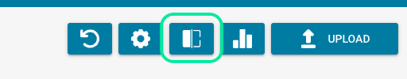
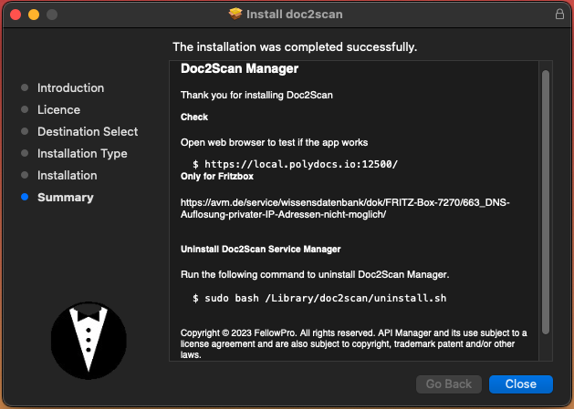

# Doc Scan

### 下载扫描仪软件

在 DocBits 仪表板上点击 Scan Document

<figure><figcaption></figcaption></figure>

由于尚未安装扫描仪，你

<figure><figcaption></figcaption></figure>

根据你使用的操作系统，点击相应按钮进行下载。

打开安装文件后，你将看到以下界面

<figure><figcaption></figcaption></figure>

点击 `Continue`，使用 `Agree` 接受软件许可协议，然后继续安装软件。

安装此软件需要 33,6 MB 的空间。你可以在下一步点击 `Install` 之前更改安装位置。

显示以下屏幕后，你

<figure><figcaption></figcaption></figure>

打开网页浏览器并输入以下地址，以测试应用是否正常运行：https://local.polydocs.io:12500/ 如果屏幕上显示此消息，并且你正在使用 FritzBox，则必须先在 FritzBox 网络设置中配置一些设置。

<figure><figcaption></figcaption></figure>

看到此屏幕后，即可点击 DocBits。

<figure><figcaption></figcaption></figure>

系统会将你重定向到 DocBits 登录页面，你可以在此输入凭据以访问仪表板。

<figure><figcaption></figcaption></figure>

现在，你只需在 Modules 下的设置中激活 Doc Scan。

<figure><figcaption></figcaption></figure>

### FritzBox 网络设置

如果安装后访问网址 https://local.polydocs.io:12500/ 时出现以下错误，原因如下：– 无法解析私有 IP 地址的 DNS。– 无法通过 FRITZ!Box 解析 FRITZ!Box 家庭网络中指向私有 IP 地址的域名。这意味着无法通过域名访问 FRITZ!Box 家庭网络中的服务器服务。
你可能会看到以下错误消息之一：“DNS timed out”“DNS request timed out”
*原因*
出于安全原因，FRITZ!Box 会屏蔽指向你自己家庭网络中 IP 地址的 DNS 响应。这是 FRITZ!Box 的一项安全功能，用于防范所谓的 DNS 重绑定攻击。
如果你使用 FritzBox，必须先在 FritzBox 菜单中进行以下设置：


1. 在 FRITZ!Box 用户界面中，点击 `Heimnetz`。
2. 在菜单中点击 `Heimnetz` 下的 `Netzwerk`。
3. 点击 `Netzwerkeinstellungen` 选项卡。


在“Hostname exceptions（主机名例外）”中的 `DNS-Rebind-Schutz section` 部分，输入不应应用 DNS 重绑定保护的 local.polydocs.io。点击 `Übernehmen` 确认。

### 卸载 Doc2Scan Service Manager

运行以下命令以卸载 Doc2Scan Manager：

```javascript
sudo bash /Library/doc2scan/uninstall.sh
```

复制

### 扫描仪兼容性

**图例：**

* 是 – 设备可正常工作
* 否 – 设备不支持该协议
* ? – 设备可与 sane-airscan 配合使用，但用户未报告所用协议
* 空白 – 作者没有此模式/设备组合的信息

**定义：**

* eSCL 是 Airscan 的缩写，是支持 Apple 的 SANE WebScan 前端
* WSD 表示

| 设备                              | eSCL 模式 | WSD 模式 |
| --------------------------------- | --------- | -------- |
| Brother ADS-2700W                 | 否        | 是       |
| Brother DCP-7055W                 | 否        | 是       |
| Brother DCP-9020CDW               | 否        | 是       |
| Brother DCP-J552DW                | 否        | 是       |
| Brother DCP-L2540DW               | 否        | 是       |
| Brother DCP-L2550DN / DCP-L2550DW | 是        |          |
| Brother HL-L2380DW 系列            | 否        | 是       |
| Brother HL-L2395DW 系列            | 是        |          |
| Brother MFC-7360N                 | 否        | 是       |
| Brother MFC-8710DW                | 否        | 是       |

显示第 1 至 10 条，共 151 条上一页下一页
