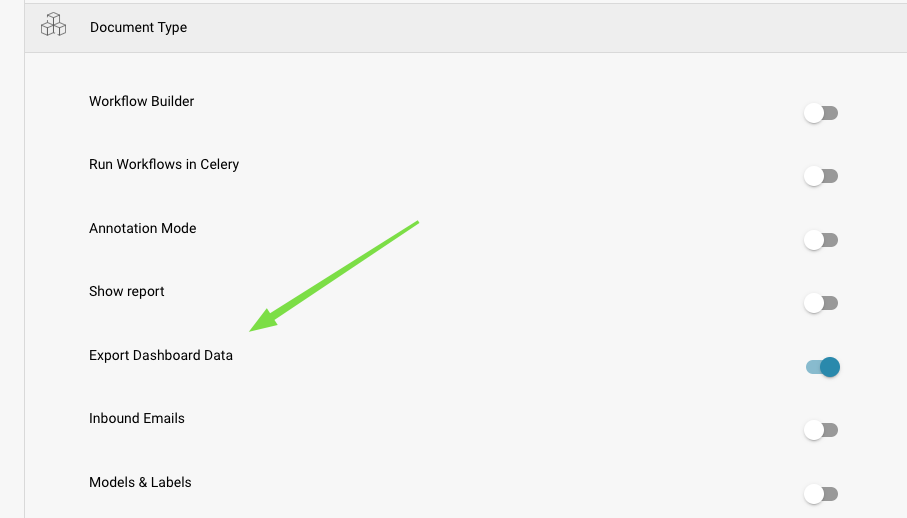
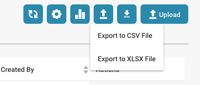

# 导出仪表板数据

1.  **导航至设置**：前往 **Settings → Module**。\\

    <figure><figcaption></figcaption></figure>
2.  **启用导出仪表板数据**：找到并启用 **Export Dashboard Data** 选项。\\

    <figure><figcaption></figcaption></figure>
3. **导出仪表板**：启用后，仪表板上会显示一个按钮，供您将数据导出为 CSV 文件。

<figure><figcaption></figcaption></figure>

<figure><figcaption></figcaption></figure>
