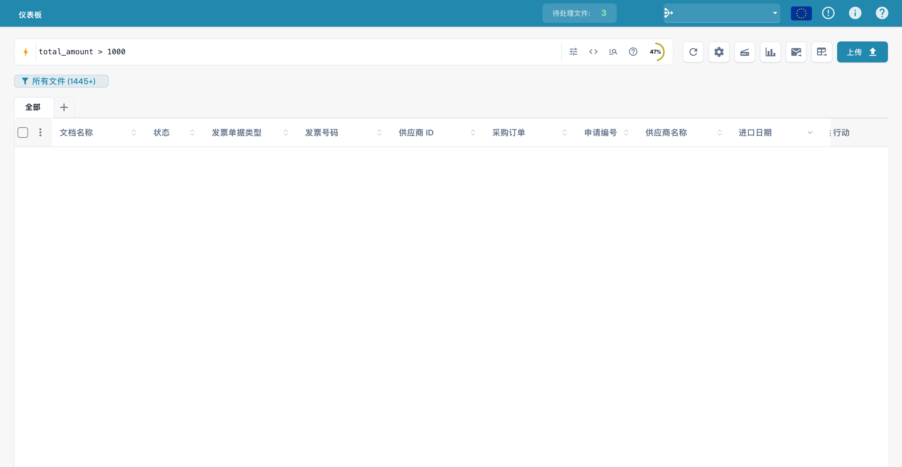

# 全文搜索

全文搜索允许用户搜索文档的实际内容以及所有提取字段，而不仅仅是文件名和 ID。

## 未启用模块时

未启用全文搜索时，仪表板搜索栏只能查询少量结构化字段。自由文本输入仅会匹配以下内容：

* `filename`
* 文档 `ID`
* `invoice_id`
* `purchase_order`

这些字段以外的内容都会被忽略。此时无法搜索文档内容，也不支持范围、运算符或智能筛选器。

## 启用模块后

启用全文搜索后，即可搜索文档中的所有提取字段，并将仪表板搜索栏升级为更丰富的查询语言。查询可以组合字段筛选条件、范围比较、逻辑运算符、相对日期和智能筛选器快捷方式。

<figure><figcaption><p>在仪表盘中输入金额查询条件。</p></figcaption></figure>

### 按字段限定查询

在字段名称后加冒号，即可匹配特定提取字段。字段名称遵循 API 标识符约定（小写、snake\_case），适用于文档类型捕获的所有字段，包括供应商、发票元数据、行项目和自定义字段。

```
supplier_name: Acme
invoice_id: INV-1234
status: ready_for_validation
```

### 范围查询

对数字和日期字段使用比较运算符。支持开放式比较和有界范围。

```
total_amount > 5000
total_amount <= 10000
invoice_due_date between 2026-01-01, 2026-04-30
```

### 逻辑运算符

使用 `AND`、`OR` 和 `NOT` 组合子句，并用括号设置优先级。`IN` 列表可在单个字段中匹配集合中的任意值。

```
supplier_name: Acme AND total_amount > 1000
(status: ready_for_validation OR status: validated) AND invoice_date: this_month
NOT status: archived
status IN (ready_for_validation, exported)
```

### 相对日期

根据查询时间戳计算的时间表达式。可在需要日期的任何位置使用。

```
imported_on: today()
invoice_date: last_week
imported_on: this_quarter
```

### 智能筛选器

用于常见查询的单词快捷方式。可单独使用，也可作为较大表达式的一部分。

```
overdue
@User
#INV-1234
$5k+
```

* `overdue` — 已超过到期日的文档。
* `@User` — 按受派人筛选；将 `User` 替换为受派人的姓名。
* `#INV-1234` — 按文档标识符快速查找。
* `$5k+` — 查找金额大于 5,000 的文档，金额以文档所用币种计。

## 子功能

全文模块还包含两种专用搜索模式。两者都依赖已启用该模块，无法独立使用。

### 向量搜索

向量搜索会查找与查询在语义上相似的文档，而不只是词面匹配的文档。仪表板会将任何以 `vector:` 开头的查询视为向量搜索，通过文档嵌入进行搜索，并按相似度对结果排序。

```
vector: frozen food invoices
```

向量索引可在“全文搜索设置”页面单独切换，与全文文本索引分开管理。禁用向量索引后，系统将停止为新文档生成嵌入，但会保留文本索引。

### AI 搜索

AI 搜索接受自然语言查询，并使用 LLM 提取结构化筛选条件，然后通过全文索引执行这些条件。请在查询前加上 `ai:`。

```
ai: invoices from Ruiz over 1000 last quarter
```

AI 搜索和向量搜索不可互换：向量搜索用于匹配相似内容，AI 搜索则将自然语言转换为筛选条件。AI 搜索没有单独的开关，而是通过现有的全文索引和向量索引执行。

下图展示模块可用性；索引状态和向量索引开关需要在可用的全文搜索设置详情中查看。

<figure><figcaption><p>在模块设置中检查全文搜索的可用性。此图展示模块开关，不是索引状态或向量索引设置；本例未更改开关。</p></figcaption></figure>

## 先决条件

* OpenSearch 基础设施在后台运行，为索引提供支持。
* 首次启用模块时，系统会为所有现有文档重新编制索引。索引所需时间取决于组织中的文档数量。
* 只有组织管理员可以切换模块。

## 如何启用

1. 前往 **设置 → 文档处理 → 模块**。
2. 在 **仪表板** 组下，启用 **全文搜索**。
3. 出现订阅对话框时确认订阅。
4. 等待初始重新索引完成，再使用全文查询。

<figure><figcaption><p>全文搜索模块的可用情况。</p></figcaption></figure>


全文搜索模块的定价由您的 DocBits 销售联系人处理。首次启用该模块时会显示订阅确认窗口。


## 另请参阅

* [全文搜索设置](../../log-settings/fulltext-search-settings.md) — 索引管理和向量索引开关。
* [全文搜索函数](../../global-settings/document-types/script/scripting-in-docbits/fulltext-search-functions.md) — `fulltext_search()` 和 `vector_search()` 的脚本 API。
* [模块概览](README.md) — DocBits 可选模块的完整列表。

全文搜索需要相应模块和权限。如果提示缺少模块，请让管理员检查组织的功能可用性和访问权限。
