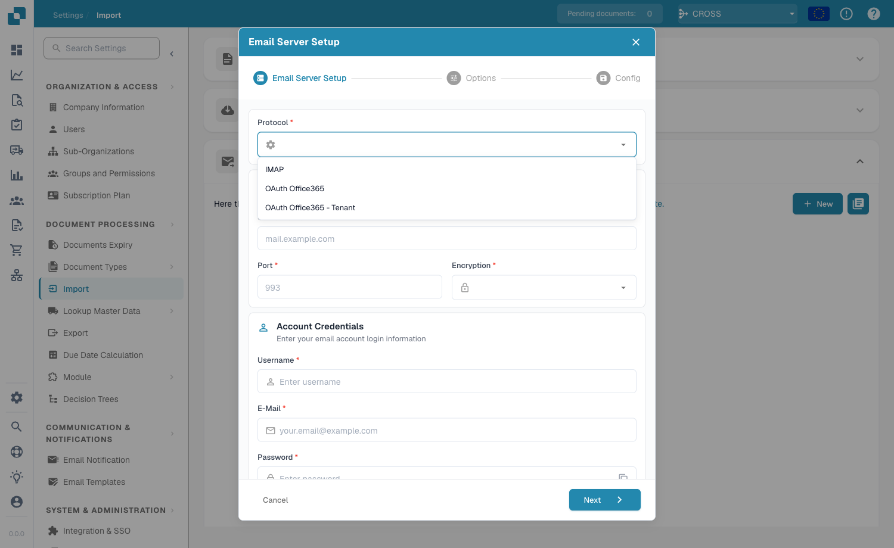
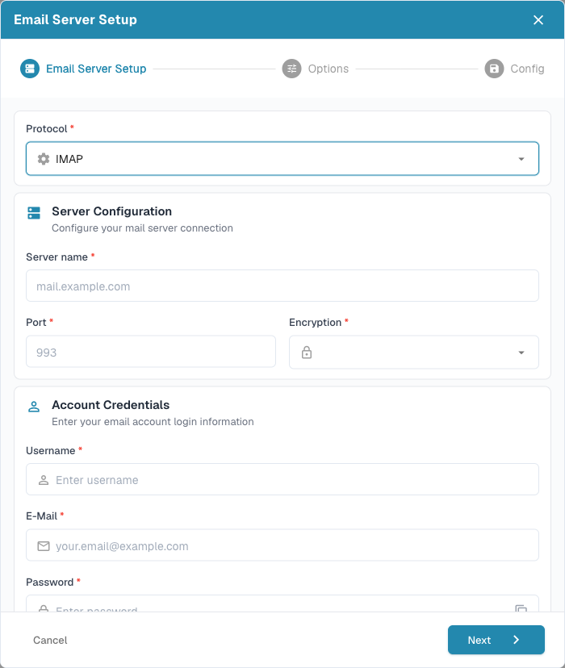
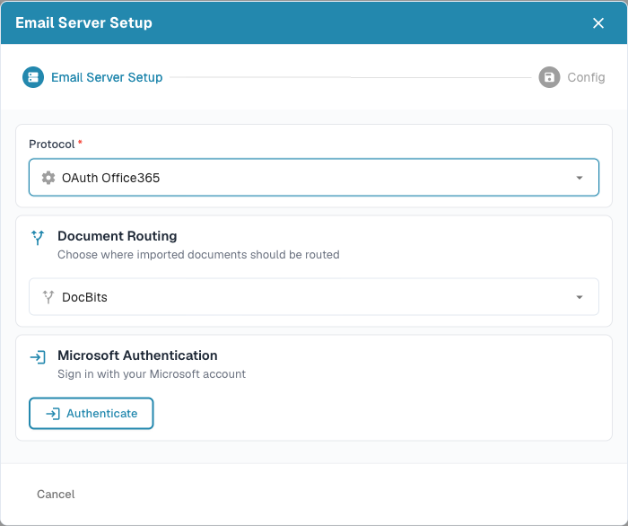
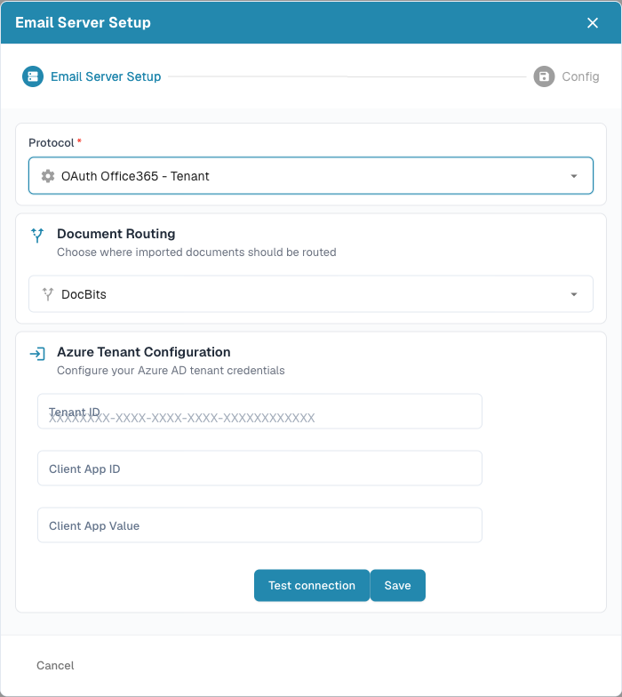
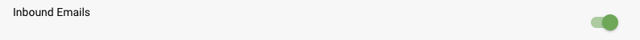
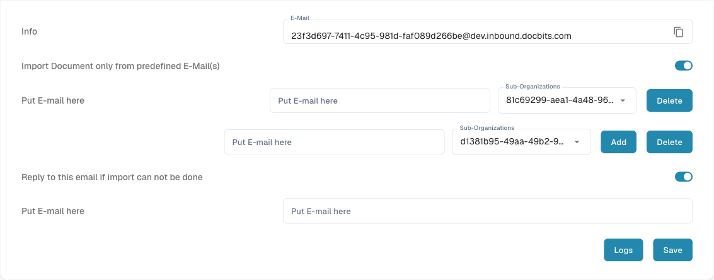

# 入站电子邮件

### 概述

DocBits 可以直接从电子邮件获取文档，无需手动上传。导入电子邮件文档有 **两种方式**，均在 **Settings → Document Processing → Import** 中管理：

| 方式 | 工作原理 | 适用场景 |
|--------|--------------|----------|
| **Email Import 账户** | DocBits 连接到您拥有的邮箱（**IMAP**、**OAuth Office365** 或 **OAuth Office365 – Tenant**），并导入找到的文档。 | 专门用于接收文档的邮箱（例如 `invoices@yourcompany.com`）。 |
| **转发电子邮件（Inbound Emails）** | DocBits 会为您提供一个唯一地址；您授权的任何人都可以将文档**转发**到该地址。 | 多个发件人临时转发文档，且无需共享邮箱凭据。 |

您可以单独使用其中任一方式，也可以同时使用两种方式。

### 方式 1 — 连接邮箱（Email Import）

前往 **Settings → Document Processing → Import**，打开 **Email Import** 部分。点击 **New** 添加邮箱连接。

<figure><figcaption>
在 Email Import 部分，点击 <strong>New</strong> 以连接邮箱。
</figcaption></figure>

设置向导随即打开。第一个字段 **Protocol** 决定 DocBits 的连接方式 — 选择 **IMAP**、**OAuth Office365** 或 **OAuth Office365 – Tenant**。

<figure><figcaption>
<strong>Protocol</strong> 下拉菜单提供三种连接类型。
</figcaption></figure>

#### IMAP

对于标准邮箱，选择 **IMAP** 并填写服务器详细信息和账户凭据：

* 邮件服务器的 **Server name** 和 **Port**（默认值为 `993`）。
* **Encryption** — `SSL`、`TLS` 或 `None`。
* 邮箱的 **Username**、**E‑Mail** 和 **Password**。

<figure><figcaption>
IMAP 表单：邮件服务器连接信息和邮箱凭据。
</figcaption></figure>

#### OAuth Office365

对于单个 Microsoft 365 用户邮箱，选择 **OAuth Office365**。您无需使用密码，而是通过 Microsoft 授权 DocBits：选择 **Document Routing** 目标，然后点击 **Authenticate** 并完成 Microsoft 登录。

<figure><figcaption>
OAuth Office365 通过 Microsoft 登录进行连接 — DocBits 不会存储密码。
</figcaption></figure>

#### OAuth Office365 – Tenant

若要通过 Azure 应用注册在租户（组织）级别连接，请选择 **OAuth Office365 – Tenant** 并输入 Azure 凭据：**Tenant ID**、**Client App ID** 和 **Client App Value**（客户端密钥）。使用 **Test connection** 验证连接，然后点击 **Save**。

<figure><figcaption>
OAuth Office365 – Tenant 使用 Azure 应用注册（Tenant ID、Client App ID、客户端密钥）。
</figcaption></figure>


**Document Routing** 决定导入的文档将发送到哪里 — **DocBits**（标准仪表板）或 **AI Workforce**。连接后，向导的后续步骤会让您选择要从哪个邮箱**文件夹**导入、可选的**共享邮箱**，以及是否将已处理的电子邮件**移动**到其他文件夹。


### 方式 2 — 将电子邮件转发到 DocBits（Inbound Emails）

首先需要启用 **Inbound Email** 模块。前往 **Settings → Document Processing → Module**，打开 **Document Type** 部分，找到 **Inbound Email** 并启用开关。

<figure><figcaption>
在 Settings → Document Processing → Module 下启用 <strong>Inbound Email</strong>。
</figcaption></figure>

启用后，**Inbound Emails** 部分会显示在 **Settings → Document Processing → Import** 下。该部分提供接收转发文档所需的全部信息：

<figure><figcaption>
Inbound Emails 部分：您的导入地址、预定义发件人列表和失败通知地址。
</figcaption></figure>

* **Import address** — 系统生成的唯一地址，格式为 `org_id@environment.inbound.docbits.com`。将文档转发或发送到此地址，DocBits 会自动导入。点击复制图标即可复制地址。
* **Import Document only from predefined E‑Mail(s)** — 启用后，只接受此处列出的发件人地址；其他人的电子邮件将被忽略。您可以为每个发件人选择一个 **Sub-Organization**（留空则分配给主组织）。使用 **Add** 添加更多发件人，使用 **Delete** 删除发件人。
* **Reply to this email if import can not be done** — 启用后，输入一个地址，以便在导入尝试失败时通知该地址，避免问题被忽略。

点击 **Save** 应用更改。


**会导入哪些附件？** DocBits 会导入受支持的文档附件 — 完整文件类型列表请参阅 [Import → Email Import](../import/README.md#email-import) — 并解包转发的 `.eml` 邮件和 Outlook `winmail.dat`（TNEF）附件，以导入其中的文档。检测也基于**实际文件内容**，因此，即使转发邮件服务器将附件重新标记为通用类型（`application/octet-stream`），仍能正确导入。内嵌图片（签名徽标／嵌入式图形）会被忽略。


### 如何选择使用方式

* **使用 Email Import 账户**：适用于文档已进入专用邮箱，且您希望 DocBits 自动获取文档的情况 — 通用邮件服务器使用 IMAP，Microsoft 365 使用 OAuth Office365。
* **使用转发电子邮件**：适用于用户需要按需转发文档，或您不希望向 DocBits 提供邮箱凭据的情况。
* **两种方式结合使用**：适用于部分文档进入固定邮箱、其他文档由用户临时转发的情况。


限制发件人（方式 2）并选择正确的 **Document Routing** 目标（方式 1），是保持入站流程整洁的两种常见方式 — 只接收您预期的文档，并将其发送到指定位置。

