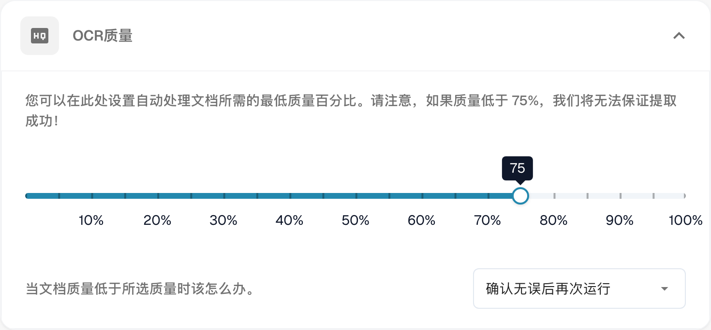
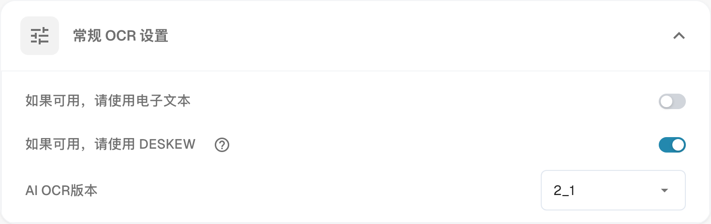
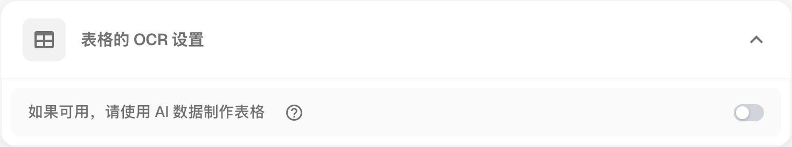
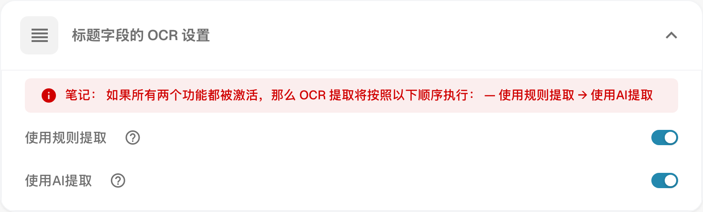

# OCR 设置


DocBits OCR 与电子文本说明：设置、质量与表头提取


## 概述

在 **OCR（光学字符识别）** 设置中，您可以配置文档处理期间 OCR 的应用方式，包括指定最低质量要求、选择是否使用嵌入文本（电子文本）、选择 OCR 版本等。本页将详细介绍所有可用设置。

## 如何访问 OCR 设置

访问 OCR 设置：

*   前往：**设置** → **文档处理** → **OCR 设置**

截图中的数值、版本和开关状态仅为示例，并非通用推荐设置。

## OCR 质量

<figure><figcaption>
OCR 质量：最低文档质量阈值，以及文档质量未达阈值时的处理选项。
</figcaption></figure>

在此部分，您可以通过调整质量滑块设置 OCR 处理所需的最低文档质量。向左或向右移动滑块可分别降低或提高质量阈值。

如果文档未达到设定的质量水平，DocBits 提供以下三种处理方式：

* **仍然运行**\
  无论文档质量如何，都会继续处理。
* **确认后重新运行**\
  **DocBits** 会暂停，并提示您确认是否继续处理。
* **抛出错误**\
  文档处理将完全停止，并显示错误消息，指出文档未达到所需的质量阈值。

## 常规 OCR 设置

<figure><figcaption>
常规 OCR 设置：电子文本、倾斜校正和 AI OCR 版本选项。
</figcaption></figure>

* **如果可用，则使用电子文本**\
  启用后，**DocBits** 将使用嵌入的电子文本（例如 PDF 中的文本），而不执行 OCR。这可以减少重复 OCR，但嵌入文本也可能缺失、乱码或顺序错误；请用实际文档验证字段和表格结果，不保证总能提高准确性。
* **如果可用，则使用 DESKEW**\
  此选项会自动校正扫描文档的对齐方式。拉直倾斜的图像有助于提高 OCR 准确性。
*   **AI OCR 版本**\
    可用于选择 AI OCR 引擎的特定版本。\
    在以下情况下，此选项可能会有帮助：

    * 当前所选版本未能达到预期效果。
    * 您正在排查与 OCR 性能或准确性有关的问题。

## 表格 OCR 设置

<figure><figcaption>
表格 OCR 设置：使用 AI 数据进行表格提取的选项。
</figcaption></figure>

* **如果可用，则对表格使用 AI 数据**\
  启用后，DocBits 将对表格使用 OCR 数据，而不是嵌入的电子文本（E-Text），即使已启用 **如果可用，则使用电子文本** 设置也是如此。

## 表头字段 OCR 设置

<figure><figcaption>
表头字段 OCR 设置：规则提取和 AI 提取选项。
</figcaption></figure>

* **使用规则提取**\
  DocBits 将应用预定义的提取规则来识别表头字段。
* **使用 AI 提取**\
  DocBits 将使用 AI 自动检测并提取表头字段。

**执行顺序：**\
如果同时启用这两个选项，**DocBits** 将按以下顺序执行提取：\
**规则提取 → AI 提取**\
\
**注意：**只有同时启用两个选项时，才适用上述执行顺序。是否同时启用应根据文档类型、规则和提取结果决定；顺序说明不代表两个选项始终都应开启，也不保证提取正确。
