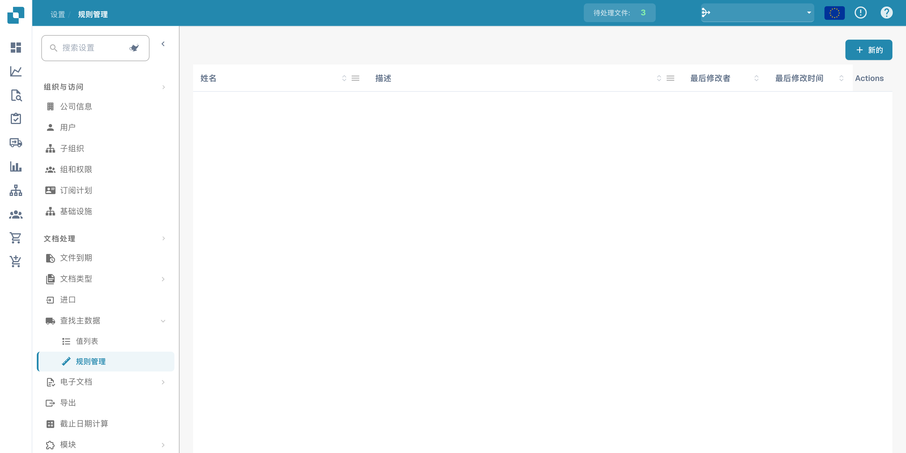
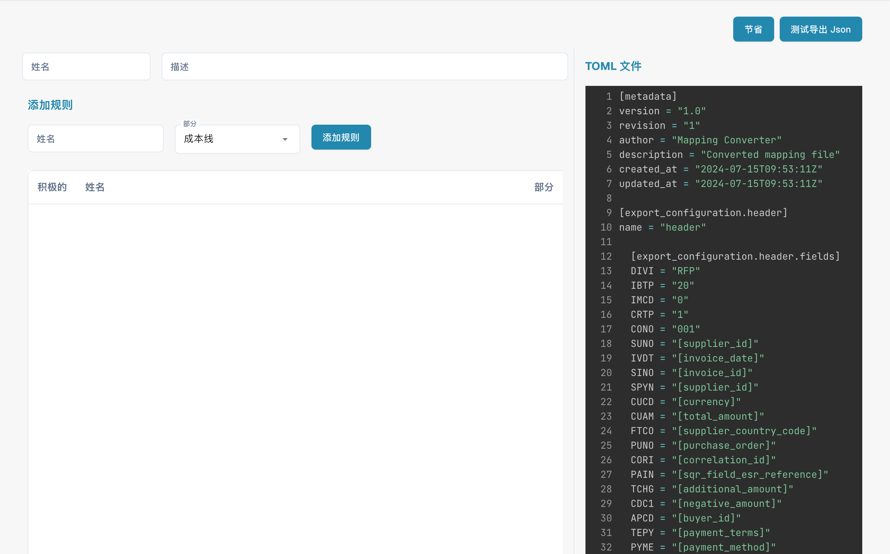

# 规则管理

<figure><figcaption>
规则管理；已配置的名称已隐藏。 界面中的“姓名”列实际表示规则名称，“Actions”列尚未翻译。
</figcaption></figure>

规则管理功能允许你创建和管理基于 TOML 的冲突解决规则，这些规则用于采购订单匹配和文档导出。每个规则集定义 DocBits 如何处理发票数据与采购订单数据之间的差异。

## 规则列表

主表显示所有规则配置：

| 列 | 描述 |
|--------|-------------|
| **名称** | 规则集的名称。标记为 **默认** 的项目是系统提供的模板。 |
| **描述** | 规则集处理内容的摘要。 |
| **最后修改者** | 上次编辑此规则集的用户。 |
| **最后修改时间** | 上次更改的时间戳。 |
| **操作** | 三点菜单，可用于编辑、复制或删除。 |

点击 **+ New** 创建规则集，或点击现有名称打开规则编辑器。

---

## 规则结构参考

本节深入说明 DocBits 开票系统中使用的冲突解决规则。这些规则旨在自动处理发票详情与采购订单（PO）数据之间的差异，确保财务对账准确无误。系统会应用这些规则来处理发票行、费用和税费，并在必要时生成相应的调整或备注。

## 规则结构

### 1. 元数据

• version：标识映射文件的版本。

• revision：用于跟踪更改的修订号。

• author：指明映射文件的创建者。

• description：简要说明文件的用途。

• created_at & updated_at：文件的创建和最后更新时间戳。

### 2. 导出配置

导出配置部分定义系统中的数据字段与导出文件中相应字段之间的映射。

• Header：定义导出发票数据的表头字段。

• Tax Lines：指定税费行项目的字段。

• Order Header Charges：映射与订单表头级别附加费用相关的字段。

• Receipt Lines：映射收货单中各个行项目的字段。

• Order Line Charges：定义与特定订单行相关费用的字段。

• Cost Lines：指定成本分摊行的字段。

• Debit Note & Credit Note：定义发生差异时生成借项通知单和贷项通知单所需的字段。

### 3. 冲突解决规则

这些规则用于处理发票数据与相应采购订单数据之间的差异。每条规则由以下几个部分组成：

• Name：规则的描述性名称，表明其处理的差异类型。

• Section：指明规则适用的发票部分（例如 receipt_lines、line_charges）。

• Active：布尔值（true 或 false），表示规则当前是否启用。

• Match Criteria：根据实际发票数据与预期采购订单数据之间的比较结果，定义触发规则的条件。

• Actions：定义触发规则后系统应执行的操作，包括调整数值、应用费用或生成贷项通知单/借项通知单。

## 规则中的常见元素

### 比较运算符

这些运算符定义如何将发票实际值与采购订单预期值进行比较：

• equal

• greater than

• greater than or equal to

• less than

• less than or equal to

• within tolerance

• outside tolerance

### 审批状态

指明差异是否已获审批：

• approved

• rejected

• any

### 操作类型

定义检测到差异时要执行的具体操作：

• receipt line

• cost line

• header charge

• line charge

• tax line

• debit note receipt line

• debit note cost line

• debit note header charge

• debit note line charge

• credit note receipt line

• credit note cost line

• credit note header charge

• credit note line charge

• credit note tax line

### 规则示例

#### [案例 1、2、3：数量和单价在容差范围内](transactionconfig-pro-template/case-1-2-3-quantity-and-unit-price-within-tolerance.md)

• 用途：处理发票上的数量和单价与采购订单相比均在可接受容差范围内的情况。

• 操作：系统接受发票中的值并计算总金额。

#### [案例 4、5：数量在容差范围内，单价超出容差范围（已审批）](./#case-4-5-quantity-within-tolerance-unit-price-outside-tolerance-approved) 

• 用途：适用于数量在容差范围内、但单价超出容差范围且已获审批的情况。

• 操作：系统将单价调整为与采购订单一致，并应用所需的行费用。

#### [案例 6：数量在容差范围内，单价低于负容差范围（已拒绝）](transactionconfig-pro-template/case-6-quantity-within-tolerance-unit-price-outside-negative-tolerance-rejected.md)

• 用途：处理单价低于预期且超出容差范围，导致被拒绝的情况。

• 操作：系统将单价调整为与采购订单一致，为差额生成贷项通知单，并根据需要应用表头费用。

### 费用和税费处理

### 每单位费用容差

• 此类别下的规则用于处理每单位费用的差异，并根据费用是否在容差范围内以及是否已获审批或被拒绝来执行相应操作。

### 税费行调整

• 这些规则通过调整税费行，或根据发票税费数据与采购订单税费数据之间的差异生成相应的贷项通知单或借项通知单，来处理税费差异。

### 枚举和选项

• 枚举：预定义的值列表，用于确保规则中的值保持一致（例如比较运算符、审批类型）。

• 选项：预定义的数量或单价处理选项，为规则定义提供灵活性。

## 截图说明

### 截图 1：规则管理界面

<figure><figcaption>
规则管理概览及可用操作。 界面中的“姓名”列实际表示规则名称，“Actions”列尚未翻译。
</figcaption></figure>

此截图展示了规则管理界面，管理员可在此查看和管理所有冲突解决规则。主要元素包括：

• 添加规则按钮：用于添加新规则。

• 规则列表：显示所有启用规则的详情，例如名称、部分和启用状态。

• 部分下拉菜单：根据规则适用的部分筛选规则（例如收货单行、行费用）。

### 截图 2：规则详细编辑

<figure><figcaption>
TOML 规则编辑器中的技术配置示例。 界面把通用名称显示为“姓名”，把保存显示为“节省”；本例仅查看未保存的表单。
</figcaption></figure>

此截图展示了正在编辑的特定规则的详细视图。主要元素包括：

• 条件部分：定义触发规则的条件。例如，条件可以指定：如果数量和单价与采购订单不同，但差异在容差范围内，则应用该规则。

• 操作部分：指定满足条件时应执行的操作，包括调整发票行、生成贷项通知单或借项通知单，或应用额外费用。

• 文档类型和成本要素：允许管理员将特定操作映射到文档类型和成本要素，以便灵活处理不同场景。
