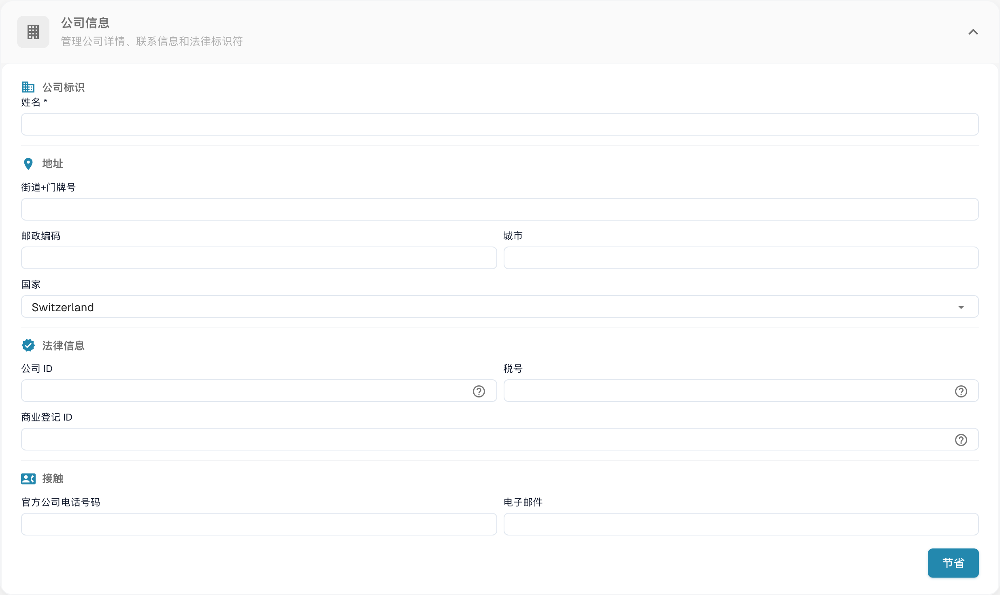

# 公司信息

<figure><figcaption>
公司信息；组织字段值已隐藏。 “姓名”在此表示公司名称，“节省”表示保存；公司资料已隐藏，本例未保存。
</figcaption></figure>

公司信息页面用于管理公司资料、偏好设置和订阅详情。页面分为以下几个部分：

## 公司信息

此部分包含核心公司数据，分为四个区域：

### 公司身份

* **名称**（必填）：公司的法定名称。

### 地址

* **街道+门牌号**：公司的街道地址。
* **邮政编码**：邮政编码。
* **城市**：城市名称。
* **国家**：从下拉菜单中选择国家/地区。

### 法律信息

* **公司 ID**：公司的唯一标识符，用于集成和内部参考。
* **税号**：用于财务报告的税务识别号。
* **商业登记 ID**：用于法律文件的商业登记号。

### 联系方式

* **公司官方电话号码**：公司的主要电话号码。
* **电子邮件**：用于官方通信的主要电子邮箱地址。

输入或更新字段后，点击 **保存** 应用更改。法定标识信息旁的 **?** 图标会显示额外的字段说明。选择此部分的标题可展开或折叠表单。

## 电子邮件域名

组织管理员可以打开 **Settings → Company Information → E-mail domains**，管理用于自动分配组织的域名。当用户使用 Microsoft 或 Google 登录且尚未加入组织时，如果其电子邮件地址使用了该组织列出的域名，DocBits 可以将其分配到此组织。一个域名只能属于一个组织。

<figure><figcaption>
公司邮件域名配置。
</figcaption></figure>

在输入框中仅输入域名，例如 `example.com`，然后选择 **添加域名** 或按 Enter。第一个域名会成为主域名。如果列表中有多个域名，可在其他行选择 **设为主要** 将其设为主域名，或选择垃圾桶图标将其删除。无效域名、个人电子邮件服务提供商域名或已分配给其他组织的域名等错误会显示在输入框下方。**尚未分配域名** 表示此组织尚无域名规则。

添加域名前，请确认哪个组织应接收新的登录用户。要管理现有成员资格，请参阅[用户](../groups-users-and-permissions/users/README.md)。

## 公司偏好设置

配置公司范围内的默认设置：

* **日期模式**：选择 DocBits 中日期的显示格式（例如 `%m/%d/%Y`、`%d.%m.%Y`）。
* **金额格式**：选择金额的数字格式（例如，Deutsch 对应 `1.000,00`，English 对应 `1,000.00`）。
* **新版本信息对话框**：切换是否在 DocBits 发布新版本时向用户显示通知。

更改后点击 **保存**。

## 应用颜色

自定义 DocBits 界面的主色。此设置有助于通过视觉区分不同环境（例如开发环境与生产环境）。

* **颜色**：输入十六进制颜色代码（例如 `#2388AE`），或使用颜色选择器。
* 点击 **保存** 应用更改，或点击 **重置** 恢复默认颜色。

## 订阅计划

查看当前有效订阅计划及其详情：

* **套餐名称**：每个有效计划的名称（例如 DocBits、DocFlow Users、DocSearch）。
* **剩余天数**：距离计划到期还剩多少天。
* **Start Date / End Date**：订阅周期。
* **用户数量**：组织中的用户总数。
* **子组织数量**：已配置的子组织数量。
* **供应商数量**：已登记的供应商数量。

## 订阅用量

监控每月的令牌和工作流用量：

| 列 | 说明 |
|--------|-------------|
| **类型** | 用量类型（文档或工作流）。 |
| **From / To** | 计费周期日期。 |
| **已使用令牌数** | 当前周期已使用的令牌数。 |
| **剩余代币** | 当前周期剩余可用令牌数。 |

使用 **选择** 按钮按特定日期范围筛选。
