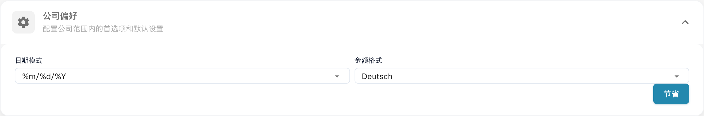
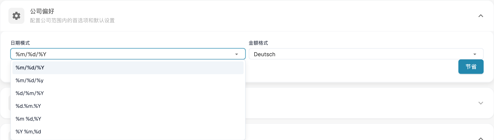

# 公司偏好

## 视频教程：公司、订阅与审计


DocBits 中的公司信息、订阅计划与审计日志


视频演示了公司信息和偏好、订阅计划、登录活动以及审计日志。

在公司信息中打开偏好设置，配置组织的日期和金额格式。

<figure><figcaption>
公司偏好及金额、日期格式。 金额格式的已配置语言名称保持原样；“节省”表示保存，本例未修改配置。
</figcaption></figure>

选择适合文档的日期格式。%d、%m 和 %Y 是技术格式代码。

<figure><figcaption>
在公司偏好中选择日期格式。 日期格式占位符及金额格式的已配置语言名称保持原样；本例未修改配置。
</figcaption></figure>

金额格式是单独的设置；已配置的名称可能保持不变。保存前检查两种格式。旧版版本信息窗口不属于当前视图。拍摄这些图片时没有更改偏好设置。


