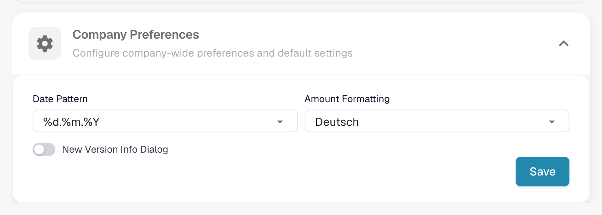

# 公司偏好设置

## 概览



在 **Company Preferences（公司偏好设置）** 中，您可以配置应用程序的关键格式和通知设置，包括：

* 选择应用程序中使用的**日期格式**
* 设置**金额格式**（例如，小数分隔符、数字分组方式）
* 启用或停用有新版本可用时显示的弹出通知

## 如何访问

要访问 **Company Preferences（公司偏好设置）**：

1.  前往 **Settings（设置）** → **Global Settings（全局设置）** → **Company Information（公司信息）**

    <figure><figcaption></figcaption></figure>
2.  滚动到 **Company Preferences（公司偏好设置）** 部分

    <figure><figcaption></figcaption></figure>

## 日期格式

在此设置中，您可以选择 **DocBits** 中使用的**日期格式**。系统提供多种格式选项，您可以自定义日期的显示方式。

<figure><figcaption></figcaption></figure>

日期格式中使用以下占位符：

* `%d` – 日（例如，07）
* `%m` – 月（例如，07）
* `%Y` – 四位数年份（例如，2025）
* `%y` – 两位数年份（例如，25）

#### **格式示例：**

* `%d.%m.%Y` → 07.07.2025
* `%m/%d/%y` → 07/07/25

请选择最符合您组织或地区需求的格式。

完成更改后，点击右下角的 **Save（保存）** 按钮以应用更改。

<figure><figcaption></figcaption></figure>

## 金额格式

此设置用于定义应用程序中金额的格式，例如，使用逗号 ( , ) 还是句点 ( . ) 作为小数分隔符。

#### **格式示例：**

* `1,000.00`（美国格式）
* `1.000,00`（欧洲格式）

<figure><figcaption></figcaption></figure>

完成更改后，点击右下角的 **Save（保存）** 按钮以应用更改。

<figure><figcaption></figcaption></figure>

<mark style="color:red;">**注意**</mark>：此设置控制 **DocBits** 中金额的显示方式。**Field Validation（字段验证）屏幕**中的**金额格式**由文档的**来源**设置决定。

## 新版本信息对话框

此设置用于启用应用程序发布新版本时显示的弹出通知。启用后，有更新可用时会自动显示对话框。要应用更新：

<figure><figcaption></figcaption></figure>

在对话框中点击 **Refresh to Close（刷新并关闭）**。**DocBits** 将重新加载并以最新版本打开。这样可以确保用户始终使用最新功能、改进和错误修复。

启用或停用此设置后，点击右下角的 **Save（保存）** 按钮以应用更改。

<figure><figcaption></figcaption></figure>
