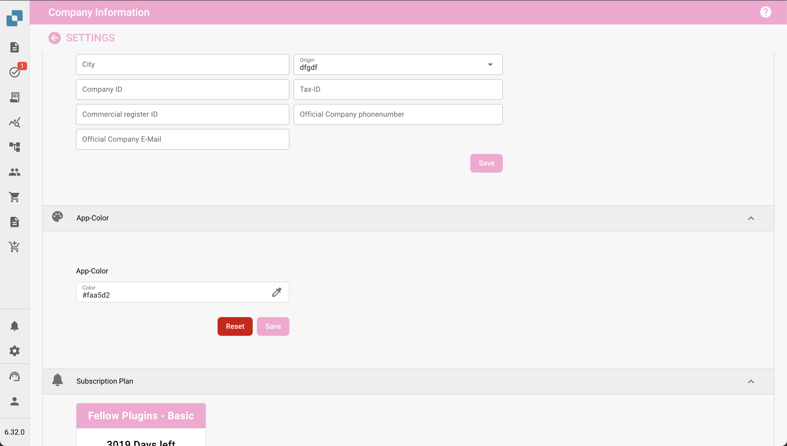

# 在公司设置中定义应用颜色

## 概述

**App Color** 设置允许管理员定义应用程序界面的配色方案。此功能尤其适用于区分测试、沙盒和生产等不同环境。为每个环境分配不同的颜色后，用户可以轻松识别当前所处的环境，从而降低在错误环境中执行关键操作的风险。

<figure><figcaption></figcaption></figure>

## 访问 App Color 设置

1. **导航至公司设置**：
   * 从主菜单中，点击 **Company Information** 部分。
2. **找到 App Color 部分**：
   * 在 Company Information 设置中向下滚动，找到 **App Color** 部分。

## 设置 App Color

1. **选择颜色**：
   * 点击颜色框，或直接在文本字段中输入十六进制代码。
   * 随即会显示颜色选择器，供您选择所需的颜色。
   * 如果已为该环境预先指定颜色，可以输入对应的十六进制代码。
2. **保存颜色**：
   * 选择颜色后，点击 **Save** 按钮以应用更改。
   * 应用程序界面会立即更新，显示新颜色。
3. **重置为默认值**：
   * 如果要恢复默认颜色，请点击 **Reset** 按钮。

## 环境颜色最佳实践

为避免混淆，建议为每种环境制定标准配色方案：

* **生产环境**：使用中性或默认颜色，例如 **#FFFFFF**（白色）或 **#f0f0f0**（浅灰色），表示线上环境。
* **测试环境**：使用鲜艳或醒目的颜色，例如 **#ffcc00**（黄色）或 **#ffa500**（橙色），表示测试环境。
* **沙盒环境**：使用具有辨识度的颜色，例如 **#007bff**（蓝色）或 **#6c757d**（灰色），表示沙盒或开发环境。

## 订阅计划通知

在 App Color 部分下方，管理员还会看到与 **Subscription Plan** 相关的信息，包括当前计划、计划状态和订阅剩余天数。

## App Color 的重要性

App Color 设置是一种简单而有效的工具，可帮助用户快速识别当前所处的环境。通过谨慎选择和管理这些颜色，组织可以减少错误并提高工作流效率。
