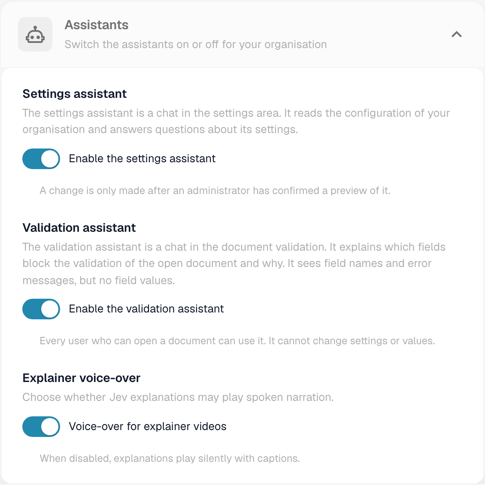
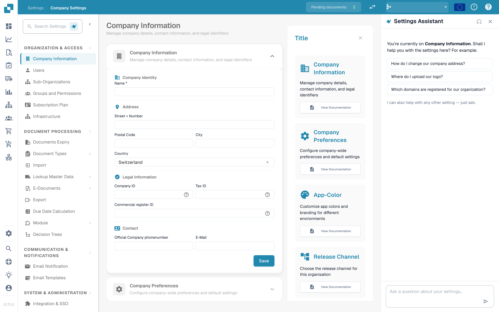

# 设置助手

**Settings Assistant（设置助手）**是设置区域中的聊天面板。你可以用日常语言提出问题，它会读取你所在组织的配置、回答问题，并直接带你前往相应的设置。如果设置中的某项功能已停止工作，它也会提醒你；获得你的确认后，还可以替你更改设置。

当你知道**想要做什么**（例如“停止按条形码拆分文档”），却不知道设置位于**哪里**，或者想了解某项功能**为什么没有生效**（例如“为什么 PO 匹配没有启用？”）时，它最能派上用场。

<figure><figcaption>
Company Information 页面上的设置助手：显示当前页面的问候语、三个示例问题和问题输入框。当某项导入已停止工作时，问候语上方会显示警告卡片（请参阅<a href="settings-assistant-chat.md#findings-the-assistant-warns-you">发现的问题</a>）。
</figcaption></figure>

该助手**默认处于关闭状态**。本页介绍如何启用并打开它。可向它提出哪些问题、它能更改哪些内容，请参阅页面 [Settings Assistant: What the Chat Can Do](settings-assistant-chat.md)。

## 谁可以使用

* **组织管理员**可以为整个组织启用或关闭该助手。
* 启用后，所有能够打开**设置**的管理员都可以自行显示或隐藏面板。
* 更改操作（应用建议、关闭或删除导入连接、创建规则）仅限**组织管理员**。其他用户会看到消息 *Available to administrators only.*（仅管理员可用）。

## 启用助手

1. 前往 **Settings → Global Settings → Company Information**。页面标题显示为 **Company Settings**。
2. 打开 **Assistants** 部分。
3. 开启 **Enable the settings assistant**。

<figure><figcaption>
Assistants 部分。设置助手有独立的开关。验证助手和讲解配音是单独的功能。
</figcaption></figure>

系统会显示简短消息 **Settings assistant enabled**（设置助手已启用）。该设置默认关闭。关闭时，面板及其按钮不会显示在任何位置。


同一部分中的 **Validation assistant**（验证助手）是另一项功能。它会解释文档中的阻止字段，且无法更改任何设置。切换其中一个功能不会影响另一个。


## 打开和关闭面板

在设置区域的每个页面上，你都可以在设置搜索框旁找到一个小型**神灯按钮**。点击即可**显示**或**隐藏**助手。

<figure><figcaption>
在每个设置页面上，助手都位于<strong>右侧</strong>：左侧是导航，中间是页面内容，旁边是助手。此处显示的是 <strong>Company Settings → Company Information</strong>。用于显示或隐藏助手的按钮是导航顶部 <strong>Search Settings</strong> 旁的灯泡图标。
</figcaption></figure>

* 面板会按用户记住你的选择，因此你下次返回时会保持打开状态。
* 在宽度为 1280 像素及以上的屏幕上，面板会显示在页面旁边。你可以拖动面板边缘调整宽度。
* 在较窄的屏幕上，面板会以覆盖层形式打开。按 **Esc** 或点击面板外部即可关闭。
* **New chat**（新建聊天，标题栏中的对话气泡图标）会清除对话。刷新页面后对话仍会保留，但关闭浏览器标签页后不会保留。

## 后续操作

* 提出你的第一个问题：请参阅 [Settings Assistant: What the Chat Can Do](settings-assistant-chat.md)。
* 助手运行于 **Fast** AI 层级。组织设置中没有可用于选择其他模型的选项。

## 故障排除

| 问题 | 原因和解决方案 |
| --- | --- |
| 设置区域中没有神灯按钮 | 组织开关处于关闭状态。组织管理员可在 **Company Information → Assistants** 中启用该功能 |
| Company Information 中缺少 **Assistants** 部分 | 只有组织管理员可以看到该部分 |
| 面板显示 **The assistant is being set up** | 该功能尚未在你的环境中开放 |
| 面板已显示，但回答提示 *Available to administrators only.* | 你的账户不是组织管理员 |

## 相关页面

* [Settings Assistant: What the Chat Can Do](settings-assistant-chat.md)
* [Company Preferences](company-preferences.md)
