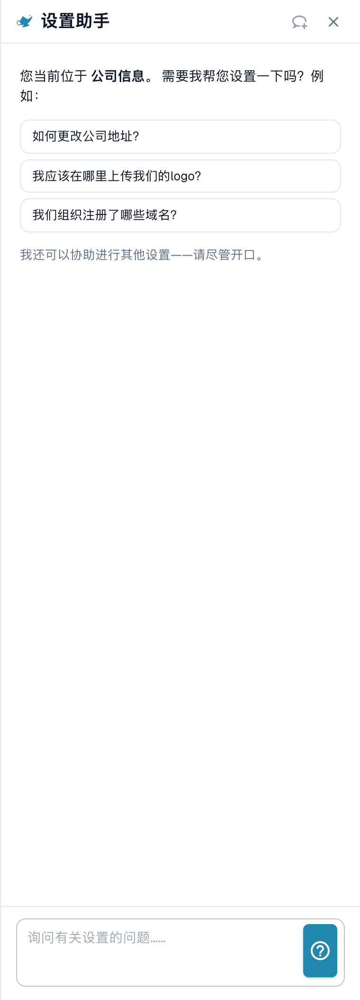
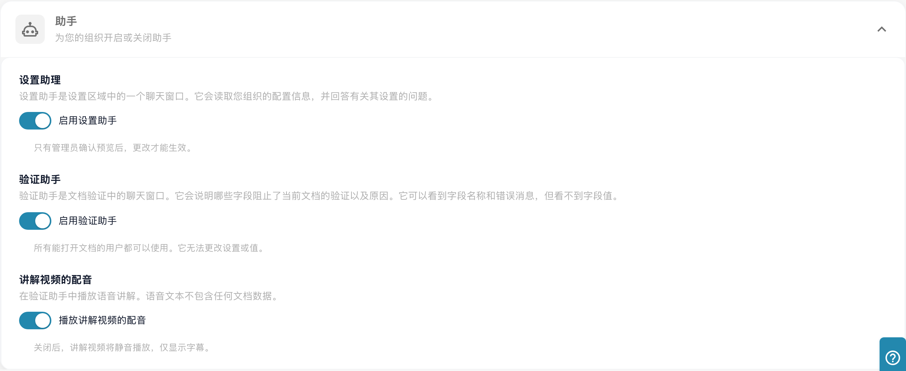

# 设置助手：启用

**Settings Assistant（设置助手）**是设置区域中的聊天面板。您可以用自然语言提出问题，它会读取您所在组织的配置、回答问题，并直接带您前往相应设置。它还可以在设置中的某项功能停止运行时发出警告，并在获得您的确认后为您更改设置。

当您知道**想要做什么**（“停止按条形码拆分文档”），但不知道设置**在哪里**，或者想了解**为什么**某项功能没有生效（“为什么采购订单匹配没有启用？”）时，它最能派上用场。

<figure><figcaption>
公司信息页面上的中文设置助手问候语、示例问题和输入框。尚未发送问题，也未更改组织配置。
</figcaption></figure>

默认情况下，助手**处于关闭状态**。本页介绍如何启用助手并打开面板。关于您可以询问什么以及助手可以更改什么，请参阅[设置助手：聊天功能](settings-assistant-chat.md)。

## 谁可以使用

* **组织管理员**可以为整个组织启用或关闭助手。
* 启用后，每位能够打开**设置**的管理员都可以为自己显示或隐藏面板。
* 执行更改（应用建议、关闭或删除导入连接、创建规则）的权限仅限于**组织管理员**。其他用户会看到消息 _仅限管理员使用。_

## 启用助手

1. 前往**设置 → 全局设置 → 公司信息**。页面标题显示为**公司设置**。
2. 打开**助手**部分。
3. 启用**启用设置助手**。

<figure><figcaption>
当前中文“助手”区域分别控制设置助手、验证助手和讲解配音。图示开关状态是测试环境现值；本次只展开区域，没有切换开关。
</figcaption></figure>

系统会显示简短消息，确认**设置助手已启用**。该设置默认处于关闭状态。关闭时，任何位置都不会显示面板及其按钮。


同一部分中的**验证助手**是另一项功能。它用于解释文档中的阻止字段，不能更改任何设置。切换其中一个助手不会影响另一个。


## 打开和关闭面板

在设置区域的每个页面上，您都可以在设置搜索框旁找到一个小型**神灯按钮**。点击该按钮即可**显示**或**隐藏**助手。

* 面板会按用户记住您的选择，因此下次回来时仍会保持打开。
* 在较宽的屏幕上（1280 像素及以上），面板会显示在页面旁边。您可以拖动面板边缘来调整宽度。
* 在较窄的屏幕上，面板会以叠加层形式打开。按 **Esc** 或点击外部区域即可关闭。
* **新建聊天**（标题栏中的对话气泡图标）会清除对话。重新加载页面后对话仍会保留，但关闭浏览器标签页后不会保留。

## 接下来

* 提出您的第一个问题：请参阅[设置助手：聊天功能](settings-assistant-chat.md)。
* 助手使用 **Fast** AI 层级。组织没有可用于选择其他模型的设置。

## 故障排除

| 问题 | 原因和解决方案 |
| ----------------------------------------------------------------------- | -------------------------------------------------------------------------------------------------------------------- |
| 设置区域中没有神灯按钮 | 组织开关处于关闭状态。组织管理员可在**公司信息 → 助手**中启用该功能 |
| 公司信息中缺少**助手**部分 | 只有组织管理员能看到该部分 |
| 面板显示**助手正在设置中** | 该功能在您的环境中尚不可用 |
| 面板已显示，但回答中出现 _仅限管理员使用。_ | 您的帐户不是组织管理员 |

## 相关页面

* [设置助手：聊天功能](settings-assistant-chat.md)
* [公司偏好设置](../company-preferences.md)
