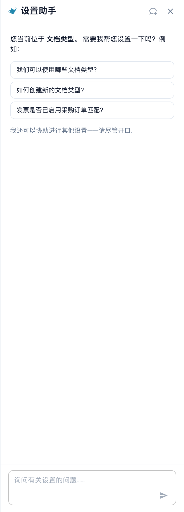
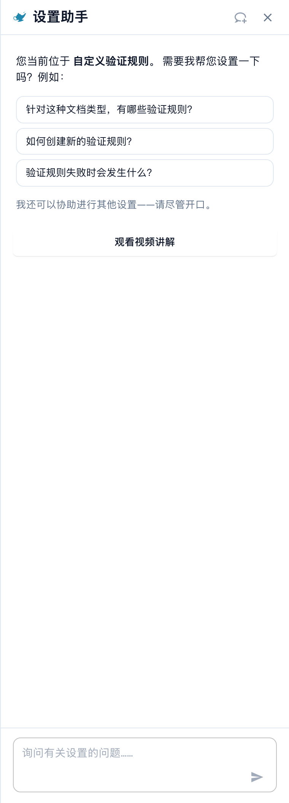

# 设置助手：聊天可以做什么

## 概览

**设置助手**的聊天功能可以回答有关设置的问题，在导入停止工作时向你发出警告，并在你确认后为你更改设置。使用前，管理员必须先[启用助手](./)。

### 它可以做什么

| 你想要……               | 示例                                                  | 你会得到什么                                                                                                                |
| ---------------------- | ----------------------------------------------------- | --------------------------------------------------------------------------------------------------------------------------- |
| 查找设置               | “在哪里可以找到电子邮件导入设置？”                    | 设置路径（例如 Settings / Import）、一个会跳转到该设置并将其突出显示的 **Open setting** 按钮                                |
| 了解设置               | “如何启用条码检测？”                                  | 对每项匹配设置的简短说明：何时启用，何时保持关闭                                                                            |
| 检查配置               | “为什么 PO 匹配未启用？”                              | 组织中每项相关设置的当前值（**Current: On** 或 **Current: Off**），以及阻止其生效的设置                                       |
| 发现导入故障           | 面板顶部的红色卡片                                     | 哪个邮箱或 FTP 连接发生故障、故障频率，以及可能的原因                                                                       |
| 安全地更改设置         | 在发现卡片中，对故障邮箱点击 **Switch off**            | 更改预览。确认前不会保存；能否撤销及其时限以具体操作的说明为准。                                                                       |
| 了解页面               | **Watch video explanation**                          | 当前页面的简短视频（仅适用于部分页面）                                                                                      |


助手使用 **Fast** AI 层级。组织中没有可用于选择其他模型的设置。


## 提问

在底部的问题输入框中输入问题，然后按 **Enter**。助手会显示当前操作（“Reading configuration…”、“Searching documentation…”、“Writing answer…”），你可以随时点击 **Stop** 停止。

### 面板会识别你所在的页面

在设置页面打开面板时，助手会针对**该页面**向你问候，并提供三个相关问题。以下是可尝试的示例问题，实际问候语和回答以当前页面、语言及组织配置为准：

| 页面                | 示例问题                                                                                                                                       |
| ------------------- | ---------------------------------------------------------------------------------------------------------------------------------------------- |
| Company Information | “如何更改公司地址？”，“在哪里上传公司徽标？”，“我们的组织注册了哪些域名？”                                                                     |
| Import              | “我们是否启用了电子邮件导入？”，“我们应该将文档发送到哪个电子邮件地址？”，“如何设置 FTP 或 SFTP 导入？”                                        |
| Classify & Extract  | “提取使用的是哪种 AI 模型？”，“我们是否启用了按条码拆分文档？”，“能否为某个供应商使用其他 AI 模型？”                                           |
| Users               | “如何邀请新用户？”，“如何将用户设为管理员？”，“如何停用用户？”                                                                                |
| Settings overview   | “如何启用条码检测？”，“为什么 PO 匹配未启用？”，“在哪里可以找到电子邮件导入设置？”                                                            |

点击问题后会立即发送。三个问题下方，面板会显示 _我还可以帮助你了解任何其他设置——直接提问即可。_ 对话期间，底部会一直显示 **Help with this page** 选项，提示“此页面可以配置什么？”

### 示例 1：查找设置

你提问：**“如何更改公司地址？”**

<!-- Obsolete illustration retired: Retire the obsolete English answer/finding illustration. The procedure remains as an explicitly conditional example; no current answer, fault, configuration or successful change is claimed. -->

回答会告诉你地址设置在哪里。下方的卡片会显示路径（**Settings / Company Settings**）和 **Open setting** 按钮。点击该按钮后，DocBits 会打开相应页面，滚动到该设置并将其突出显示几秒钟。

### 示例 2：了解有多个名称的设置

你提问：**“如何启用条码检测？”**

<!-- Obsolete illustration retired: Retire the obsolete English answer/finding illustration. The procedure remains as an explicitly conditional example; no current answer, fault, configuration or successful change is claimed. -->

“条码检测”可能指三种不同的设置，因此助手会询问 _你指的是：QR Code Extraction、Barcode Assignment，还是 Split Document on Barcode？_ 并逐一说明：

* **QR Code Extraction**：在处理期间自动读取支持的条码和 QR 码。文档中包含有用代码时，适合启用此设置。
* **Barcode Assignment**：允许审核人员在验证期间手动将解码后的条码值分配给字段。它需要先通过提取检测代码，也不会让处理过程实现免人工操作。
* **Split Document on Barcode**：在分隔页处将一个上传文件拆分为多个文档。仅当分隔代码可靠时才使用此设置。

### 示例 3：查明某项功能为何没有运行

你提问：**“为什么 PO 匹配未启用？”**

<!-- Obsolete illustration retired: Retire the obsolete English answer/finding illustration. The procedure remains as an explicitly conditional example; no current answer, fault, configuration or successful change is claimed. -->

助手会读取组织的设置并报告检查结果。例如，PO Matching 开启而 **Auto export if PO matched 100%** 关闭时，匹配功能和匹配后的自动导出必须分别判断：关闭自动导出并不等于关闭匹配。请根据回答中的当前值和设置路径，检查相关条件；不要把示例值当作自己组织的配置。

### 示例 4：PO 匹配

你打开 **Settings → Document Types** 并提问：**“发票是否启用了 PO 匹配？”**（此问题也是该页面三个建议问题之一。）

<figure><figcaption>
文档类型页面上的中文设置助手初始面板，提供与当前页面相关的问题；本图没有执行提问，也不表示任何匹配或导出开关已启用。
</figcaption></figure>

助手会读取该文档类型及相关设置。若匹配开启而匹配后的自动导出关闭，不能仅据此断言发票必须人工处理：还应检查其他导出规则、审批要求和工作流。下图展示当前中文问候语与提问入口，没有执行此问题或确认任何开关状态。

* 有关**匹配规则和容差**，请参阅页面 [Purchase Order Matching Rules](../../document-types/more-settings/purchase-order/purchase-order-matching-rules.md)。
* 若要查看**供应商的文档为何无法匹配**，请打开 [Touchless Intelligence: PO Matching Diagnosis](../../../../analytics-dashboard/touchless-intelligence/touchless-po-matching-diagnosis.md)。该页面会显示原因、受影响的文档以及决策流程。

### 示例 5：字段验证（自定义验证规则）

在 **Settings → Document Types → Custom Validation Rules** 页面上，面板会针对该页面向你问候并建议三个问题。

<figure><figcaption>
自定义校验规则页面上的中文设置助手问候语和建议问题。本图只展示提问入口，未创建或激活规则。
</figcaption></figure>

在此使用助手可以**查找**正确的设置，并了解规则的作用。若要**创建或更改**规则，请直接在页面上操作：参阅 [自定义校验规则](../../document-types/custom-validation-rules.md) 和 [Duplicate a Custom Validation Rule](../../document-types/duplicate-a-custom-validation-rule.md)。如果助手为你创建规则，该规则始终会以**非活动**状态创建，你需要自行启用。


不要混淆 **Custom Validation Rules**（适用于文档类型字段的规则）和 **E-Invoice Validation**（对 XRechnung、ZUGFeRD 和 Factur-X 文件进行的检查）。它们是两个不同的页面。


### 示例 6：可以尝试的更多问题

* “提取使用的是哪种 AI 模型？”
* “我们是否启用了按条码拆分文档？”
* “如何停用用户？”
* “在哪里可以设置文档的保留时长？”
* “哪些设置会影响免人工处理率？”
* “向我展示供应商门户设置的屏幕截图。”


如果问题不属于设置范围，或者助手在其掌握的 DocBits 信息中找不到相关内容，它会明确告知。例如，询问某个非设置项目时，助手会回答 _我在此处可用的 DocBits 信息中找不到有关……的内容_，并提供最接近页面的链接。它不会猜测。


### 回答中的链接和屏幕截图

* 回答可以包含 **View documentation** 链接。这些链接仅指向 docs.docbits.com，并会在新标签页中打开。只有当你的环境支持文档搜索时，回答才会包含文档链接。
* 回答可以显示文档中的**屏幕截图**。点击缩略图可放大。
* **Copy answer**（回答旁边的小型复制图标）会复制文本。

## 发现项：助手会向你发出警告 

设置中出现故障时，面板顶部会显示一张**红色卡片**。你无需提问。每次打开面板，以及每次返回浏览器标签页时，助手都会再次检查。

<!-- Obsolete illustration retired: Retire the obsolete English answer/finding illustration. The procedure remains as an explicitly conditional example; no current answer, fault, configuration or successful change is claimed. -->

目前有两项检查：

| 检查         | 卡片标题                                                                  | 统计内容                                             |
| ------------ | ------------------------------------------------------------------------- | ---------------------------------------------------- |
| 电子邮件导入 | “Email import: 1 mailbox affected” / “Email import: 3 mailboxes affected” | 登录失败的邮箱                                       |
| FTP 导入     | “FTP import: 1 connection affected” / “FTP import: 2 connections affected” | 连接或登录尝试失败的连接                             |

每张卡片都有三个按钮：

* **Show errors**（然后显示 **Hide**）：列出最多十个受影响的邮箱或连接，并显示其状态（**Switched off** 或 **Retrying**）、失败尝试次数以及原因。
* **Open import settings**：打开 **Settings → Import**。
* **Help me fix this**：开始聊天。助手会自动询问“我的电子邮件导入停止工作了。你能帮我修复吗？”，并引导你了解原因。

摘要行会说明问题的严重程度：

| 摘要行                                                     | 含义                                                   |
| ---------------------------------------------------------- | ------------------------------------------------------ |
| _已关闭：此处没有任何内容正在导入。_                       | 所有受影响的邮箱都已关闭，不会收到任何内容。           |
| _仍在重试，但导入很可能失败。_                             | DocBits 会继续尝试，但登录不起作用。                   |
| _1 个已关闭，2 个仍在重试。_                               | 两种情况都有。                                         |

### 你可能会看到的原因

助手会将技术错误转换为以下某个原因：

| 显示的原因                                                                                  | 操作建议                                                                   |
| ------------------------------------------------------------------------------------------- | -------------------------------------------------------------------------- |
| 策略阻止登录（例如已禁用基本身份验证，或需要应用密码/MFA）                                   | 请联系邮件管理员获取应用密码，或将邮箱切换为现代身份验证                   |
| 登录遭拒（检查用户名和密码）                                                                | 密码已更改。请在导入设置中输入新密码                                       |
| 未找到邮箱或路径                                                                            | 邮箱已重命名或删除。请检查地址或文件夹                                     |
| 无法连接服务器                                                                              | 请检查服务器名称和防火墙                                                   |
| 连接超时                                                                                    | 服务器速度较慢或连接受阻。请稍后重试                                       |
| 证书或 TLS 连接失败                                                                         | 请检查加密设置和服务器证书                                                 |
| 无法确定原因                                                                                | 请打开导入设置并测试连接                                                   |

### 关闭或删除故障连接

在展开的行中，你可以使用 **Switch off**（仅当连接仍处于启用状态时显示）或 **Delete**。两者都遵循相同的安全流程：

1. 点击按钮。助手会询问 _关闭（名称）？在重新启用此邮箱之前，不会从中导入任何内容。_ 或 _删除（名称）？它会被永久移除，且无法撤销。_
2. 点击 **Yes, switch off** 或 **Yes, delete** 确认，或者点击 **Cancel**。
3. 随即显示结果行：_（名称）已关闭。_，并提供一个 **Undo** 按钮。已删除的连接没有 **Undo** 按钮，因为删除是永久性的。

如果其他人在此期间更改了邮箱，你会看到 _此邮箱在此期间已更改。请检查并重试。_ 设置不会发生任何更改。

## 安全地更改设置

助手绝不会自行更改任何内容。每项更改都遵循相同的四个步骤：

1. **预览**：你会看到设置、其范围（**Organization**）以及**当前值 → 建议值**。此时尚未保存。
2. **确认**：点击 **Confirm**（或 **Yes**）。只有组织管理员可以执行此操作。
3. **结果行**：聊天中会显示 **Changed: (setting) → (value)**。
4. **撤销**：带有倒计时（“还剩 14 分钟”）的按钮可以让你撤销更改。更改也会记录在日志中。

**示例（仅供说明）。** 对于助手获准写入的设置，建议卡片会在 **Open setting** 旁边显示 **Apply** 按钮。假设卡片涉及 **Auto export if PO matched 100%**。点击 **Apply** 后，对话框 **Apply this change?** 会显示 _Current: Off → Proposed: On_。点击 **Confirm** 后，会出现一条 **Setting updated.** 消息，并带有 **Undo** 按钮。如果你在大约 15 分钟内发现错误，点击 **Undo** 即可恢复原来的值。没有 **Apply** 按钮的卡片仅用于导航：使用 **Open setting**，然后自行更改值。

如果自打开对话框后值发生了变化，你会看到 _此设置自你打开对话框后已发生变化。请重新预览。_ 此时不会应用任何更改。

### 助手可以更改什么

| 更改                                                           | 示例请求（仅供说明）                                             |
| -------------------------------------------------------------- | ---------------------------------------------------------------- |
| 单项组织设置（对建议使用 **Apply**）                           | “启用自动 PO 匹配和导出”                                         |
| 启用或停用文档类型                                             | “停用文档类型 Delivery Note”                                     |
| 重命名访问组                                                   | “将 Buyers 组重命名为 Purchasing”                                |
| 查找字段的搜索模式（Auto 或 Manual）                           | “改为手动搜索供应商，而不是自动搜索”                             |
| 删除字段                                                     | “删除 Cost Center 字段”                                          |
| 从目录创建非活动的验证规则                                     | 打开 **Custom Validation Rules** 页面并说明要检查的内容           |
| 创建非活动的转换规则                                           | “创建一条从供应商 VAT 编号中移除连字符的规则”                    |
| 关闭或删除导入连接                                             | 使用发现卡片中的按钮                                           |

### 规则草稿

如果你要求创建**转换规则**，助手会先显示**规则预览**：

* 规则名称和简单说明（“移除供应商 VAT 编号中的连字符”）；
* 目标（抬头字段、表格列、表格行、文档属性）；
* 在示例文档上进行测试：**适用于 5 个示例中的 4 个**，并将每份文档标记为**适用**、**不适用**或**适用，无更改**。

点击 **Create rule** 即可保存。规则创建后处于**非活动**状态：检查后由你自行启用。在 **15 分钟**内可以撤销创建。之后，请在规则列表中删除该规则。每小时最多可通过助手创建 **10 条规则**。

## 视频说明

在部分页面（目前包括 **Layouts**、**Users** 和 **Sub-Organizations**）上，助手会提供 **Watch video explanation**。视频会在面板中播放，带有字幕和文字稿（**Show transcript**）；如果有相应版本，则会使用你的语言。

## 限制和消息

| 消息                                                                    | 含义                                                                   |
| ----------------------------------------------------------------------- | ---------------------------------------------------------------------- |
| 请求过多。请稍等片刻。                                                  | 你在短时间内发送了许多问题。稍等片刻后，**Retry** 会变为可用。         |
| 仅管理员可用。                                                          | 你的账户不是组织管理员。                                               |
| 助手暂时不可用。                                                        | 请几分钟后重试。                                                       |
| 助手响应时间过长。                                                      | 未能及时开始生成回答。点击 **Retry**。                                 |
| 出错了。请重试。                                                        | 一般性错误。可以复制 **Error ID** 以联系支持人员。                     |
| 正在设置助手                                                            | 此功能在你的环境中尚不可用。                                           |
| 你已切换组织——此回答不再适用于当前组织。                                | 生成回答或打开更改对话框期间，你切换了组织。                           |

浏览器会话中会保留最近 50 轮对话。问题最多可包含 4000 个字符。

## 提示

* **一次只问一件事**。“电子邮件导入在哪里，是否已启用？”拆分成两个问题效果更好。
* 使用**页面问候语**。这三个问题是针对当前页面编写的，是最快的开始方式。
* 说明**你想实现什么**，而不是设置名称。“我希望发票无需任何人查看就能导出”有助于找到正确的设置。
* 确认前请检查**预览**，特别是**当前值 → 建议值**。
* 不确定时，请使用 **Open setting** 查看页面。助手不会隐瞒设置的位置。

## 相关页面

* [设置助手：启用助手](./)
* [分析仪表板](../../../../analytics-dashboard/)
* [DocBits MCP](../../../../../advanced-functions-and-tools/docbits-mcp/)
